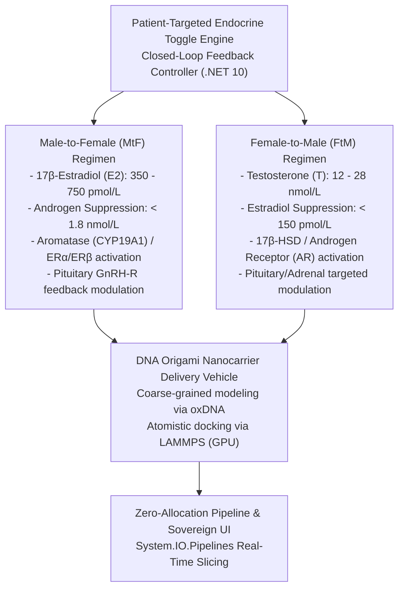

# dotnet-weaver-lammps-hrt (weaver-lammps-hrt)

> **Core Project Goal:**  
> **To develop and fabricate a permanent Female-to-Male (FtM) and Male-to-Female (MtF) Hormone Replacement Therapy (HRT) using patient-targeted delivery.**

---

## 📄 Scientific Abstract

> **Title:** **Autonomous Closed-Loop DNA Origami Nanocarriers for Permanent, Patient-Targeted Endocrine Regulation: An Open-Source In-Silico Modeling, Pharmacogenomics, and Benchtop Fabrication Framework**

Conventional Hormone Replacement Therapy (HRT) for gender-affirming care relies on lifelong, episodic exogenous administration of sex steroids via intramuscular depot injections, transdermal matrices, or oral formulations. This paradigm induces chronic peak-to-trough pharmacokinetic volatility, elevated thromboembolic and hepatic risks, systemic dysphoric fluctuations, and absolute dependency on vulnerable centralized pharmaceutical supply chains. Here, we present **`weaver-lammps-hrt`**, an open-source computational nanotechnology and synthetic biology platform engineering autonomous, patient-targeted DNA origami nanocarriers for permanent, closed-loop Female-to-Male (FtM) and Male-to-Female (MtF) endocrine regulation.

The platform couples multi-scale molecular dynamics with real-time bioinformatic streaming and decentralized fabrication protocols:
1. **Structural Nanotechnology & Biomolecular Gating:** Engineered nanocarriers (hexagonal six-helix bundle nanotubes, hollow 3D cuboids, and tetrahedral cages folded from bacteriophage M13mp18 ssDNA scaffolds) feature surface-conjugated peptide and nucleic acid aptamer ligands displaying high-affinity tropism for anterior pituitary gonadotropes along the Hypothalamic-Pituitary-Gonadal (HPG) axis. Autonomous allosteric aptamer gates modulate steroid hormone micro-release in direct response to endogenous gonadotropin (LH/FSH) feedback signals, achieving self-regulating physiological homeostasis.
2. **Zero-Allocation In-Silico Simulation Pipeline:** The computational engine integrates coarse-grained mechanical folding simulations via oxDNA and atomistic docking dynamics via LAMMPS across diverse hardware backends (Intel Arc, NVIDIA CUDA, AMD ROCm, CPU). Trajectory coordinate streams (`.xyz`, `.dcd`, `.lammps`) are ingested by a high-throughput, zero-allocation .NET 10 microservice utilizing `System.IO.Pipelines`, `ReadOnlySpan<byte>`, and AVX-512 SIMD vectorization, serializing multi-gigabyte atomic frames into columnar Apache Parquet with zero Garbage Collection heap pressure in steady state.
3. **Bistable Endocrinology & Pharmacogenomics:** A mathematical bistable state machine models target endocrine setpoints (Feminizing MtF: 17β-estradiol 500–600 pmol/L, testosterone &lt; 1.8 nmol/L; Masculinizing FtM: testosterone 15–25 nmol/L, 17β-estradiol &lt; 150 pmol/L). The integrated `PharmacogenomicsService` screens high-impact genetic markers (*Factor V Leiden*, *Prothrombin G20210A*, *COMT*, *CYP1B1\*3*, *UGT2B17*, *AR CAG*, *TLR9*), triggering severity call-out alerts and closed-loop kinetic recalibration (`k_eff × 0.85`, safe estradiol capping, aptamer Kd tuning).
4. **Decentralized Translation & Community Science ("How-To"):** Complete oligo routing tables, cryptographic SHA-256 provenance manifests, and an exhaustive benchtop fabrication protocol (50 µL stoichiometric pipetting schedules, non-toxic reagent substitutions, 90°C → 4°C thermal annealing ramps, and agarose gel electrophoresis QC guidelines).

For the interactive documentation, architectural guides, and visual workflows, visit the [**Weaver-LAMMPS-HRT Documentation Wiki**](docs/index.md).

---

## 🧬 Architectural Overview & Scientific Mission

Current clinical Hormone Replacement Therapy (HRT) requires lifelong exogenous administration of steroid hormones (estradiol or testosterone injections, patches, or gels), creating systemic troughs, dependency on fragile pharmaceutical supply chains, and fluctuating endocrine levels. 

**`weaver-lammps-hrt`** is an open-source, sovereign computational platform designed to model, simulate, and fabricate permanent, patient-targeted endocrine delivery and feedback systems. By coupling **DNA nanotechnology (DNA origami)** with **bistable synthetic biology toggle circuits**, the system achieves targeted in-vivo hormonal regulation.



### 1. Male-to-Female (MtF) Regimen
- **Target Hormonal Setpoints:** Sustained 17β-estradiol (E2) within cisgender female physiological range (350 to 750 pmol/L) and active negative-feedback suppression of endogenous testosterone to < 1.8 nmol/L.
- **Mechanism:** DNA origami nanocarriers functionalized with targeting aptamers directed to anterior pituitary gonadotrope cells (GnRH receptors) to modulate LH/FSH secretion and promote steady-state estrogen receptor (ERα/ERβ) agonism.

### 2. Female-to-Male (FtM) Regimen
- **Target Hormonal Setpoints:** Sustained total testosterone (T) within cisgender male physiological range (12 to 28 nmol/L) and suppression of cyclic estrogen synthesis (< 150 pmol/L).
- **Mechanism:** Nanocarrier-mediated androgen receptor (AR) activation and targeted steroidogenic enzyme modulation (upregulating 17β-HSD while suppressing aromatase CYP19A1).

### 3. Patient-Targeted Delivery via DNA Origami Nanostructures
- **Coarse-Grained oxDNA Simulation:** Simulates the structural integrity, melting temperature, and mechanical folding of 3D DNA origami nanocarriers (hexagonal nanotubes, nanoboxes) under physiological human serum conditions (37°C, 150 mM NaCl, 2–10 mM Mg²⁺).
- **Atomistic LAMMPS Simulation:** Hardware-accelerated molecular dynamics (Intel Arc A770, NVIDIA, AMD Radeon) measuring non-covalent binding contacts (< 5.0 Å) and dissociation constants (Kd) between surface-displayed aptamers and target cell receptors.

### 4. Sovereign .NET 10 Microservice & Zero-Allocation Pipelines
- **Zero-Allocation Parsing:** Ingests massive multi-gigabyte trajectory streams (`.xyz`, `.dcd`, oxDNA) using `System.IO.Pipelines`, `ReadOnlySpan<byte>`, and `Utf8Parser` with zero GC allocations in steady state.
- **In-Silico Docking Analysis:** Live computation of ligand-pocket binding contact ratios and thermodynamic stability verdicts.
- **Sovereign Web Dashboard:** Visual bistable toggle controls, patient profile setpoint management, and cryptographically verified dataset export/import with SHA-256 provenance manifests.

---

## 🚀 Quickstart

### 1. Run the Default Stack (Intel iGPU & CPU)
By default, the platform boots with support for Intel integrated graphics (Iris Xe / UHD via `/dev/dri`) and standard CPUs:
```bash
docker compose up -d
```
Visit the Sovereign Dashboard at **`http://localhost:5000`**.

### 2. Run with Hardware Acceleration Overrides

#### Discrete Intel Arc GPU (e.g., A770 16GB)
Enables Level Zero / SYCL hardware acceleration and scales shared memory to 16GB:
```bash
docker compose -f docker-compose.yml -f compose/docker-compose.arc.yml up -d
```

#### NVIDIA Workstations / Servers (CUDA)
Utilizes the NVIDIA Container Toolkit and CUDA/OpenCL:
```bash
docker compose -f docker-compose.yml -f compose/docker-compose.nvidia.yml up -d
```

#### AMD Radeon Systems (ROCm)
Utilizes the Kernel Fusion Driver (`/dev/kfd`):
```bash
docker compose -f docker-compose.yml -f compose/docker-compose.radeon.yml up -d
```

### 3. Run with Secure Public Access & Automated SSL Overlays
Deploy to a public VPS, research lab server, or homelab with production TLS 1.3 encryption, automatic Let's Encrypt SSL certificates, and zero direct exposure of port 5000:
- **Caddy (Automatic Let's Encrypt SSL - Recommended):**
  ```bash
  export DOMAIN="hrt.yourdomain.org"
  export ACME_EMAIL="admin@yourdomain.org"
  docker compose -f docker-compose.yml -f compose/docker-compose.public-caddy.yml up -d
  ```
- **Hardened Nginx with Certbot Companion:**
  ```bash
  export DOMAIN="hrt.yourdomain.org"
  docker compose -f docker-compose.yml -f compose/docker-compose.public-nginx.yml up -d
  ```
- **Cloudflare Zero Trust Tunnel (Bypasses CGNAT & ISP Port Blocks):**
  ```bash
  export TUNNEL_TOKEN="eyJhIjoi..."
  docker compose -f docker-compose.yml -f compose/docker-compose.public-cloudflare.yml up -d
  ```
> Consult the [**Secure Public Access & Reverse Proxies Guide**](docs/secure-public-access.md) for domain setup, firewall hardening, and A+ SSL configurations.

---

## 📊 Sovereign Web Dashboard (`http://localhost:5000`)

The embedded dashboard provides:
- **Endocrine Toggle Hub:** One-click switching between **`Male-to-Female (MtF / E2 Dominant)`** and **`Female-to-Male (FtM / T Dominant)`** regimens, with real-time patient setpoints for target E2, T, and aptamer Kd.
- **In-Silico Docking Telemetry:** Live trajectory analysis reporting binding occupancy ratios (0.0 to 1.0), average pocket contacts per frame, and thermodynamic stability classifications.
- **Zero-Allocation Telemetry:** Real-time monitoring of GC Generation 0, 1, and 2 collections to ensure the zero-allocation invariant is maintained during continuous trajectory processing.
- **Cryptographic Dataset Export & Import:** Package simulation trajectories into compressed `.tar.gz` bundles paired with an immutable `provenance.manifest.json` featuring SHA-256 digest validation.

---

## 📚 Documentation & Interactive Wiki

Comprehensive documentation, biomedical engineering primers, architectural diagrams, screenshots, and step-by-step example workflows are available in the repository's [**`docs/`**](docs/) directory and automatically deployed as an interactive wiki via GitHub Pages:

* **[Live Documentation Portal](https://lantea-one.github.io/dotnet-weaver-lammps-hrt/)** (GitHub Pages)
* **[Getting Started & Deployment Guide](docs/getting-started.md)**: Local .NET 10 setup and Docker GPU overrides (Intel Arc, NVIDIA, AMD).
* **[Secure Public Access & Reverse Proxies](docs/secure-public-access.md)**: Production deployment architectures, free Let's Encrypt SSL/TLS, Caddy, Nginx, Traefik, and Cloudflare Tunnels.
* **[Guided DNA Origami Workflow Wizard](docs/workflow-wizard.md)**: 6-stage engineering pipeline from FASTA scaffold to benchtop synthesis.
* **[Endocrine Hub & Pharmacodynamics](docs/endocrine-hub.md)**: In-vivo HPG axis feedback, bistable setpoints, and 72-hour kinetics.
* **[In-Silico Simulation Studio](docs/in-silico-simulations.md)**: oxDNA serum stability, LAMMPS aptamer gating ($\Delta G$), payload retention, and whole-body PBPK modeling.
* **[Configuration & Sovereign Peering](docs/configuration-peers.md)**: Database precedence law, single-use share keys, and remote federation.
* **[Stack Topology & Hardware Telemetry](docs/stack-services.md)**: Microservice diagnostics, GC telemetry, and SIMD acceleration.
* **[Trajectory Streaming & Columnar Datasets](docs/trajectories-and-datasets.md)**: Zero-allocation `System.IO.Pipelines` parsing and DuckDB Parquet.
* **[Example Biomedical Workflows](docs/example-workflows.md)**: End-to-end recipes for MtF, FtM, high-throughput streaming, and lab peering.
* **[DIY & HomeLab Benchtop Fabrication Guide](docs/diy-fabrication-guide.md)**: Accessible physical synthesis instructions, 50 µL pipetting recipe, and agarose gel QC for community bio-hackers.
* **[REST API Reference & Test Harness](docs/api-reference.md)**: Programmatic minimal endpoints, JSON schemas, and test execution.

---

## 🛠️ Local Development & Testing

### Prerequisites
- [.NET 10 SDK](https://dotnet.microsoft.com/)
- [Docker Engine & Docker Compose](https://docs.docker.com/engine/install/)

### Run the Parser & Web Dashboard Locally
```bash
dotnet run --project src/WeaverLammpsHrt.TrajectoryParser/WeaverLammpsHrt.TrajectoryParser.csproj
```

### Run Test Suite
```bash
# Run all unit tests across parsers, cryptographic dataset services, and endocrine engines
dotnet test dotnet-weaver-lammps-hrt.sln
```

---

## 📖 Standards & Legal Disclaimers

- **[DISCLAIMER.md](DISCLAIMER.md)**: Formal scientific research, medical non-advice, and BSL-1 biosafety declarations.
- **[CODING_STANDARDS.md](CODING_STANDARDS.md)**: The "Zero-Ignorance" Open-Bio documentation protocol, requiring 100% docblocks on all members (including private) and the "What / Why / How" commenting triad.
- **[AGENTS.md](AGENTS.md)**: Universal instructions for AI coding assistants (Claude, Cursor, Copilot, Gemini, ChatGPT).
- **[.cursorrules](.cursorrules)**: IDE rules for Cursor users.
- **[.github/copilot-instructions.md](.github/copilot-instructions.md)**: Context guidelines for GitHub Copilot.
