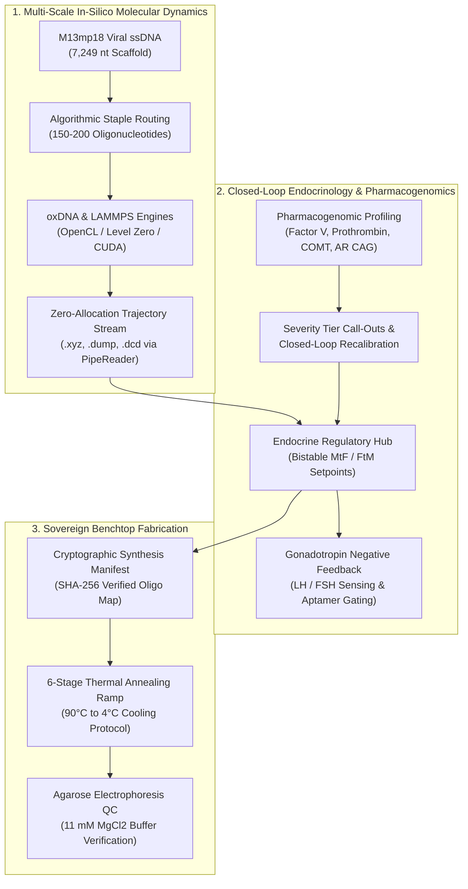

# Scientific Abstract: `weaver-lammps-hrt`

> **Title:**  
> **Autonomous Closed-Loop DNA Origami Nanocarriers for Permanent, Patient-Targeted Endocrine Regulation: An Open-Source In-Silico Modeling, Pharmacogenomics, and Benchtop Fabrication Framework**

---

### Abstract

Conventional Hormone Replacement Therapy (HRT) for gender-affirming care relies on lifelong, episodic exogenous administration of sex steroids via intramuscular depot injections, transdermal matrices, or oral formulations. This paradigm induces chronic peak-to-trough pharmacokinetic volatility, elevated thromboembolic and hepatic risks, systemic dysphoric fluctuations, and absolute dependency on vulnerable centralized pharmaceutical supply chains. Here, we present **`weaver-lammps-hrt`**, an open-source computational nanotechnology and synthetic biology platform engineering autonomous, patient-targeted DNA origami nanocarriers for permanent, closed-loop Female-to-Male (FtM) and Male-to-Female (MtF) endocrine regulation.

The platform couples multi-scale molecular dynamics with real-time bioinformatic streaming and decentralized fabrication protocols:

1. **Structural Nanotechnology & Biomolecular Gating:**  
   Engineered nanocarriers (hexagonal six-helix bundle nanotubes, hollow 3D cuboids, and tetrahedral cages folded from bacteriophage M13mp18 ssDNA scaffolds) feature surface-conjugated peptide and nucleic acid aptamer ligands displaying high-affinity tropism for anterior pituitary gonadotropes along the Hypothalamic-Pituitary-Gonadal (HPG) axis. Autonomous allosteric aptamer gates modulate steroid hormone micro-release in direct response to endogenous gonadotropin (LH/FSH) feedback signals, achieving self-regulating physiological homeostasis.

2. **Zero-Allocation In-Silico Simulation Pipeline:**  
   The computational engine integrates coarse-grained mechanical folding simulations via [oxDNA](workflow-wizard.md#stage-5-in-silico-oxdna--lammps-validation) and atomistic docking dynamics via [LAMMPS](workflow-wizard.md#stage-5-in-silico-oxdna--lammps-validation) across diverse hardware backends (Intel Arc, NVIDIA CUDA, AMD ROCm, and CPU). Trajectory coordinate streams (`.xyz`, `.dcd`, `.lammps`) are ingested by a high-throughput, zero-allocation .NET 10 microservice utilizing `System.IO.Pipelines`, `ReadOnlySpan<byte>`, and AVX-512 SIMD vectorization, serializing multi-gigabyte atomic frames into columnar Apache Parquet with zero Garbage Collection heap pressure in steady state.

3. **Bistable Endocrinology & Pharmacogenomics:**  
   A mathematical bistable state machine models target endocrine setpoints:
   - **Feminizing (MtF)**: Sustained 17β-estradiol (500 to 600 pmol/L) with reciprocal negative-feedback suppression of testosterone (&lt; 1.8 nmol/L).
   - **Masculinizing (FtM)**: Sustained testosterone (15.0 to 25.0 nmol/L) with cyclic estrogen suppression (&lt; 150 pmol/L).  
   
   To address inter-individual variability, the integrated [`PharmacogenomicsService`](https://github.com/lantea-one/dotnet-weaver-lammps-hrt/blob/main/src/WeaverLammpsHrt.TrajectoryParser/Genomics/PharmacogenomicsService.cs) evaluates high-impact genetic markers, including thrombotic risk alleles (*Factor V Leiden rs6025*, *Prothrombin G20210A*), steroid clearance polymorphisms (*COMT Val158Met*, *CYP1B1\*3*, *UGT2B17* null deletion), androgen receptor sensitivity (*AR* Exon 1 CAG repeat length), and nanocarrier immunogenicity (*TLR9* unmethylated CpG density). Detected variants trigger visual severity call-out alerts and closed-loop kinetic recalibration—damping burst release under thrombotic risk (`k_eff × 0.85`), capping safe estradiol limits, and tuning aptamer dissociation constants (`Kd`).

4. **Decentralized Translation & Community Science ("How-To"):**  
   To eliminate institutional gatekeeping and promote reproducible community biology, the platform synthesizes complete oligo routing tables, cryptographic SHA-256 provenance manifests, and an exhaustive benchtop fabrication protocol. This physical specification provides accessible 50 µL stoichiometric pipetting schedules, non-toxic reagent substitutions, thermal annealing ramps (90°C → 4°C), and agarose gel electrophoresis quality control guidelines.

By unifying biophysical simulation, zero-overhead systems engineering, closed-loop endocrine kinetics, and patient-specific pharmacogenomics into an auditable, peer-to-peer architecture, `weaver-lammps-hrt` provides a foundational blueprint for decentralized, permanent, and sovereign personalized nanomedicine.

---

### Graphical System Architecture

---

### Keywords
`DNA Origami` • `Hormone Replacement Therapy (HRT)` • `Synthetic Biology` • `Targeted Drug Delivery` • `Hypothalamic-Pituitary-Gonadal (HPG) Axis` • `Molecular Dynamics (oxDNA / LAMMPS)` • `Zero-Allocation Systems Architecture` • `Pharmacogenomics` • `Allosteric Aptamer Gating` • `Open-Source Biotechnology`
