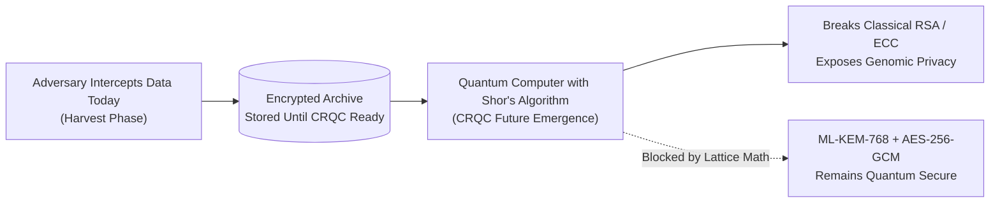
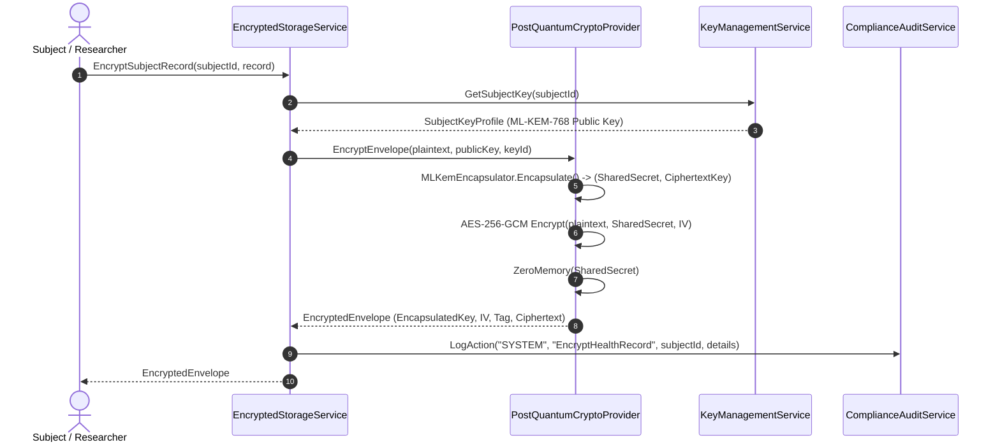
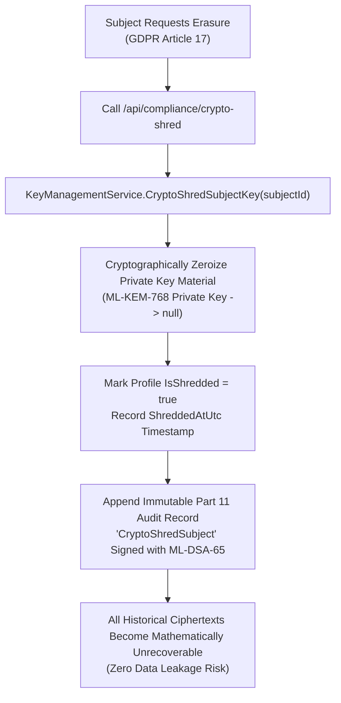
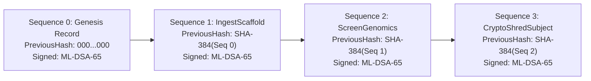
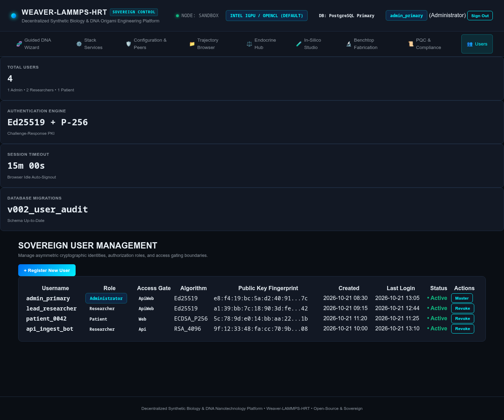
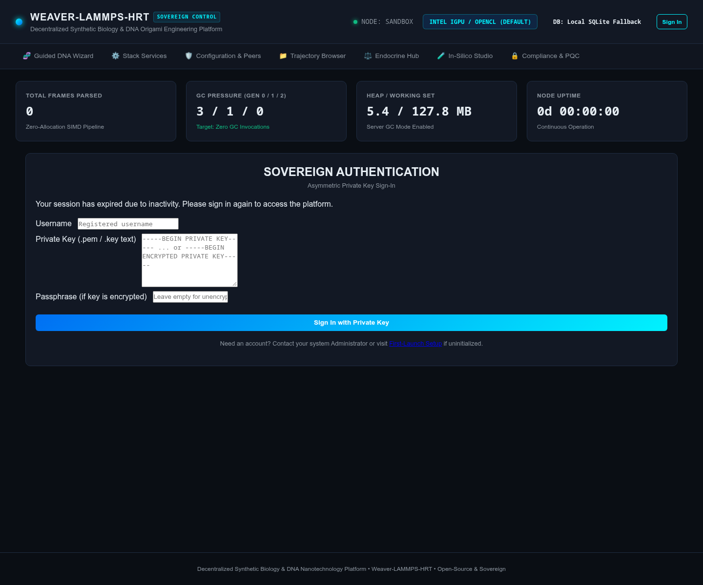
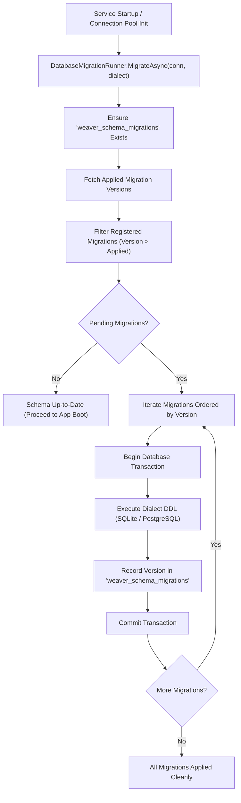

# Post-Quantum Cryptography & Regulatory Compliance Suite

> **NIST FIPS 203 (ML-KEM-768), FIPS 204 (ML-DSA-65), HIPAA Safe Harbor, GDPR Article 17 Crypto-Shredding, GINA, and FDA 21 CFR Part 11 Audit Trails**

NanoWeaverHrt processes deeply sensitive biomedical payloads: individualized endocrine kinetics profiles, targeted DNA origami nanocarrier sequences, patient pharmacogenomic variants (e.g., Factor V Leiden, AR CAG repeats), and multi-gigabyte molecular dynamics trajectory files.

To safeguard patient sovereignty against future quantum computing threats ("Harvest Now, Decrypt Later") and fulfill international regulatory standards, the platform integrates an enterprise-grade **Post-Quantum Cryptography (PQC)** engine and a **Unified Regulatory Compliance Suite**.

---

## 1. Threat Landscape: "Harvest Now, Decrypt Later"

Conventional healthcare infrastructure relies heavily on classical public-key cryptography (RSA-2048, ECDSA P-256, Diffie-Hellman). Shor's algorithm, running on a sufficiently powerful Cryptanalytically Relevant Quantum Computer (CRQC), will render these classical mathematical primitives solvable in polynomial time.

Hostile state actors and adversarial organizations currently intercept and hoard encrypted patient genomic and endocrine data. When CRQCs become operational, archived data will be decrypted retroactively.

NanoWeaverHrt protects patient data **today** using post-quantum lattice-based mathematical structures that remain provably intractable for both classical supercomputers and quantum architectures.

---

## 2. Post-Quantum Cryptographic Architecture

The cryptographic subsystem conforms strictly to the finalized National Institute of Standards and Technology (NIST) Post-Quantum Cryptography standards:

### Cryptographic Algorithms Overview

| Purpose | Algorithm Standard | Key / Block Size | Quantum Security Level | Intractable Hardness Problem |
| :--- | :--- | :--- | :--- | :--- |
| **Key Encapsulation (KEM)** | **ML-KEM-768** (NIST FIPS 203) | Public: 1,184 B Private: 2,400 B Ciphertext: 1,088 B | NIST Level 3 (equivalent to AES-192, 128-bit quantum security) | Module Learning With Errors (M-LWE) over polynomial rings |
| **Digital Signatures** | **ML-DSA-65** (NIST FIPS 204) | Public: 1,952 B Private: 4,032 B Signature: 3,309 B | NIST Level 3 | Module Learning with Errors & Short Integer Solution (M-SIS) |
| **Bulk Data Encryption** | **AES-256-GCM** | Key: 256 bits IV: 96 bits Tag: 128 bits | 128-bit quantum security against Grover's algorithm (O(2¹²⁸)) | Symmetric block cipher with Galois Counter Mode authentication |
| **Cryptographic Hashing** | **SHA-384** / **SHA-256** | 384 bits / 256 bits | Collision resistant against quantum attack | Merkle–Damgård construction |

---

## 3. Hybrid Post-Quantum Envelope Encryption

All patient health records, endocrine profiles, and exported trajectory bundles utilize **hybrid envelope encryption**:

### Zeroization of Memory
Whenever ephemeral symmetric keys or shared secrets are derived during key encapsulation or decapsulation, raw key byte spans are cleared using `System.Security.Cryptography.CryptographicOperations.ZeroMemory` inside guarded `finally` blocks, preventing secret material from lingering in process memory or core dumps.

---

## 4. Multi-Tier Key Management & GDPR Article 17 Crypto-Shredding

The platform implements per-subject key derivation and multi-tier cryptographic isolation via `IKeyManagementService`:

1. **Node Master KEM Key (`node_storage_master`)**: Used for system configuration, node telemetry, and shared cluster state.
2. **Node Master Signing Key (`node_signing_master`)**: Authoritative ML-DSA-65 key used to sign the FDA 21 CFR Part 11 audit ledger and dataset export manifests.
3. **Subject Key Profiles (`sub_...`)**: Dedicated, isolated ML-KEM-768 key pairs generated for each patient or research subject upon onboarding.

### GDPR Article 17: Right to Erasure via Crypto-Shredding
In distributed computing and peer-to-peer synthetic biology environments, physically deleting raw trajectory coordinates or multi-gigabyte logs across immutable backups or peer nodes is often practically impossible.

Under **GDPR Article 17**, NanoWeaverHrt achieves irreversible cryptographic erasure through **Crypto-Shredding**:

Once shredded:
* Any subsequent decryption attempt immediately throws a `CryptographicException`.
* Attempting to encrypt new records under the shredded subject ID is strictly prohibited.
* The public identity and pseudonymized audit events remain intact for regulatory audit compliance, but the underlying health data is permanently rendered pseudorandom mathematical noise.

---

## 5. FDA 21 CFR Part 11 Tamper-Evident Audit Ledger

For synthetic biology workflows intended for eventual clinical or translational deployment, computer systems must comply with **FDA 21 CFR Part 11** (Electronic Records; Electronic Signatures).

### Cryptographic Hash-Chained Architecture
The `ComplianceAuditService` maintains an append-only, tamper-evident audit ledger chained cryptographically using SHA-384 digests and signed with the node's post-quantum ML-DSA-65 key:

### Mathematical Digest Verification
Each record hash Hᵢ is calculated deterministically:

$$H_i = \text{SHA-384}\left(\text{Seq}_i \mathbin{\Vert} \text{TimeUtc}_i \mathbin{\Vert} H_{i-1} \mathbin{\Vert} \text{Operator}_i \mathbin{\Vert} \text{Action}_i \mathbin{\Vert} \text{Resource}_i \mathbin{\Vert} \text{DetailsJson}_i\right)$$

### Continuous Integrity Auditing
The `VerifyLedgerIntegrity()` engine continuously verifies the ledger:
1. **Sequence Continuity**: Validates that sequences increment monotonically (0, 1, 2, ..., N) with zero gaps.
2. **Unbroken Hash Links**: Verifies that each record's `PreviousHash` matches the exact `CurrentHash` of its immediate predecessor.
3. **Payload Digest Verification**: Recomputes the SHA-384 hash over all fields and verifies match with `CurrentHash`.
4. **Post-Quantum Signature Verification**: Verifies the ML-DSA-65 signature against the node's authoritative public key.

If any byte in any record is modified, inserted, or reordered, `VerifyLedgerIntegrity()` fails immediately, reporting the exact sequence number and failure category, while degrading platform status to `"Degraded"`.

---

## 6. HIPAA Safe Harbor & GINA Compliance Engine

### HIPAA Safe Harbor (§ 164.514) De-Identification
The platform includes an automated de-identification pre-processor for genomic FASTA sequences, patient records, and clinical metadata. It sanitizes all 18 HIPAA Safe Harbor identifiers:

* Direct Patient Names, Aliases, and Clinician Identifiers
* Medical Record Numbers (MRN), Social Security Numbers, and Health Plan IDs
* Geographic identifiers smaller than state level (hospitals, clinics, street addresses)
* Dates directly related to individuals (birth dates, admission dates, discharge dates)
* Contact information (phone numbers, email addresses, IP addresses, URLs)

The engine substitutes identifiers with deterministic, non-reversible cryptographic pseudonyms formatted as:
`sub_<first-16-chars-of-sha256-digest>`

### GINA (Genetic Information Nondiscrimination Act) Safeguards
In accordance with GINA, genetic and pharmacogenomic data can only be accessed or processed for explicit synthetic biology nanocarrier design, dosage calibration, and safety validation.

The `DeIdentifySubject` engine enforces:
1. **Explicit GDPR Article 9 Consent Confirmation**: Operation fails if `gdprConsentConfirmed` is false.
2. **GINA Non-Discrimination Purpose Limitation**: Operation fails if `ginaPurposeLimited` is false.
3. **Audit Log Emission**: The de-identification event is automatically signed and appended to the Part 11 audit ledger.

---

## 7. Encrypted Trajectory Dataset Bundles (`.enc.tar.gz`)

When exporting simulation datasets for cross-lab collaboration or public distribution, users can invoke the encrypted dataset exporter:

* **Endpoint**: `POST /api/datasets/export-encrypted`
* **Workflow**:
  1. Compresses trajectory coordinate files (`.xyz`, `.dump`, `.dcd`) into a `.tar.gz` archive.
  2. Encrypts the archive using the recipient or subject's post-quantum ML-KEM-768 public key with AES-256-GCM bulk encryption.
  3. Appends an SHA-256 tamper-evident manifest signed with the node's ML-DSA-65 key.
  4. Saves the resulting file as `<filename>.<subjectId>.<timestamp>.enc.tar.gz`.

---

## 8. Web UI & REST API Management

### Sovereign Web UI (`/compliance`)
The interactive Blazor dashboard provides continuous compliance monitoring:
* **Real-Time PQC Badge**: Visual confirmation of active ML-KEM-768 and ML-DSA-65 cipher suites.
* **Compliance Matrix**: Live operational status for HIPAA Safe Harbor, GDPR Articles 9 & 17, GINA, and FDA 21 CFR Part 11.
* **Interactive Safe Harbor De-Identification Sandbox**: Test and sanitize clinical FASTA sequences directly in the browser.
* **Crypto-Shredding Management**: On-demand execution of GDPR Article 17 private key zeroization.
* **Live Audit Ledger Viewer**: Searchable table displaying real-time SHA-384 hash links, timestamps, operators, and signature status, with an on-demand "Run Verification Audit" integrity check button.

### REST API Endpoints

| Endpoint | Method | Description |
| :--- | :--- | :--- |
| `/api/compliance/status` | `GET` | Returns platform-wide compliance posture, active PQC ciphers, and ledger health. |
| `/api/compliance/audit-ledger?limit=100` | `GET` | Retrieves the latest tamper-evident FDA Part 11 audit records. |
| `/api/compliance/verify-ledger` | `GET` | Executes full mathematical SHA-384 and ML-DSA-65 signature ledger verification. |
| `/api/compliance/de-identify` | `POST` | De-identifies clinical sequences pursuant to HIPAA Safe Harbor and validates GINA/GDPR consent. |
| `/api/compliance/crypto-shred` | `POST` | Irreversibly zeroizes a subject's private ML-KEM key (GDPR Article 17). |
| `/api/compliance/encrypt-record` | `POST` | Encrypts arbitrary health records under a subject's post-quantum ML-KEM key. |
| `/api/compliance/decrypt-record` | `POST` | Decrypts an authenticated envelope using the subject's private ML-KEM key. |
| `/api/datasets/export-encrypted` | `POST` | Exports an encrypted, ML-DSA-65-signed trajectory bundle (`.enc.tar.gz`). |

---

## 9. Asymmetric PKI Identity, Role Gating & Browser Idle Expiration

To prevent credential leakage, eliminate brute-force password attacks, and protect against administrative hijacking, NanoWeaverHrt implements a **zero-password cryptographic public-key infrastructure (PKI)** for all user accounts and API clients.

### Cryptographic Identity & Challenge-Response Authentication
User identities are anchored to asymmetric cryptographic keypairs:
* **Supported Algorithms**: Ed25519 (Edwards-curve Digital Signature Algorithm, RFC 8032) and ML-DSA-65 (NIST FIPS 204 Module-Lattice-Based Digital Signature Algorithm, post-quantum).
* **Challenge-Response Handshake**: The client submits their username to receive a cryptographically random 256-bit challenge. The client signs the challenge with their local private key (optionally unlocked with a passphrase) and submits the signature. Upon verification, a cryptographically signed session token is issued.
* **Zero Passwords Stored**: Passwords and private keys are never stored on the server. If a passphrase is used, it only encrypts the private key locally on the user's workstation.

### Role-Based Access Control (RBAC) & Transport Boundaries

| Role | Cluster Privileges | Data Visibility | Operational Actions |
| :--- | :--- | :--- | :--- |
| **Administrator** | Full read/write system control | All cluster, simulation, telemetry, and patient records | User registration/revocation, configuration overrides, database migrations |
| **Researcher** | Execution and observation | All simulations, trajectories, and endocrine models | Launch simulations, stream trajectories, run pharmacodynamics, export datasets |
| **Patient** | Restricted observation | Own individualized simulation and endocrine profile only | Monitor personal therapy setpoints, download encrypted digital DNA payloads |

Users are further restricted by **Access Gating Boundaries**:
* `Api`: REST API access only (service accounts, automated ingestion bots, automated laboratory pipetting robots).
* `Web`: Interactive web dashboard access only (clinicians, researchers, patients via web browsers).
* `ApiWeb`: Dual interactive UI and REST API capabilities (system administrators, principal investigators).

### Sovereign User Management UI (`/users`)

Authenticated administrators manage cryptographic identities directly via the User Management interface:

Features include:
* Real-time user catalog displaying usernames, assigned roles, transport access gates, algorithm types, and truncated public key fingerprints.
* In-browser keypair generation generating high-entropy Ed25519 or NIST P-256 keys with immediate `.pem` download.
* Immediate cryptographic identity revocation with audit ledger event logging.

### Automatic Browser Idle Session Expiration

Unattended workstations in clinical and wet-lab environments represent a critical security vulnerability. NanoWeaverHrt implements an automated **Browser Idle Timeout Guard**:

1. **Multi-Event Client Activity Watchdog**: Client-side JavaScript registers passive DOM listeners across all user interactions (`mousemove`, `mousedown`, `keydown`, `scroll`, `touchstart`, `click`).
2. **Throttled Activity Heartbeats**: Active browser sessions transmit periodic heartbeats every 30 seconds to refresh `LastActivityUtc` on the server session state.
3. **Inactivity Expiration**: If no user activity is detected for **15 minutes** (default configurable timeout):
   - Client-side timer triggers an immediate redirect to `/login?reason=idle_timeout`.
   - The server session state invokes `SignOut()`, clearing all cached identity tokens and credentials from memory.
   - The user is greeted with a clear visual notice: *"Your session has expired due to 15 minutes of inactivity. For sovereign security and patient confidentiality, you have been automatically signed out. Please authenticate with your private key to continue."*

---

## 10. Deterministic Multi-Dialect SQL Schema Migrations

NanoWeaverHrt guarantees reliable database evolution without relying on fragile ad-hoc DDL scripts or manual SQL interventions.

### Architecture of `DatabaseMigrationRunner`
The migration subsystem coordinates versioned, idempotent schema updates across both **SQLite** (local embedded node) and **PostgreSQL** (`pg_duckdb` cluster backend):

### Registered Migration Manifest

| Version | Migration Name | Dialect Highlights | Purpose |
| :--- | :--- | :--- | :--- |
| **001** | `001_InitialSchema` | SQLite & PostgreSQL | Creates `weaver_configuration`, `weaver_share_keys`, and `weaver_users` tables. |
| **002** | `002_UserAuditAndIndexes` | `CREATE INDEX IF NOT EXISTS` | Adds secondary indexes on `role`, `access_gate`, and `is_active` for high-throughput auth. |

---

## 11. Zero-Information-Disclosure RFC 7807 ProblemDetails

In accordance with strict security hardening guidelines, NanoWeaverHrt eliminates sensitive data leakage across all REST API endpoints.

### RFC 7807 Specification & Content Negotiation
All unhandled exceptions, validation failures, and authorization denials return structured Problem Details compliant with **RFC 7807**, formatted according to the client's `Accept` header:
* `application/problem+json` (default)
* `application/problem+xml`

### Sanitization & Redaction Guarantees
The `SecureExceptionSanitizer` enforces four zero-disclosure rules:
1. **Filesystem Path Redaction**: All Windows (`C:\...`) and Unix (`/home/...`, `/etc/...`) paths in error messages are replaced with `[REDACTED_PATH]`.
2. **Credential Redaction**: Connection string passwords, user passwords, and authorization tokens (`password=...;`, `pwd=...;`) are stripped and replaced with `[REDACTED]`.
3. **Cryptographic Key Redaction**: Any PEM headers or base64 key blocks (`BEGIN PRIVATE KEY`, `BEGIN EC PRIVATE KEY`) are sanitized to `[REDACTED_KEY]`.
4. **Internal Server Error Masking (HTTP 500)**: Raw stack traces, database schema details, and unhandled exception internals are never exposed to API consumers. The client receives an opaque correlation trace ID (`traceId`) to provide to system administrators for internal log correlation.
