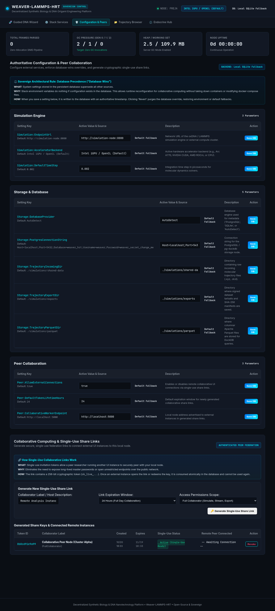
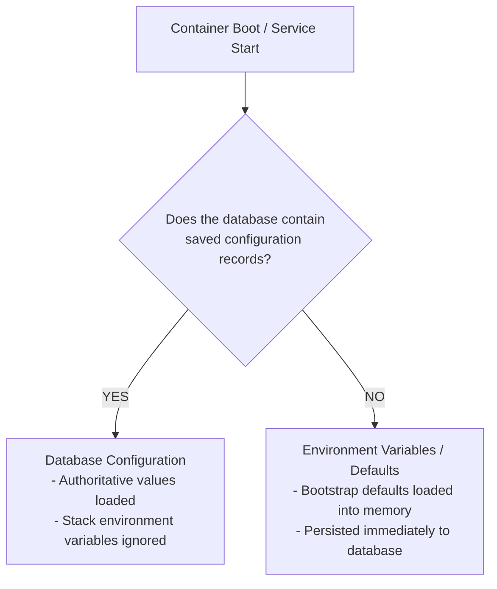
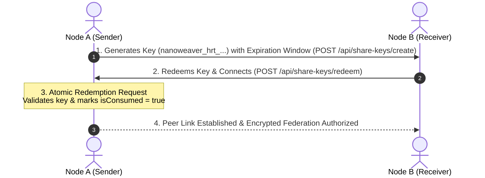
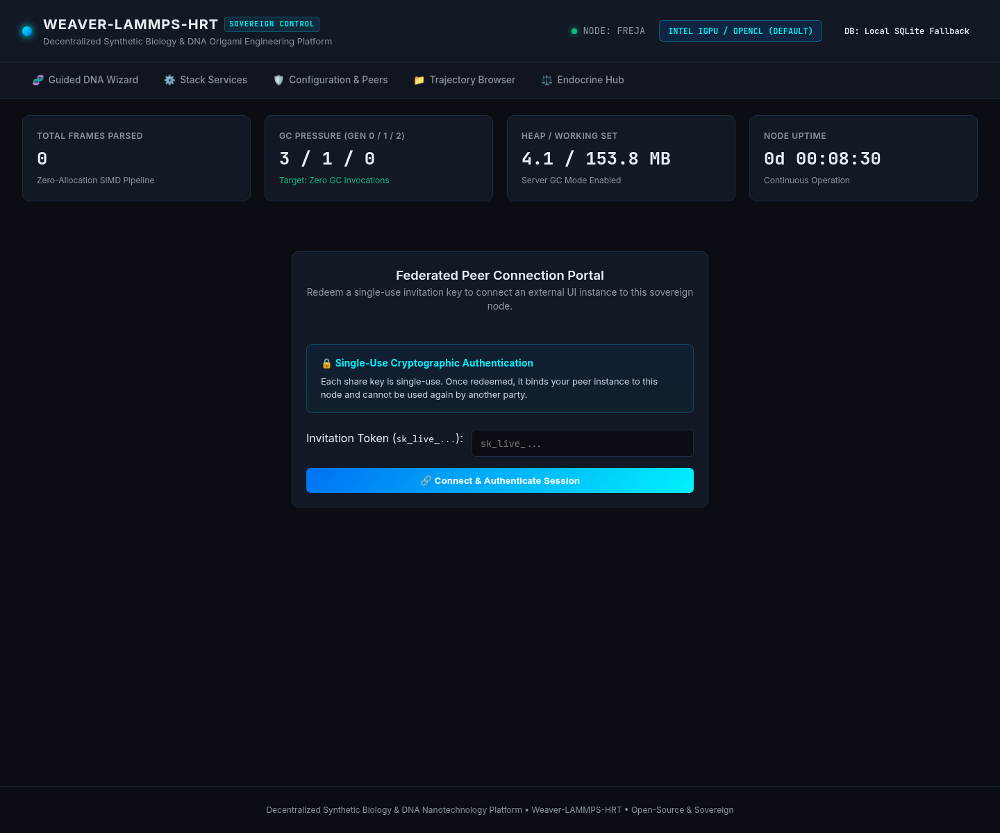

# Configuration & Sovereign Peering

> **Authoritative Database Precedence, Single-Use Share Keys, and Research Node Federation**

The **Configuration & Peering** module manages the persistence layer of the NanoWeaverHrt (`nanoweaver-hrt`) platform. It guarantees that configuration changes made by authorized researchers remain strictly authoritative across container restarts, while providing a zero-trust, cryptographically verified mechanism for federating research nodes.



---

## 1. The Database Precedence Law

A foundational architectural principle of the NanoWeaverHrt platform is the **Database Precedence Law**:

> **"Whatever is in the database wins. Stack environment variables do nothing if configuration exists in the database."**



### Why This Law Exists
In containerized microservice architectures (Docker Compose, Kubernetes, Podman), environment variables are frequently passed via declarative YAML files. In research environments:
1. **Preventing Accidental Overwrites**: If a researcher fine-tunes buffer sizes, SIMD flags, or shared directories in the sovereign dashboard, restarting a Docker container must **never** silently overwrite those changes with stale environment variables from a `.env` file.
2. **True Sovereignty**: The running node and its database hold ultimate authority over its state, independent of orchestrator defaults.

### Storage Engines Supported
* **Primary / Production**: PostgreSQL with `pg_duckdb` for high-throughput columnar analytics.
* **Embedded / Standalone**: SQLite (`weaver_hrt.db`) with zero external daemon requirements. The platform automatically bootstraps SQLite if PostgreSQL is unreachable.

---

## 2. Core Configurable Parameters

| Configuration Key | Data Type | Default Value | Description |
| :--- | :--- | :--- | :--- |
| `PipeReaderHighWatermark` | `long` | `4194304` (4 MB) | Maximum unconsumed byte buffer size before `PipeReader` pauses upstream disk I/O. |
| `PipeReaderLowWatermark` | `long` | `1048576` (1 MB) | Buffer drain threshold before resuming disk reading. |
| `SimdVectorizationMode` | `string` | `Auto` | Runtime vector engine: `Auto`, `AVX512`, `AVX2`, `SSE42`, or `ScalarFallback`. |
| `SharedDataPath` | `string` | `/simulations/shared-data` | Directory where oxDNA and LAMMPS write active trajectory files. |
| `ParquetCompressionCodec`| `string` | `Zstandard` | Compression algorithm for columnar frame archives: `Snappy`, `Zstandard`, or `Gzip`. |
| `MaxConcurrentStreamCount`| `int` | `8` | Maximum simultaneous trajectory streaming parsers allowed. |
| `PeerFederationEnabled` | `bool` | `true` | Allows remote trusted research nodes to link via single-use share keys. |
| `Peer:RequireSignedDatasets` (`PEER_REQUIRE_SIGNED_DATASETS`) | `bool` | `false` | When `true`, `POST /api/datasets/import` refuses every dataset whose manifest is not signed by this node or by an active registered peer key in `weaver_peer_keys`. Unparseable values fail closed (`true`). |

---

## 3. Single-Use Share Key Security Architecture

To securely share trajectory datasets, simulation telemetry, and DNA nanocarrier configurations across independent labs without creating centralized accounts, the platform implements **Single-Use Cryptographic Share Keys**.



### Key Format & Generation
Every share key is generated using a cryptographically secure pseudo-random number generator (`RandomNumberGenerator.GetBytes(32)`):
```
nanoweaver_hrt_a7f92b41d08e5c1234b6e7890abcdef1234567890abcdef1234567890abcdef1
```
* **Prefix**: `nanoweaver_hrt_` denotes an active live production peering token.
* **Payload**: 64 hexadecimal characters (256 bits of entropy), making brute-force guessing computationally infeasible.

### Configurable Expiration Windows
Researchers can select from seven discrete validity periods when issuing a key:
* **`1h`**: 1 Hour (urgent, temporary cross-lab consultation).
* **`4h`**: 4 Hours (standard lab shift or live computational pairing).
* **`24h`**: 24 Hours (overnight batch processing).
* **`7d`**: 7 Days (weekly multi-institution collaboration).
* **`1m`**: 1 Month (30-day trial or peer review audit).
* **`1y`**: 1 Year (long-term multi-center clinical trials).
* **`Never`**: Permanent, persistent sovereign link between trusted internal workstations.

### Atomic Redemption & Replay Immunity
* When a remote peer connects using a share key, the database executes an atomic transaction:
  ```sql
  UPDATE peer_share_keys
  SET is_consumed = TRUE, consumed_at = CURRENT_TIMESTAMP, consumer_ip = @remote_ip
  WHERE key_hash = @hash AND is_consumed = FALSE AND expires_at > CURRENT_TIMESTAMP;
  ```
* If two peers attempt to redeem the same key simultaneously, exactly one transaction succeeds. The second receives an HTTP 409 Conflict error. Once consumed, the key is dead and can never be reused.

---

## 4. Connecting Remote Peers

Researchers connect remote nodes using the **Sovereign Peer Connect Dialog**:



### Connection Workflow
1. Navigate to **Configuration & Peers** in the sidebar.
2. Click **Connect Remote Peer** to open the modal.
3. Enter the remote node's URL (e.g., `https://node-beta.hrt-lab.local` or an Onion / Tailscale address).

   > ⚠️ **Never point a peer at port `5000` across a network.** Kestrel's port `5000` is bound for
   > loopback and container-internal traffic only. A reachable peer must sit behind one of the
   > hardened reverse proxy overlays (`compose/docker-compose.public-caddy.yml`,
   > `compose/docker-compose.public-nginx.yml`, or `compose/docker-compose.public-cloudflare.yml`),
   > which terminate TLS on `443`. See [**Secure Public Access**](secure-public-access.md).

4. Paste the single-use share key (`nanoweaver_hrt_...`).
5. Click **Verify & Link Peer**.

The local node verifies the remote certificate, performs the atomic key exchange, and establishes an encrypted federated link. Both nodes can now stream trajectory analytics and exchange dataset bundles whose Ed25519 or ML-DSA-65 manifest signatures are verified against the Peer Key Registry (`weaver_peer_keys`) without transferring multi-gigabyte raw trajectory files over public networks.

---

## 5. Peer Key Registry & Signed Dataset Imports

Single-use share keys (`weaver_share_keys`) authorize collaborative UI sessions; they do not sign or verify dataset archives. Dataset provenance is governed by the **Peer Key Registry** (`weaver_peer_keys`) and the `Peer:RequireSignedDatasets` configuration setting.

> **With strict mode off (the default), signing tells you who sent a bundle. It does not protect you from an uploader who omits the signature.** An unsigned bundle is imported exactly as before. Turn on `Peer:RequireSignedDatasets` to make signatures mandatory.

### Establishing Peer Trust Out of Band
1. **Export your node's public key**: Call `GET /api/peer-keys` as an Administrator and read the `localNode` object (`keyId`, `algorithm`, `publicKeyBase64`). The 64-character lowercase hexadecimal SHA-256 fingerprint (`keyId`) is also written to the node log at startup.
2. **Verify the fingerprint out of band**: Confirm the peer laboratory's `keyId` directly with its operator over an independent authenticated channel. Never copy a public key out of a dataset bundle you received.
3. **Register the peer key**: Submit the peer's `label`, `algorithm` (`Ed25519` or `MlDsa65`), and SubjectPublicKeyInfo `publicKeyBase64` to `POST /api/peer-keys`.
4. **Enforce strict mode (optional)**: Set `Peer:RequireSignedDatasets` to `true` via `POST /api/configuration/override` (or `PEER_REQUIRE_SIGNED_DATASETS=true` when no database override exists) so unsigned dataset imports are rejected with `403 Forbidden`.
5. **Revoking a peer key**: Call `POST /api/peer-keys/{keyId}/revoke`. Revocation is **permanent**: the row stays in `weaver_peer_keys` with `isActive: false` to preserve the audit trail, and that key can never be reactivated or re-registered.
6. **Self-trust and key rotation**: A node always trusts its own `dataset_signing_ed25519.key` (and still verifies the cryptographic signature in full). Deleting `dataset_signing_ed25519.key` rotates the node's key on the next start; bundles signed by the previous key will then return `403 Forbidden` on import unless the old public key is registered as a peer in `weaver_peer_keys`.

---

## Next Steps
* Inspect service vitals in [**Stack Topology & Hardware Telemetry**](stack-services.md).
* Explore zero-allocation parsing in [**Trajectory Streaming & Dataset Provenance**](trajectories-and-datasets.md).
