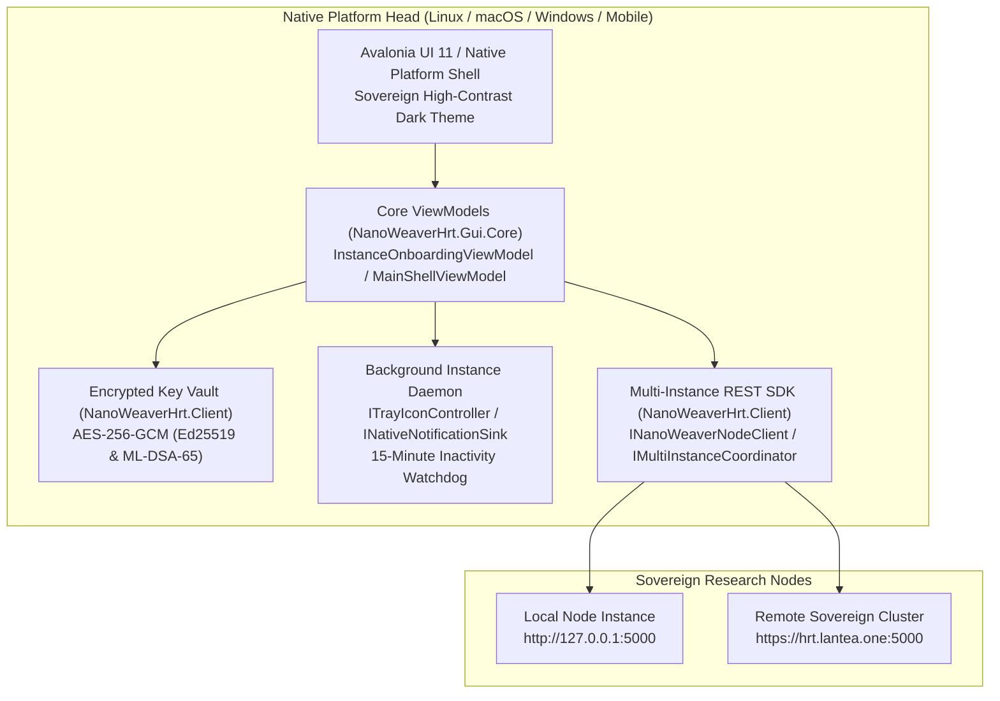

# Standalone Multi-Platform Desktop & Mobile GUI Applications

> **Platform Overview:**  
> The **NanoWeaver HRT** GUI application provides a sovereign, client-side control hub across Linux, macOS, Windows, Android, iOS, and iPadOS. It connects seamlessly to local node instances (`http://127.0.0.1:5000`) and remote sovereign HTTPS cluster nodes, orchestrating molecular dynamics simulations, endocrine toggle setpoints, and patient DNA blueprint delivery from a native, hardware-accelerated user interface.

---

## 1. Architectural Highlights



1. **Multi-Instance Coordination & Connection Vault**:
   - Manages multiple concurrent node profiles in a local SQLite profile store (`IInstanceProfileRepository`).
   - Automatically polls node health, active simulation progress, and telemetry alerts across all registered profiles.
   - Enforces a 15-minute idle inactivity timeout, securely clearing sensitive session tokens and locking local key vaults when terminals are unattended.
2. **Client-Side PKI Challenge-Response Vault**:
   - Private keys are generated and stored exclusively within the client vault (`IClientKeyRingVault`) using AES-256-GCM envelope sealing.
   - Private key material never traverses network boundaries. The client signs raw 32-byte server nonces locally using **Ed25519** or post-quantum **ML-DSA-65** (FIPS 204).
3. **Cross-Platform Sovereign Palette**:
   - Custom high-contrast theme conforming to sovereign lab standards:
     - Background: Deep Void Dark (`#0b0f19`)
     - Surface / Card: Obsidian Slate (`#161f30`)
     - Border / Accent: Bioluminescent Cyan (`#00f5d4`)
     - Alert / Critical: Emergency Magenta (`#ff2a85`)
     - Text Primary: Pure White (`#ffffff`)

---

## 2. Installation & Distribution Packages

All packages are deterministically compiled and cryptographically signed with the sovereign X.509 code-signing certificate and OpenPGP archive key.

### 2.1 Linux Distribution Packages

The Linux desktop application installs to `/usr/lib/nanoweaver-hrt-desktop/NanoWeaverHrt`, with FreeDesktop `.desktop` launchers, XDG autostart system tray daemons, AppStream metadata, and vector icons.

#### ArchLinux & CachyOS / Manjaro
```bash
# 1. Install binary package via pacman:
# For x86_64:
sudo pacman -U nanoweaver-hrt-desktop-x86_64.pkg.tar.zst

# For arm64 (aarch64):
sudo pacman -U nanoweaver-hrt-desktop-arm64.pkg.tar.zst

# 2. Or install via Arch User Repository (AUR):
# Pre-compiled release binary:
paru -S nanoweaver-hrt-desktop-bin

# Build directly from source tracking main:
paru -S nanoweaver-hrt-desktop-git
```

#### Debian 12 / 13 & Ubuntu 22.04 / 24.04+ (Unified DEB)
```bash
# For amd64:
sudo apt install ./nanoweaver-hrt-desktop-amd64.deb

# For arm64:
sudo apt install ./nanoweaver-hrt-desktop-arm64.deb
```

#### Fedora 39 / 40 / 41, RHEL 9 / 10 & openSUSE (Unified RPM)
```bash
# For amd64:
sudo dnf install ./nanoweaver-hrt-desktop-amd64.rpm

# For arm64:
sudo dnf install ./nanoweaver-hrt-desktop-arm64.rpm
```

---

### 2.2 macOS (`NanoWeaverHrt.dmg`)

The macOS release is distributed as a Universal Apple Disk Image containing the self-contained `NanoWeaverHrt.app` bundle supporting Apple Silicon (`arm64`) and Intel (`x86_64`).

1. Download `NanoWeaverHrt.dmg` (or architecture-specific `NanoWeaverHrt-macos-arm64.dmg` / `NanoWeaverHrt-macos-amd64.dmg`).
2. Double-click the `.dmg` disk image and drag **NanoWeaver HRT** into your `/Applications` directory.
3. Because the binary is signed by the project's Sovereign Root CA rather than Apple's paid Developer ID program, trust the sovereign root anchor once in macOS Keychain:
   ```bash
   sudo security add-trusted-cert -d -r trustRoot -k /Library/Keychains/System.keychain docs/assets/keys/nanoweaver-codesign-root-ca.crt
   ```
4. Launch `NanoWeaver HRT` from Launchpad or Spotlight.

---

### 2.3 Windows Standalone Executables, Installer & MSIX

Windows distributions provide three direct download channels:

#### 1. Standalone Portable Executable (`nanoweaver-hrt-desktop-portable-x64.exe` / `NanoWeaverHrt.exe`)
For instant execution without installation or administrative rights:
- Runs directly on any 64-bit Windows terminal (Windows 10, Windows 11, Windows Server 2022+).
- Self-contained single-file binary embedding the .NET runtime and native Avalonia rendering assemblies.
- Ideal for portable USB clinical deployments, offline laboratory workstations, and air-gapped simulation nodes.

#### 2. Dual-Scope GUI Installer (`nanoweaver-hrt-desktop-installer.exe`)
The NSIS installer supports dual installation scopes with elevation awareness:
- **Standard (Non-Elevated) Users**: Installs directly to the Current User profile without requiring UAC escalation:
  - Install Location: `%LOCALAPPDATA%\Programs\NanoWeaverHrt`
  - Registry Scope: `HKEY_CURRENT_USER\Software\NanoWeaverHrt`
- **Administrators**: When executed with elevated permissions, the installer explicitly displays an installation scope page defaulting to **Current User**, with the choice to install for **All Users (System)**:
  - System Location: `%ProgramFiles%\NanoWeaverHrt`
  - Registry Scope: `HKEY_LOCAL_MACHINE\Software\NanoWeaverHrt`
- **Silent CLI Flags**:
  - `/CURRENTUSER`: Silently installs just for the current user.
  - `/ALLUSERS`: Silently installs for all users (requires administrative privileges).
  - `/S`: Standard silent execution.

#### 3. Windows Store App Package (`NanoWeaverHrt.msix`)
For managed enterprise deployments or Windows Sandbox execution, the signed MSIX package can be installed without accessing the Microsoft Store:
```powershell
# 1. Import sovereign code-signing root certificate into Trusted People:
Import-Certificate -FilePath docs/assets/keys/nanoweaver-codesign-root-ca.crt -CertStoreLocation Cert:\LocalMachine\TrustedPeople

# 2. Add the MSIX application package:
Add-AppxPackage -Path NanoWeaverHrt.msix
```

#### 4. Automated Release Scheme & Direct Binary Downloads
All release assets are continuously published on every push to `main` and tagged release:
- **Continuous Rolling Nightly Release**: Tagged `nightly`, providing immediate access to the latest master build with direct `.exe`, `.dmg`, `.deb`, `.rpm`, and mobile package downloads.
- **Tagged CalVer Releases**: Permanent releases minted using the `v<yyyy>.<mm>.<dd>.<increment>` convention (e.g. `v2026.10.29.1`, `v2026.10.29.2`).
- Direct downloads are hosted on the Sovereign Forgejo instance (`https://git.lantea.one/lantea-one/nanoweaver-hrt/releases`) and mirrored on GitHub Releases.

---

### 2.4 Mobile Sideloading (Android, iOS & iPadOS)

Mobile platform heads connect directly to local wireless node instances or sovereign HTTPS endpoints:

1. **Android (`nanoweaver-hrt-mobile-android.apk`)**:
   - Sideloadable on any Android 10+ device without Google Play Services dependencies.
   - Download the APK and install via ADB or mobile file manager:
     ```bash
     adb install nanoweaver-hrt-mobile-android.apk
     ```
2. **iOS (`nanoweaver-hrt-mobile-ios.ipa`)**:
   - Configured for iPhone displays (`UIDeviceFamily = [1]`).
   - Sideload via AltStore, SideStore, Sideloadly, or Xcode development provisioning.
3. **iPadOS (`nanoweaver-hrt-mobile-ipados.ipa`)**:
   - Configured for iPad displays (`UIDeviceFamily = [2]`).
   - Supports iPad multitasking, split-view side-by-side simulation monitoring, and stage manager.

---

## 3. Sovereign Code-Signing PKI & 90-Day Rotation Architecture

### 3.1 Why ACME / Let's Encrypt Cannot Issue Code-Signing Certificates
A frequent question is why automated ACME certificate authorities (such as Let's Encrypt) are not used for software code signing.

Under the CA/Browser Forum Baseline Requirements and RFC 5280:
- Let's Encrypt and standard ACME CAs strictly issue certificates with the Extended Key Usage (EKU) `id-kp-serverAuth` (`1.3.6.1.5.5.7.3.1`) for TLS web servers.
- ACME CAs explicitly forbid and refuse to issue certificates with the `id-kp-codeSigning` EKU (`1.3.6.1.5.5.7.3.3`).
- Commercial code-signing CAs require proprietary identity verification, hardware tokens, and expensive recurring subscriptions that threaten open-source sovereign healthcare initiatives with arbitrary revocation.

### 3.2 The Sovereign 90-Day PKI Model
**NanoWeaver HRT** solves this by implementing an independent, transparent sovereign PKI:
1. **Sovereign Root CA (`nanoweaver-codesign-root-ca.crt`)**:
   - 10-year root authority dedicated exclusively to software signing.
   - Public anchor committed directly to the repository under `docs/assets/keys/nanoweaver-codesign-root-ca.crt`.
2. **Automated 90-Day Short-Lived Leaf Certificates (`nanoweaver-codesign-leaf.crt`)**:
   - Exactly matches the security posture of Let's Encrypt 90-day certificates.
   - Automatically rotated every month via scheduled Forgejo Actions (`.forgejo/workflows/rotate-codesign-certs.yml`) and GitHub Actions (`.github/workflows/rotate-codesign-certs.yml`).
   - Enforces strict `id-kp-codeSigning` EKU and digital signature key usage.
3. **OpenPGP / GPG Archive Signing Key (`nanoweaver-archive-keyring.asc`)**:
   - Signs Linux packages, Debian `Release` files, RPM headers, and master `SHA256SUMS` manifests.
   - Public key available at `docs/assets/keys/nanoweaver-archive-keyring.asc`.

---

## 4. Verifying Package Signatures

Every binary release includes cryptographic provenance signatures:

```bash
# 1. Verify SHA-256 integrity manifest with OpenPGP / GPG:
gpg --import docs/assets/keys/nanoweaver-archive-keyring.asc
gpg --verify artifacts/packages/SHA256SUMS.asc artifacts/packages/SHA256SUMS
sha256sum -c artifacts/packages/SHA256SUMS

# 2. Verify individual package detached X.509 CMS signature (.p7s):
openssl cms -verify \
  -in artifacts/packages/linux/nanoweaver-hrt-desktop-amd64.deb.p7s \
  -inform DER \
  -content artifacts/packages/linux/nanoweaver-hrt-desktop-amd64.deb \
  -CAfile docs/assets/keys/nanoweaver-codesign-root-ca.crt
```
