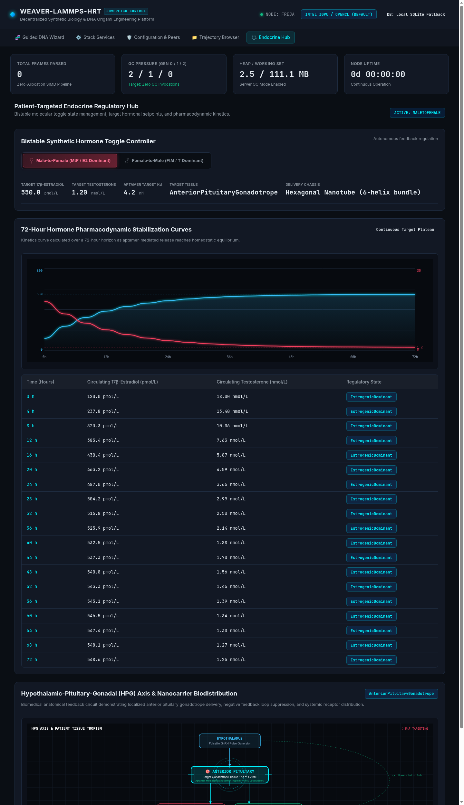

# Patient-Targeted Endocrine Regulatory Hub

> **Pharmacodynamics, Closed-Loop In-Vivo Kinetics, and Bistable Setpoint Stabilization**

The **Endocrine Regulatory Hub** provides computational modeling and real-time visualization of physiological hormone regulation. It bridges molecular nanocarrier design with biological systems pharmacology, modeling how targeted DNA origami nanocarriers maintain stable, permanent hormone levels in vivo.



---

## Biomedical Foundations: The HPG Axis & Feedback Loops

To understand how targeted DNA nanocarriers function as sovereign Hormone Replacement Therapy (HRT), it is essential to understand the biological control system governing human sex steroids: the **Hypothalamic-Pituitary-Gonadal (HPG) Axis**.

```
                           +------------------------+
                           |      Hypothalamus      |
                           |   GnRH Pulsing Pulse   |
                           +-----------+------------+
                                       |
                                       v (GnRH)
                           +------------------------+
                           |   Anterior Pituitary   |
                           |    Gonadotropes        |
                           +-----------+------------+
                                       |
                    +------------------+------------------+
                    |                                     |
                    v (LH)                                v (FSH)
         +---------------------+               +---------------------+
         |  Leydig Cells /     |               |  Granulosa Cells /  |
         |  Theca Cells        |               |  Sertoli Cells      |
         +----------+----------+               +----------+----------+
                    |                                     |
                    +------------------+------------------+
                                       |
                                       v
                    +-------------------------------------+
                    |     Steroid Hormones Produced:      |
                    |  - 17β-Estradiol (E2)               |
                    |  - Testosterone (T)                 |
                    |  - Progesterone (P4)                |
                    +------------------+------------------+
                                       |
             (Negative Feedback) - - - + - - - > Inhibit Hypothalamus & Pituitary
```

### The Endogenous Feedback Loop
1. **Hypothalamic Driving**: The hypothalamus secretes pulses of Gonadotropin-Releasing Hormone ($\text{GnRH}$).
2. **Pituitary Response**: $\text{GnRH}$ binds to receptors on gonadotrope cells in the anterior pituitary, triggering the synthesis and pulsatile release of **Luteinizing Hormone (LH)** and **Follicle-Stimulating Hormone (FSH)**.
3. **Gonadal Steroidogenesis**: LH and FSH circulate via the bloodstream to gonadal tissues, where enzymes (such as Cytochrome P450 aromatase and $17\beta$-hydroxysteroid dehydrogenase) convert cholesterol into testosterone, estrogens, and progesterone.
4. **Reciprocal Negative Feedback**: When circulating steroid hormone concentrations rise above physiological setpoints, they cross the blood-brain barrier and bind to estrogen/androgen receptors in the hypothalamus and pituitary. This **suppresses** further $\text{GnRH}$, $\text{LH}$, and $\text{FSH}$ release, preventing runaway hormone production.

### The Failure of Conventional HRT
Conventional HRT relies on periodic exogenous depot injections (e.g., intramuscular estradiol valerate or testosterone cypionate weekly or biweekly), daily transdermal patches/gels, or oral pills.
* **Peak-to-Trough Volatility**: Injections produce massive supraphysiological spikes within 24–48 hours, followed by steep exponential decay into sub-therapeutic troughs before the next dose.
* **Symptomatic Distress**: Patients experience mood swings, fatigue, vasomotor hot flashes, and migraine episodes correlated directly with hormone peaks and troughs.
* **Cardiovascular & Thrombotic Risks**: Transiently high estrogen peaks trigger hepatic production of coagulation factors, increasing deep vein thrombosis (DVT) risk.

---

## How DNA Nanocarriers Achieve Permanent Homeostasis

Instead of dumping free steroids into the general circulation, our system utilizes **autonomous closed-loop DNA origami nanocarriers**:

1. **Cellular Targeting**: Nanocarriers home specifically to pituitary gonadotrope cells and hypothalamic microvasculature via surface-conjugated peptide ligands.
2. **Aptamer Gating**: The nanocarrier contains an engineered oligonucleotide aptamer latch responsive to LH/FSH concentration. When circulating hormone drops below the physiological target, LH/FSH levels rise; the elevated LH/FSH binds the nanocarrier's aptamer latch, inducing a conformational change that opens the nanocarrier cavity.
3. **On-Demand Micro-Dosing**: The opened cavity exposes its steroid reservoir, diffusing nanomolar quantities locally until feedback restores baseline gonadotropin levels, re-locking the carrier.

---

## The Mathematical Bistable State Machine

The Endocrine Regulatory Hub implements a mathematical state machine modeling the patient's hormonal state:

```
                  +--------------------------------+
                  |            STATE 0             |
                  |       Baseline / Unprimed      |
                  +---------------+----------------+
                                  |
              +-------------------+-------------------+
              |                                       |
   Select Feminizing (MtF)                 Select Masculinizing (FtM)
              |                                       |
              v                                       v
+-------------------------------+   +-------------------------------+
|            STATE 1            |   |            STATE 2            |
|    Feminizing Homeostasis     |   |    Masculinizing Homeostasis  |
| E2: 500-600 pmol/L (Target)   |   | T:  15-25 nmol/L (Target)     |
| T:  < 1.8 nmol/L (Suppressed) |   | E2: < 150 pmol/L (Suppressed) |
| LH: Basal suppression         |   | LH: Basal suppression         |
+-------------------------------+   +-------------------------------+
```

### State 1: Feminizing Hormone Therapy (MtF)
* **Estradiol ($E_2$) Target Setpoint**: $500\text{ to }600\text{ pmol/L}$ ($136\text{ to }163\text{ pg/mL}$).
  * High enough to induce secondary female sex characteristics, breast tissue development, and feminine fat redistribution.
  * Sufficiently elevated to mediate pituitary negative feedback without requiring synthetic anti-androgens (spironolactone or cyproterone acetate).
* **Testosterone ($T$) Target Suppression**: $< 1.8\text{ nmol/L}$ ($< 50\text{ ng/dL}$).
* **Progesterone ($P_4$) Stabilization**: Optional third-trace co-factor for alveolar tissue maturation and neuroprotection.

### State 2: Masculinizing Hormone Therapy (FtM)
* **Testosterone ($T$) Target Setpoint**: $15.0\text{ to }25.0\text{ nmol/L}$ ($430\text{ to }720\text{ ng/dL}$).
  * Promotes virilization, vocal fold thickening, clitoral hypertrophy, lean muscle accretion, and cessation of menses.
* **Estradiol ($E_2$) Target Suppression**: $< 150\text{ pmol/L}$ ($< 40\text{ pg/mL}$).
  * Downregulated naturally via androgen-mediated negative feedback on hypothalamic GnRH pulsatility.

---

## 72-Hour Dynamic Pharmacodynamics Simulation

The Hub includes a high-resolution 72-hour kinetics engine implemented via interactive HTML5 Canvas charting:

### Multi-Trace Dynamic Curves
* **Cyan Trace ($E_2$)**: Displays circulating $17\beta$-estradiol in $\text{pmol/L}$.
* **Magenta Trace ($T$)**: Displays circulating testosterone in $\text{nmol/L}$.
* **Amber / Green Trace ($\text{LH / FSH}$)**: Displays anterior pituitary gonadotropin signaling in $\text{IU/L}$.

### Closed-Loop Perturbation Testing
Using the interactive UI controls, researchers can simulate acute physiological perturbations:
* **Exogenous Hormone Bolus**: Injects an immediate pulse to observe how rapidly the closed-loop nanocarrier shuts down release.
* **Metabolic Clearance Spike**: Increases enzymatic hepatic clearance rates to verify whether the nanocarrier accelerates release to protect the target setpoint.

---

## 3D Double Helix & Anatomical Visualizations

### Interactive 3D B-DNA Helix Projection
The hub renders a real-time 3D mathematical projection of the DNA double helix directly on the sovereign HTML5 Canvas:
* Rotates smoothly along its longitudinal axis ($36^\circ\text{ rotation per base pair}$).
* Visualizes major and minor grooves, phosphate-sugar backbones, and complementary base pairs ($A\text{-}T$ in cyan, $G\text{-}C$ in magenta).
* Allows researchers to visually inspect where targeting aptamer loops are inserted into the staple arrangement.

### Anatomical Targeting Map
Provides an anatomical schema linking the nanocarrier's physical route:
1. **Intravenous / Subcutaneous Depot** $\to$
2. **Capillary Fenestrations** $\to$
3. **Pituitary Gonadotrope Binding** $\to$
4. **Circulatory Systemic Stabilization**.

---

## Next Steps
* Learn about database persistence in [**Configuration & Sovereign Peering**](configuration-peers.md).
* Monitor microservice vitals in [**Stack Topology & Hardware Telemetry**](stack-services.md).
