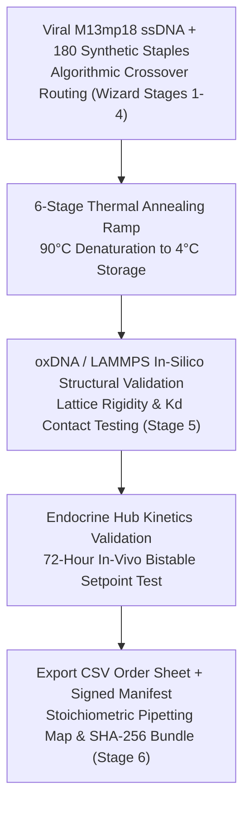
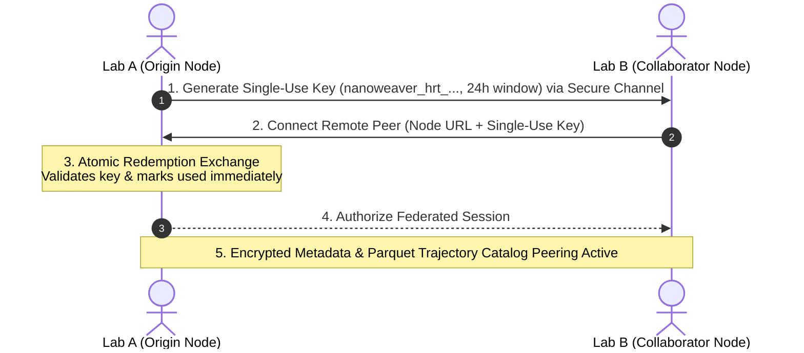

# Example Biomedical & Computational Workflows

> **Step-by-Step Practical Guides for Wet-Lab Nanotechnologists and Computational Researchers**

This guide provides concrete, end-to-end walkthroughs for common workflows in **NanoWeaverHrt** (`nanoweaver-hrt`). Each workflow details the scientific objectives, parameter settings, expected inputs and outputs, and system interactions.

---

## Workflow 1: Designing an MtF Feminizing DNA Nanotube

### Objective
Design and simulate an autonomous DNA origami cylindrical nanotube targeted to anterior pituitary gonadotrope cells for permanent, closed-loop 17β-estradiol (E2) titration and natural luteinizing hormone (LH) suppression.



### Step 1: Ingest Scaffold in the Guided DNA Wizard
1. Open the web dashboard at `http://localhost:5000` and click **Guided DNA Wizard** in the navigation bar.
2. Select **M13mp18 Bacteriophage** (7,249 nt) as the base scaffold.
3. Observe the calculated metrics:
   * **Total Bases**: 7,249 nt
   * **GC-Content**: ~42.8%
   * **Molecular Mass**: ~2,392,170 Da
4. Click **Proceed to Geometry Selection**.

### Step 2: Configure Nanotube Conformation
1. Choose **Cylindrical Nanotube** (6-helix bundle).
2. Set dimensions:
   * **Length**: 60 nm (approximately 176 base pairs).
   * **Inner Cavity Diameter**: 4.5 nm.
   * **Lattice Arrangement**: Honeycomb lattice (120° angles).
3. Confirm that the calculated inner cavity volume (V ≈ 954 nm³) is sufficient to encapsulate ~150 molecules of hydrophobic 17β-estradiol.
4. Click **Generate Staple Crossovers**.

### Step 3: Configure Tissue-Targeting & Staple Routing
1. The routing engine generates 178 staple strands with an average length of 42 nucleotides.
2. Under **Functional Overhangs**, enable **Pituitary Gonadotrope Targeting Peptide Adapter** (T₁₅ poly-T anchor on the distal end staples).
3. Enable **LH-Responsive Aptamer Latches** on the entry caps.
4. Click **Review Thermal Annealing Protocol**.

### Step 4: Verify Stoichiometric Annealing Schedule
1. Review the 6-stage temperature ramp:
   * 90°C for 10 min (Denaturation).
   * 90°C → 65°C @ 1.0°C/min.
   * 65°C → 55°C @ 0.1°C/min (Core crossover nucleation).
   * 55°C → 45°C @ 0.05°C/min (Aptamer loop assembly).
   * 45°C → 20°C @ 0.5°C/min.
   * Hold at 4°C.
2. Confirm buffer stoichiometry: 1x TAE with 12.5 mM MgCl2.

### Step 5: Simulate In-Vivo Setpoints in Endocrine Hub
1. Navigate to **Endocrine Hub** in the sidebar.
2. Select **Feminizing Protocol (MtF)**.
3. Observe the setpoint targets:
   * Target E2: 550 pmol/L.
   * Target T: < 1.8 nmol/L.
4. Run the **72-Hour Kinetics Simulation**:
   * Observe the initial surge of E2 reaching steady state by Hour 18.
   * Verify that endogenous LH drops from basal 8.5 IU/L to < 1.2 IU/L, naturally shutting down gonadal androgenesis without exogenous anti-androgens.
5. Trigger an **Exogenous Bolus Perturbation** to confirm that the simulated nanocarrier closes its aptamer latches until equilibrium is re-established.

### Step 6: Export Benchtop Synthesis Package
1. Return to the Wizard and click **Export Synthesis Bundle**.
2. Download:
   * `staples_order_sheet.csv`: 96-well plate coordinates and oligonucleotide sequences for ordering.
   * `thermal_cycler_profile.pcr`: Binary protocol file for thermocyclers.
   * `manifest.json`: SHA-256 cryptographic provenance file.

---

## Workflow 2: Ingesting a 10 GB oxDNA Trajectory with Zero Allocations

### Objective
Stream a 10 GB molecular dynamics trajectory (`trajectory.xyz`) from an oxDNA simulation run, parse 100,000 frames using SIMD vector instructions with zero Garbage Collector pressure, and convert coordinates into a compressed columnar Parquet archive.

### Step 1: Stage the Trajectory File
Copy or symlink the simulation output into the platform's shared volume:
```bash
cp /data/simulations/oxdna_nanocage_run.xyz simulations/shared-data/nanocage_100k.xyz
```

### Step 2: Initiate Streaming via REST API or Dashboard
Navigate to **Trajectory Browser** on `http://localhost:5000` or invoke the streaming endpoint via `curl`:
```bash
curl -X POST http://localhost:5000/api/trajectories/stream \
  -H "Content-Type: application/json" \
  -d '{
    "fileName": "nanocage_100k.xyz",
    "format": "XYZ",
    "convertToParquet": true,
    "compression": "Zstandard"
  }'
```

### Step 3: Monitor Zero-Allocation Telemetry in Real Time
1. Open **Stack Services & Telemetry** in the dashboard.
2. Observe the **Memory & GC Telemetry** panel:
   * **Throughput**: Sustained > 400 MB/sec.
   * **ThreadPool**: Active worker threads processing SIMD slices.
   * **Garbage Collection**:
     * `Gen 0`: Occasional minor sweeps.
     * `Gen 1`: Flat.
     * `Gen 2`: **Strictly 0**.
3. Verify that CPU SIMD vectorization displays `Active (AVX-512)` or `Active (AVX2)`.

### Step 4: Spatial Analytics with DuckDB
Once streaming completes, the compressed archive is saved as `nanocage_100k.parquet` (~920 MB).
You can now run analytical queries via the REST API:
```bash
curl -X POST http://localhost:5000/api/analytics/query \
  -H "Content-Type: application/json" \
  -d '{
    "query": "SELECT frame_index, AVG(z) as mean_z FROM \"nanocage_100k.parquet\" GROUP BY frame_index ORDER BY frame_index LIMIT 10"
  }'
```

---

## Workflow 3: Secure Peering & Dataset Federation

### Objective
Establish a secure, authenticated link between Lab A (Originating Node) and Lab B (Collaborating Node) using single-use share keys to exchange trajectory metadata without transmitting raw multi-gigabyte trajectory files across public networks.



### Step 1: Generate Peering Key on Lab A
1. Log into Lab A's dashboard (`https://lab-a.hrt-lab.local`).
2. Navigate to **Configuration & Peers**.
3. Under **Single-Use Peering Keys**, select an expiration window:
   * Choose **`24h`** for a one-day collaboration session.
4. Click **Generate New Share Key**.
5. Copy the generated key:
   ```
   nanoweaver_hrt_9e8b7c6d5e4f3a2b1c0d9e8b7c6d5e4f3a2b1c0d9e8b7c6d5e4f3a2b1c0d9e8b
   ```

### Step 2: Connect from Lab B
1. Log into Lab B's dashboard (`https://lab-b.hrt-lab.local`).
2. Navigate to **Configuration & Peers** and click **Connect Remote Peer**.
3. In the modal:
   * **Remote Node URL**: `https://lab-a.hrt-lab.local`
   * **Single-Use Key**: Paste `nanoweaver_hrt_9e8b7c...`
4. Click **Verify & Link Peer**.

### Step 3: Verify Atomic Invalidation & Federated Access
1. On Lab A's dashboard, refresh the key list:
   * The key status transitions immediately from `Active` to `Consumed`.
   * Displays timestamp of consumption and Lab B's IP address.
2. If Lab B attempts to reuse the key or another actor intercepts it, the server rejects it with `HTTP 409 Conflict: Key already consumed`.
3. Lab B can now browse Lab A's Parquet trajectory catalog, request SIMD metric aggregates, and verify cryptographic manifest hashes directly.

---

## Next Steps
* Consult the [**REST API Reference**](api-reference.md) for full programmatic integration.
* Return to the [**Portal Home**](index.md).
