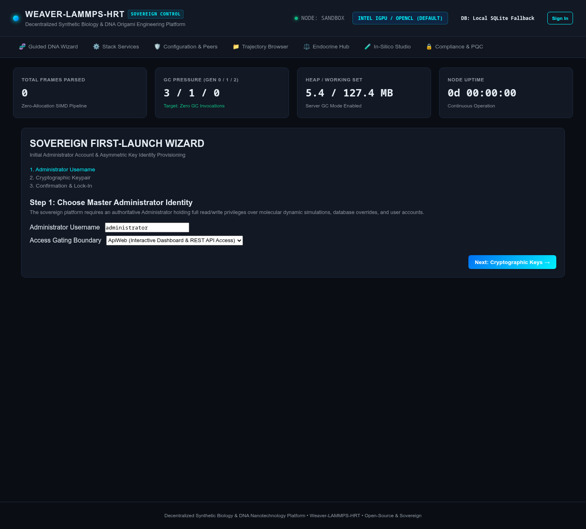

# Getting Started & Deployment Guide

> **Quickstart, Local Setup, and Hardware-Accelerated Container Deployment**

This guide walks you through setting up and running **NanoWeaverHrt** (`nanoweaver-hrt`) on your local workstation or high-performance compute node. The system is designed to run self-contained with zero external cloud dependencies.

---

## 1. System Requirements & Hardware Acceleration

### Minimum Workstation Requirements
* **CPU**: 64-bit x86_64 or ARM64 processor (SSE4.2 or ARM NEON support required).
* **RAM**: 8 GB minimum (16 GB+ recommended for multi-gigabyte trajectory parsing).
* **Storage**: 2 GB free disk space for the .NET service and container images.
* **Operating System**: Linux (Ubuntu 22.04+, Debian 12+, Fedora 39+, Arch Linux) or Windows 11 with WSL2.
* **Software Prerequisites**:
  * [.NET 10 SDK](https://dotnet.microsoft.com/)
  * [Docker](https://www.docker.com/) and [Docker Compose v2+](https://docs.docker.com/compose/)
  * [Node.js v20+](https://nodejs.org/) (for running UI unit tests)

### Hardware SIMD Vectorization
The trajectory parsing pipeline automatically detects and leverages SIMD vector instruction sets at runtime:
* **AVX-512**: Vectorizes 16 32-bit floats simultaneously (Xeon Scalable, AMD Zen 4/5).
* **AVX2**: Vectorizes 8 32-bit floats simultaneously (Intel Haswell+, AMD Zen 1+).
* **SSE4.2**: Vectorizes 4 32-bit floats simultaneously (legacy x86_64 fallback).

### GPU Acceleration Backends
The simulation containers support accelerated molecular dynamics (oxDNA and LAMMPS) across all major GPU hardware:
* **Intel Discrete GPUs** (Arc A770, A750, Flex, Max) via Intel oneAPI Level Zero / OpenCL.
* **NVIDIA GPUs** (RTX 30xx/40xx, A100, H100) via CUDA and NVIDIA Container Toolkit.
* **AMD Radeon GPUs** (RX 7000, Instinct MI200/MI300) via AMD ROCm.
* **Intel Integrated GPUs / CPU Fallback**: Directly via Linux Direct Rendering Infrastructure (`/dev/dri`).

---

## 2. Running Locally with .NET 10 SDK

For development, testing, and UI exploration, you can run the trajectory parser and sovereign Blazor dashboard directly on your host machine.

### Step 1: Clone the Repository
```bash
git clone https://git.lantea.one/lantea-one/nanoweaver-hrt.git
cd nanoweaver-hrt
```

### Step 2: Build the Solution
Compile the .NET 10 microservice and test projects:
```bash
# Set XDG_RUNTIME_DIR if running in sandboxed or headless Linux environments
XDG_RUNTIME_DIR=/tmp dotnet build NanoWeaverHrt.slnx
```

### Step 3: Run the Service
Launch the microservice and embedded web server:
```bash
XDG_RUNTIME_DIR=/tmp dotnet run --project src/NanoWeaverHrt/NanoWeaverHrt.csproj
```

Once running, navigate your web browser to:
```
http://localhost:5000
```

The web dashboard initializes automatically with embedded SQLite storage (or PostgreSQL if configured) and connects to local file streams.

### Step 4: First-Launch Master Administrator Setup Wizard

On initial boot, the sovereign node enforces a strict zero-backdoor policy: **no default passwords or insecure credentials exist**. All core platform operations and API endpoints are locked until the authoritative **Master Administrator** is initialized.



1. **Automatic Redirection**: Navigating to any page on a fresh node automatically redirects to `/setup`.
2. **Master Identity**: Choose your Administrator username and configure the access gate boundary (`ApiWeb` or `Web`).
3. **Cryptographic Keypair Generation**:
   - Generate a high-security keypair directly in the browser (Ed25519 recommended, or ML-DSA-65 for post-quantum signatures).
   - Optionally encrypt the private key with a passphrase (AES-256-CBC with PBKDF2 HMAC-SHA256).
   - Alternatively, supply an existing public key in PEM or Base64 format.
4. **Mandatory Backup & Lock-In**:
   - Download the generated private key (`.pem`) file.
   - Confirm secure offline storage.
   - Once completed, the setup wizard is permanently locked to prevent administrative hijacking.

---

## 3. Running with Docker Compose

For production deployment and automated integration with oxDNA and LAMMPS simulation containers, use the provided Docker Compose profiles. All custom images are published directly to the authoritative Forgejo container registry (and mirrored to GitHub Container Registry), or can be built locally on demand from source.

### Container Image Registry Reference

| Service | Container Image Tag (Forgejo) | Mirrored Tag (GitHub) | Local Build Context |
| :--- | :--- | :--- | :--- |
| **Sovereign Web UI & Parser** | `git.lantea.one/lantea-one/nanoweaver-hrt-web:latest` | `ghcr.io/lantea-one/nanoweaver-hrt-web:latest` | `docker/web/Dockerfile.web` |
| **Molecular Simulation Node** | `git.lantea.one/lantea-one/nanoweaver-hrt-simulation:latest` | `ghcr.io/lantea-one/nanoweaver-hrt-simulation:latest` | `docker/simulation/Dockerfile.simulation` |

```bash
# To build both custom container images locally from source:
docker compose build

# Or pull pre-built images directly from Forgejo:
docker compose pull
```

### Container identity (.env)
Both containers run as a non-root user so that files they create in `./simulations/shared-data`, `./simulations/exports` and `./simulations/parquet` belong to you instead of root. Linux decides file access by numeric user and group IDs, so Compose needs to know yours. Generate a `.env` file in the repository root (it is git-ignored; `example.env` documents each variable):
```bash
cat > .env <<EOF
WEAVER_UID=$(id -u)
WEAVER_GID=$(id -g)
WEAVER_VIDEO_GID=$(getent group video | cut -d: -f3)
WEAVER_RENDER_GID=$(getent group render | cut -d: -f3)
EOF
```
If `.env` is missing the defaults are `1000:1000` for the user and `44` / `109` for the video and render groups, which are Debian and Ubuntu values. Other distributions (Arch, Fedora and others) use different group numbers, so run the `getent` commands above rather than trusting the defaults.

#### Alternative: resolve the groups at launch time

A `.env` file records the group numbers as they were on the day you wrote it. A kernel or graphics-driver update can renumber the `video` and `render` groups, which leaves a stale `.env` quietly removing GPU access. To re-resolve them on every launch, export the variables instead and skip `.env` altogether — values present in the environment take precedence over `.env`:

```bash
export WEAVER_UID=$(id -u)
export WEAVER_GID=$(id -g)
export WEAVER_VIDEO_GID=$(getent group video | cut -d: -f3)
export WEAVER_RENDER_GID=$(getent group render | cut -d: -f3)
docker compose up -d
```

Add those four `export` lines to your shell profile to make the behaviour permanent.

> **Why these must be numbers, not group names.** Compose passes `group_add` straight through to the container, where a *name* is resolved against the container image's own `/etc/group` — not the host's. The `/dev/dri` device nodes, by contrast, keep the host's numeric group ID when they are passed in, and nothing translates between the two. Writing `video` would therefore resolve to whatever that name means inside the image (44 on Debian and Ubuntu) and silently fail to match a host group of, say, 983. Writing `render` is worse: the `ubuntu:24.04` base image has no `render` group at all, so the container refuses to start with `unable to find group render: no matching entries in group file`. Always supply the host's numeric GID, which is what the `getent ... | cut -d: -f3` commands above produce.

> **Why the GPU group numbers matter:** device nodes in `/dev/dri` keep their host group number inside the container, and a non-root process can open them only if it belongs to a group with that same number. Render nodes (`renderD*`) are often world read/write, but the `card*` nodes are typically `root:video` with mode `0660`, so a wrong `WEAVER_VIDEO_GID` silently removes card access. The same applies to `/dev/kfd` on AMD Radeon, which is reached through the render group.

> **Rootless Docker / Podman:** in rootless mode container UID 0 maps to your own host user. Set `WEAVER_UID=0` and `WEAVER_GID=0` in `.env`; any other value maps to a sub-UID and produces files your host account cannot write.

### Node key material (generated on first launch)

Nothing to configure. The first time the parser starts it generates two 256-bit secrets of its own and stores them in `./simulations/shared-data/node-keys/`:

| File | Protects | If you lose it |
| :--- | :--- | :--- |
| `token_signing.key` | Seals login tokens so they cannot be forged | Everybody is signed out and signs in again |
| `phi_master.key` | Encrypts patient profile data at rest | Patient data already encrypted with it is unrecoverable |

Both files are written with mode `0600` (readable by the account that runs the container and nobody else), are 32 bytes long, and are git-ignored twice over, so they can never be committed. They are generated with the operating system's cryptographic random number generator, which means **every node's keys are unique to that node** — no key ships in the source code.

> **Back these up.** `./simulations/shared-data/node-keys` must be part of your backup set, with permissions preserved (`cp -a`). A backup of the database without the key file cannot be decrypted, by design.

> **Do not delete them to "reset" something.** Removing `token_signing.key` only invalidates existing sessions, but removing `phi_master.key` permanently destroys the ability to read patient data that was encrypted with it. A truncated, over-long or unreadable key file is treated as a hard error: the service refuses to start rather than quietly generating a replacement that could not decrypt anything.

> **Upgrading from an earlier release.** Tokens issued before the upgrade stop being accepted and the browser simply returns to the sign-in page — the API answers such a token with a plain `401 Unauthorized`. Patient profile data encrypted by an earlier release is migrated automatically on the first start after the upgrade: it is read with the old key one last time and rewritten with this node's own key. No operator ever handles a secret and nothing is lost.

> **Running more than one replica.** A token signed by one node is rejected by every other node, because each node has its own key. If you run several `trajectory-parser` replicas behind a load balancer, either point `./simulations/shared-data/node-keys` at shared storage on every replica (the first node to start creates the files, the others read them, and a simultaneous cold start is safe), or set `WEAVER_TOKEN_SIGNING_KEY` to the same Base64-encoded 32 bytes everywhere (`openssl rand -base64 32`), sourced from your orchestrator's secret store. `phi_master.key` must be shared the same way if more than one node writes patient profile data, otherwise node B cannot read what node A encrypted.

To keep the keys on a mount that the simulation and database containers cannot see at all, create the directory yourself first and switch the parser over — `docker-compose.yml` carries the two commented lines and the reason the manual step is required:
```bash
mkdir -p ./simulations/node-keys && chmod 700 ./simulations/node-keys
```

### Scenario A: Default Deployment (Intel iGPU or CPU Fallback)
This configuration passes through `/dev/dri` for Intel integrated graphics or falls back cleanly to multi-threaded CPU execution:
```bash
docker compose up -d
```

### Scenario B: Intel Arc Discrete GPUs (e.g., Arc A770)
Uses the Intel compute runtime with oneAPI Level Zero and OpenCL driver pass-through:
```bash
docker compose -f docker-compose.yml -f compose/docker-compose.arc.yml up -d
```

### Scenario C: NVIDIA CUDA GPUs
Requires the [NVIDIA Container Toolkit](https://docs.nvidia.com/datacenter/cloud-native/container-toolkit/latest/install-guide.html) installed on the host:
```bash
docker compose -f docker-compose.yml -f compose/docker-compose.nvidia.yml up -d
```

### Scenario D: AMD Radeon GPUs (ROCm)
Passes through `/dev/kfd` and `/dev/dri` with ROCm user permissions:
```bash
docker compose -f docker-compose.yml -f compose/docker-compose.radeon.yml up -d
```

### Scenario E: Secure Public Access with Automated Let's Encrypt SSL
When deploying to a public VPS or homelab domain, use one of the hardened reverse proxy overlays (Caddy, Nginx, or Cloudflare Tunnel) to enforce HTTPS, eliminate cleartext HTTP, and auto-renew Let's Encrypt certificates:
```bash
# Option 1: Automatic Let's Encrypt TLS via Caddy (Recommended)
export DOMAIN="hrt.yourdomain.org"
export ACME_EMAIL="admin@yourdomain.org"
docker compose -f docker-compose.yml -f compose/docker-compose.public-caddy.yml up -d

# Option 2: Hardened Nginx with Certbot
docker compose -f docker-compose.yml -f compose/docker-compose.public-nginx.yml up -d

# Option 3: Cloudflare Zero Trust Tunnel (Bypasses CGNAT & ISP Port Blocks)
export TUNNEL_TOKEN="your-token"
docker compose -f docker-compose.yml -f compose/docker-compose.public-cloudflare.yml up -d
```
> For complete instructions on DNS setup, firewall rules, and reverse proxy architectures, consult the [**Secure Public Access & Reverse Proxies Guide**](secure-public-access.md).

### Scenario F: PostgreSQL with pg_duckdb Columnar Analytics

By default the node stores its data in a local SQLite file inside `./simulations/shared-data`, which needs no configuration at all. The infrastructure overlay replaces that with a PostgreSQL container carrying the `pg_duckdb` extension, for vectorized SQL over large Parquet trajectory sets:
```bash
# Optional but recommended: choose your own database password before the first launch
export WEAVER_POSTGRES_PASSWORD="$(openssl rand -base64 24)"
docker compose -f docker-compose.yml -f docker-compose.infra.yml up -d
```
`WEAVER_POSTGRES_PASSWORD` is read by both the database and the parser, so the two can never drift apart. If you do not set it, the published placeholder `weaver_secret_change_me` is used; that is safe only because the database port is published on the loopback interface only (`127.0.0.1:5432`) and the parser reaches the database over the private Compose network. Set a real password before exposing that port anywhere else.

The parser is pointed at the database with `POSTGRES_CONNECTION_STRING=Host=pg-duckdb;...`, which the overlay sets for you, and it waits for the database healthcheck before starting. Both details matter: if the connection fails for any reason the service **quietly** falls back to local SQLite and carries on, so a missing connection string or an early start looks like success while the PostgreSQL database sits unused. Confirm which backend is actually live after launch — the authenticated health report names it under `subsystems.database.provider`, as either `PostgreSQL (pg-duckdb)` or `Local SQLite Fallback`:
```bash
curl -s -H "Authorization: Bearer <your-token>" http://localhost:5000/api/system/health
```

### Verifying Container Health
Check the status of running containers:
```bash
docker compose ps
```
To view real-time log outputs:
```bash
docker compose logs -f trajectory-parser
```

### Recovering from root-owned files (upgrading from earlier releases)
Earlier releases ran as root, so `weaver_config.db`, its `-wal` / `-shm` journals, exports and parquet files may be owned by root on the host. SQLite needs write access to the directory (to create the journals), not just the file, so fix ownership recursively. This is a one-time step and no data is deleted. `simulations/configs` is read-only and needs no change.
```bash
docker compose down
# Option 1: with sudo
sudo chown -R "$(id -u):$(id -g)" simulations/shared-data simulations/exports simulations/parquet
# Option 2: without sudo (any member of the docker group)
docker run --rm -v "$PWD/simulations:/s" alpine chown -R "$(id -u):$(id -g)" /s/shared-data /s/exports /s/parquet
# Then create .env (see "Container identity" above) and restart
docker compose up -d
```

---

## 4. Testing & Quality Verification

We maintain strict test-driven engineering standards. All pull requests must pass 100% of unit tests and achieve 100% line and branch code coverage.

### Running .NET Unit & Integration Tests
```bash
XDG_RUNTIME_DIR=/tmp dotnet test NanoWeaverHrt.slnx \
  --collect:"XPlat Code Coverage" \
  --settings coverlet.runsettings
```

### Running Frontend JavaScript Visualization Tests
The custom sovereign HTML5 Canvas charting and 3D double helix visualization modules are thoroughly verified using Node's native test runner with zero external mock libraries:
```bash
cd src/NanoWeaverHrt/wwwroot
npm test
cd ../../..
```

---

## 5. Directory Structure Overview

```
nanoweaver-hrt/
├── compose/                              # Docker Compose overrides (Hardware & Public Access)
│   ├── caddy/                            # Hardened Caddy reverse proxy configuration
│   │   └── Caddyfile                     # Automatic Let's Encrypt TLS & WebSocket proxy
│   ├── nginx/                            # Hardened Nginx configuration template
│   │   └── nginx.conf                    # Zero-buffering reverse proxy template
│   ├── docker-compose.arc.yml            # Intel Arc A770 Level Zero override
│   ├── docker-compose.nvidia.yml         # NVIDIA CUDA override
│   ├── docker-compose.radeon.yml         # AMD ROCm override
│   ├── docker-compose.public-caddy.yml   # Hardened Caddy + Let's Encrypt SSL override
│   ├── docker-compose.public-nginx.yml   # Hardened Nginx + Certbot SSL override
│   └── docker-compose.public-cloudflare.yml # Cloudflare Zero Trust Tunnel override
├── docs/                                 # GitHub Pages wiki documentation & images
│   ├── images/                           # High-resolution UI screenshots
│   └── index.md                          # Portal home
├── simulations/                          # Simulation input, output, and shared data
│   ├── configs/                          # oxDNA and LAMMPS input parameter files
│   ├── exports/                          # SHA-256 signed dataset export bundles
│   └── shared-data/                      # Shared mount volume for trajectory streams
├── src/
│   └── NanoWeaverHrt/ # ASP.NET Core & Blazor trajectory service
│       ├── Services/                     # Pipeline parsing, SIMD, config, and endocrine math
│       ├── Components/Pages/             # Blazor Interactive Server UI pages
│       └── wwwroot/                      # Sovereign CSS, charting JS, and double helix 3D
└── tests/
    └── NanoWeaverHrt.Tests/ # Unit, integration, and coverage test suite
```

---

## Next Steps
* Configure [**Secure Public Access & Reverse Proxies**](secure-public-access.md) if deploying your node to the internet.
* Proceed to the [**Guided DNA Workflow Wizard**](workflow-wizard.md) to design your first targeted nanocarrier.
* Explore the [**Endocrine Hub & Pharmacodynamics**](endocrine-hub.md) to understand in-vivo setpoint stabilization.
