# In-Silico Simulation Studio & Translational Validation

> **Multi-Scale Molecular Dynamics, Allosteric Gating Energetics, and Whole-Body Pharmacokinetics**

The **In-Silico Simulation Studio** provides computational nanotechnologists and biomedical researchers with a predictive verification harness. Before investing resources in physical oligonucleotide synthesis or animal trials, researchers execute four targeted in-silico campaigns to determine whether candidate nanocarriers will remain stable, responsive, and effective under human physiological conditions.

---

## 1. Translational Scientific Mission

Transitioning from digitized DNA sequences to an in-vivo therapeutic formulation presents four critical biophysical hurdles:
1. **Low-Magnesium Serum Instability**: Bare DNA origami requires 2 to 12.5 mM Mg²⁺ to screen phosphate charges; human blood serum contains only 0.5 to 1.0 mM Mg²⁺ alongside active endonucleases (DNase I).
2. **Allosteric Gating Energetics**: Aptamer latches must remain strictly sealed (preventing burst leakage) under basal conditions, yet unbind exergonically upon binding endocrine trigger signals (elevated LH/FSH).
3. **Steroid Cargo Retention**: Lipophilic sex steroids (17β-estradiol, testosterone) are small non-polar molecules that passively permeate through bare DNA pores unless chemically anchored.
4. **Whole-Body Clearance & Dosing Realism**: Nanocarriers are subject to reticuloendothelial system (RES) clearance and hepatic metabolism, dictating realistic subcutaneous depot intervals rather than unphysical single-dose lifetime expectations.

The In-Silico Simulation Studio resolves these uncertainties across four specialized computational campaigns:

```mermaid
flowchart TD
    subgraph C1["Campaign 1: oxDNA Serum Stability"]
        A1["Physiological Salt & Temp Stress<br>(37°C, 150 mM NaCl, 0.8 mM Mg²⁺)"] --> B1["Root Mean Square Fluctuation (RMSF)<br>& Crossover Fraying Probabilities"]
    end
    subgraph C2["Campaign 2: LAMMPS Aptamer Gating"]
        A2["Steered MD & Umbrella Sampling<br>(0.5 to 3.0 nm Reaction Coordinate)"] --> B2["Potential of Mean Force (PMF)<br>& Pituitary GnRH-R Affinity (Kd)"]
    end
    subgraph C3["Campaign 3: Payload Confinement"]
        A3["Atomistic Cavity Dynamics (NPT)<br>(CHARMM36/GAFF Steroid Cargo)"] --> B3["Steroid Retention Percentage<br>& Passive Leakage Turnover"]
    end
    subgraph C4["Campaign 4: Whole-Body QSP/PBPK"]
        A4["Multi-Compartment PBPK Model<br>(Subcutaneous Depot + HPG Feedback)"] --> B4["30/60/90-Day Patient Kinetics<br>& Semi-Annual Dosing Schedules"]
    end
```



---

## 2. The Four Simulation Campaigns

### Campaign 1: oxDNA Physiological Serum & Low-Magnesium Stress
* **Simulation Engine**: oxDNA (OpenCL / Level Zero / SYCL GPU acceleration).
* **Biophysical Objective**: Models coarse-grained mechanical rigidity and thermal fluctuations under human physiological serum conditions (37.0°C, 150 mM NaCl, 0.8 mM Mg²⁺).
* **Mathematical Electrostatic Screening**:
  The engine computes the Debye-Hückel screening length (Debye length λ_D) from total ionic strength:

$$I = [\text{Na}^+] + 3 \times [\text{Mg}^{2+}]$$

$$\lambda_D = \frac{0.304}{\sqrt{I}} \times \sqrt{\frac{T}{298.15}}\text{ nm}$$

* **Failure Detection & Passivation**:
  Unpassivated nanocarriers exhibit elevated Root Mean Square Fluctuation (RMSF > 1.4 nm) at 0.8 mM Mg²⁺, inducing crossover unhybridization. When poly-L-lysine-polyethylene glycol (PLL-PEG) passivation and *M.SssI* CpG enzymatic methylation are applied, RMSF drops to baseline (< 0.85 nm), preserving structural integrity.

### Campaign 2: LAMMPS Aptamer Gating Free-Energy & GnRH-R Tropism
* **Simulation Engine**: LAMMPS (CHARMM36 nucleic acid & GAFF parameters).
* **Biophysical Objective**: Steered Molecular Dynamics (SMD) and umbrella sampling along the latch unbinding coordinate (0.5 to 3.0 nm) to compute the Potential of Mean Force (PMF).
* **Allosteric Gating Criteria**:
  * **Unbound Basal Barrier**: Must maintain ΔG ≥ +8.5 kcal/mol to prevent passive steroid leakage.
  * **Bound Triggered Barrier**: Binding of Luteinizing Hormone (LH) must shift the free-energy landscape exergonically (ΔG ≤ 0.0 kcal/mol), causing spontaneous gate opening.
  * **Anterior Pituitary Tropism**: Evaluates spatial non-covalent contacts (< 5.0 Å) against human Gonadotropin-Releasing Hormone Receptor (GnRH-R), verifying high-affinity homing (Kd ≤ 5.0 nM).

### Campaign 3: Steroid Payload Encapsulation & Micro-Leakage Dynamics
* **Simulation Engine**: LAMMPS atomistic molecular dynamics in explicit TIP3P water.
* **Biophysical Objective**: Measures confinement kinetics of 50 discrete molecules of 17β-estradiol or testosterone enanthate inside the hollow nanocarrier cavity.
* **Chemical Functionalization Findings**:
  * **Bare DNA Cavity**: Hydrophobic steroids slip freely through structural pores, resulting in > 20% passive leakage over 100 ns.
  * **Cyclodextrin / Cholesterol Anchoring**: Non-covalent inclusion complexes retain 98.6% of cargo in the closed state (< 1.5% passive leakage), releasing rapidly (> 8.0%/min) upon aptamer gate opening.

### Campaign 4: Quantitative Systems Pharmacology (QSP) / Whole-Body PBPK Model
* **Simulation Engine**: .NET 10 Systems Pharmacology Engine.
* **Biomedical Objective**: Multi-compartment whole-body pharmacokinetics model tracking nanocarrier depot dissolution, organ biodistribution, and HPG-axis negative feedback over 30, 60, or 90 days.
* **Compartment System**:
  1. **Subcutaneous Depot**: First-order slow dissolution reservoir (t_½ ≈ 95 days).
  2. **Central Blood Volume**: Plasma circulation with dynamic nanocarrier concentration.
  3. **Target Anterior Pituitary**: Homing site for GnRH-R mediated micro-release.
  4. **Hepatic Clearance**: Scaled by subject-specific genetic clearance multipliers (k_eff).
  5. **Reticuloendothelial System (RES)**: Macrophage phagocytosis in spleen and liver.
* **Pharmacogenomic Coupling**:
  * For MtF subjects carrying *Factor V Leiden* or *Prothrombin G20210A*, peak estradiol is safely capped at ≤ 500 pmol/L.
  * For FtM subjects carrying *AR CAG* repeats or *UGT2B17* deletions, androgen targets are recalibrated (15 to 25 nmol/L).
* **Dosing Verdict**: Empirically confirms that a periodic subcutaneous depot (e.g. 25 mg every 180 days) maintains cis-typical endocrine levels without hormonal volatility.

### Semi-Annual 180-Day Time-Release Depot Kinetics Model
* **Mathematical Foundation**: Coupled Korsmeyer-Peppas anomalous non-Fickian transport and zero-order hydrogel matrix hydrolytic surface erosion:

$$M_t / M_\infty = k \cdot t^n + k_{ero} \cdot t$$

where *n* ≈ 0.50 to 0.70 represents anomalous transport combining thermo-responsive hydrogel matrix swelling and polymer chain scission.
* **Three-Phase Release Profile**:
  1. **Phase I (Days 1–7: Burst Suppression)**: Controlled retention diffusion barrier holds burst release strictly ≤ 5.0% of cumulative payload, eliminating acute cardiovascular thrombotic risks or polycythemia spikes.
  2. **Phase II (Days 8–150: Zero-Order Steady-State Plateau)**: Coupled hydrogel degradation and nanocarrier release maintaining steady micro-aliquots:
     - **MtF Feminizing**: 50 to 100 µg/day bio-identical 17β-estradiol (target: 400 to 700 pmol/L) with pituitary gonadotropin suppression (LH < 1.0 IU/L, FSH < 1.5 IU/L).
     - **FtM Masculinizing**: 5.0 to 7.0 mg/day bioactive testosterone (target: 15.0 to 30.0 nmol/L).
  3. **Phase III (Days 151–180: Terminal Reserve Taper)**: Controlled depletion down to ~5% reserve, triggering clinical re-dosing prompts before systemic levels crash.
* **Clinical Loading Mass Guidelines**:
  - **Masculinizing (FtM)**: Requires **1000 to 1050 mg initial formulation mass** to match adult male systemic clearance (~850 L/day) and deliver 5.0 to 7.0 mg/day (sustaining 15.0 to 30.0 nmol/L).
  - **Feminizing (MtF)**: Requires **16.0 to 20.0 mg initial formulation mass** to match adult female systemic clearance (~500 L/day) and deliver 50 to 100 µg/day (sustaining 400 to 700 pmol/L).
  - **Pharmacogenomics**: Down-titrate FtM initial mass to ~630 mg in *UGT2B17* deletion carriers (0.60x clearance) to avoid androgen stacking.
* **Target Metric**: Time in Target Range (TTR) ≥ 95.0% across 180 days.

---

## 3. In-Silico Stage-Gate Decision Matrix

Researchers use this matrix to enforce clear Go / No-Go decision gates before wet-lab capital expenditure:

| Campaign | Primary Metric | Target Threshold | Action if Failed |
| :--- | :--- | :--- | :--- |
| **1. Serum Stability** | Average RMSF | < 1.20 nm at 0.8 mM Mg²⁺ | Apply PLL-PEG coating; reinforce low-GC crossovers with GC-clamps. |
| **2. Aptamer Gating** | Latch Free Energy (ΔG) | ≥ +8.5 kcal/mol unbound<br>≤ 0.0 kcal/mol bound | Lengthen complementary latch stem; retune aptamer binding loop. |
| **3. Payload Leakage** | Closed Passive Leakage | < 2.0% cargo loss over 100 ns | Functionalize cavity with cyclodextrin or cholesterol anchors. |
| **4. Whole-Body PBPK** | Target Range Time | ≥ 90% over 90 simulated days | Adjust subcutaneous depot mass and release kinetics. |

---

## 4. REST Minimal API Endpoints

The simulation engine is fully accessible programmatically:

```http
# Discover all simulation campaigns
GET /api/simulations/campaigns

# Execute oxDNA physiological serum stability analysis
POST /api/simulations/run/serum-stability
Content-Type: application/json
{
  "scaffoldName": "M13mp18",
  "temperatureCelsius": 37.0,
  "monovalentSaltMolar": 0.15,
  "divalentMagnesiumMilliMolar": 0.8,
  "pllPegCoatingApplied": true,
  "cpGMethylationApplied": true
}

# Execute LAMMPS aptamer gating and receptor tropism analysis
POST /api/simulations/run/aptamer-gating
Content-Type: application/json
{
  "targetReceptor": "Anterior Pituitary Gonadotrope (GnRH-R)",
  "targetGonadotropin": "Luteinizing Hormone (LH)",
  "umbrellaSamplingWindows": 24
}

# Execute steroid payload confinement and leakage analysis
POST /api/simulations/run/payload-leakage
Content-Type: application/json
{
  "chassisGeometry": "Hexagonal Nanotube (6-HB)",
  "hormoneMolecule": "17β-Estradiol",
  "cavityFunctionalization": "Cyclodextrin Anchored"
}

# Execute whole-body PBPK endocrine simulation
POST /api/simulations/run/pbpk-endocrine
Content-Type: application/json
{
  "patientId": "SUBJECT-001",
  "regimen": "MaleToFemale",
  "depotDoseMg": 25.0,
  "simulationDurationDays": 90,
  "genomicMarkerIds": ["F5_LEIDEN", "COMT_VAL158MET"]
}

# Export runnable input deck script for oxDNA or LAMMPS
GET /api/simulations/configs/CAMPAIGN_SERUM_STABILITY
```

---

## 5. Longitudinal Serum Assay Calibration & Adaptive Depot Re-Dosing (Milestone 34)

Real patients metabolize hormones and degrade subcutaneous polymer hydrogels at slightly different rates than population averages. **NanoWeaver HRT** closes the loop between theoretical 180-day depot kinetics (`ITimeReleaseDepotService`) and real-world patient blood draws using a deterministic regularized weighted least-squares (WLS) Bayesian calibration engine (`IDepotCalibrationService`).

### Regularized Bayesian Objective Function

Given longitudinal serum assay observations recorded at follow-up visits (such as Day 30, Day 60, and Day 90), the optimizer searches bounded physiological domains for individualized metabolic clearance (`c ∈ [0.40, 2.50]`) and daily hydrogel erosion rate (`e ∈ [0.20, 2.00]` %/day) using a deterministic 25 × 25 coarse sweep followed by 5 local coordinate-refinement rounds:

$$\mathcal{L}(c, e) = \frac{1}{N} \sum_{i=1}^{N} \left[ w_{\text{primary}} \left(\frac{y_i - \hat{y}(t_i; c, e)}{S_{\text{primary}}}\right)^2 + w_{\text{sec}} r_{\text{sec},i}^2 + w_{\text{LH}} r_{\text{LH},i}^2 \right] + \lambda_N \left[ \left(\frac{c - c_0}{c_0}\right)^2 + \left(\frac{e - e_0}{e_0}\right)^2 \right]$$

* **Single-Point Prior Shrinkage (`N = 1`)**: Uses `λ₁ = 0.25` to anchor estimates smoothly toward the baseline formulation prior `(c₀, e₀)` when only one blood draw has arrived.
* **Multi-Point Longitudinal Identification (`N ≥ 2`)**: Uses `λ = 0.0002` so longitudinal assays jointly identify clearance and erosion kinetics within `≤ 2%` of ground truth with zero random seeds and 100% deterministic repeatability.

### Clinical Safety Guardrails & Adaptive Re-Dosing

Every calibration automatically evaluates patient safety thresholds across all recorded assays:

| Clinical Guardrail | Condition | Severity Tier | Adaptive Response |
| :--- | :--- | :--- | :--- |
| **HPG Axis Escape** | `LH ≥ 2.0 IU/L` or `FSH ≥ 3.0 IU/L` after Day 14 | `WarningEscape` | Flags incomplete pituitary suppression for clinician review. |
| **FtM Erythrocytosis** | `Hematocrit ≥ 52.0%` (Warning) / `≥ 54.0%` (Critical) | `WarningEscape` / `CriticalSafety` | Applies automated 15% safety down-titration to next-cycle mass on `CriticalSafety`. |
| **MtF Supraphysiological E2** | `17β-Estradiol ≥ 1100.0 pmol/L` (Warning) / `≥ 1500.0 pmol/L` (Critical) | `WarningEscape` / `CriticalSafety` | Flags elevated thrombotic exposure and applies 15% next-cycle down-titration on `CriticalSafety`. |
| **Sub-Therapeutic Trough Drift** | MtF `E2 < 350.0 pmol/L` or FtM `T < 10.0 nmol/L` | `AdvisoryDrift` | Advances `AdjustedRedoseDay` and scales `RecommendedNextMassMg` for a full 180-day horizon. |

---

## 6. Multi-Year Permanent Homeostasis & Mitotic Cell-Turnover Durability (Milestone 43)

Once an initial semi-annual polymer depot (Days 0–180) has stabilized systemic sex steroids while aptamer-targeted epigenetic reprogrammers install endogenous steroidogenic promoter control, clinical durability over **1 to 10 years (365 to 3,650 days)** depends on whether proliferating and quiescent stem/progenitor compartments retain the reprogrammed state across mitotic cell divisions without epigenetic washout or a gap during the Day 90–180 exogenous taper.

`MultiYearHomeostasisService` (`IMultiYearHomeostasisService`) integrates a deterministic, zero-LINQ 4th-order Runge-Kutta (RK4) coupled ODE system at daily resolution:

1. **Two-Compartment Progenitor Epigenetic Memory (Quiescent vs. Proliferating)**:
   - Target transduced tissue splits into a slow-cycling quiescent stem pool (`quiescentStemCellFraction`, division rate `lambdaQ = 0.35 / tissueDivisionIntervalDays`) and an active dividing progenitor pool (`1 - quiescentStemCellFraction`, division rate `lambdaP = 1.0 / tissueDivisionIntervalDays`).
   - Across each division, unfaithful DNMT1 copying (`1 - mitoticFidelityRate`) dilutes methylated progenitor retention, counteracted by cooperative reader-writer Hill self-reinforcement (`promoterReinforcementStrength`, cubic Hill constant `K = 0.62`, saturation ceiling `cap = min(0.95, initialFraction + 0.02)`).
   - Optional linkage to an evaluated or approved patient-owned epigenetic toggle circuit (`circuitId`) scales chromatin reinforcement and endogenous drive competence based on the circuit's modeled fold-change stability.

2. **Coupled Exogenous-to-Endogenous Handoff (Days 90–180)**:
   - Days 0–180 exogenous release profiles from `ITimeReleaseDepotService` supply the transient hydrogel contribution fraction, tapering toward zero across Months 3–6 as PLGA erosion finishes.
   - Endogenous reprogrammed steroidogenesis ramps up across Day 90–180 proportionally to `min(1.0, weightedMethylation / 0.80)`, compensating for depot depletion so systemic MtF `17β-estradiol` and FtM `testosterone` remain inside target bounds without requiring repeat hormone injections.

3. **Clinical Durability Guardrails & Early Washout Detection**:
   - **Permanent Homeostasis Benchmark**: Overall projected Time in Target Range `>= 95.0%`, absence of a sub-therapeutic trough drop inside the Day 90–180 handoff window (`handoffTroughDropDetected = false`), and final retained methylated progenitor fraction `>= 0.55` earn `PermanentHomeostasisVerified`.
   - **Mitotic Drift Advisory**: Any TTR regression below `95.0%`, Day 90–180 handoff gap, or epigenetic washout below `0.55` flags `MitoticDriftAdvisory`, records the exact `washoutOnsetYear`, sets `mitoticDriftAlert = true` and `requiresBoosterDose = true`, and surfaces a booster epigenetic LNP / promoter reinforcement advisory across both the Web UI (`/depot-studio`) and Desktop Tray notifications.

---

## Next Steps
* Run simulations interactively in the web dashboard at **`/simulations`**.
* Connect to physical oligo ordering in the [**Guided DNA Workflow Wizard**](workflow-wizard.md).
* Review regulatory audit logging in [**Post-Quantum Cryptography & Compliance**](compliance-and-security.md).
