# In-Silico Simulation Studio & Translational Validation

> **Multi-Scale Molecular Dynamics, Allosteric Gating Energetics, and Whole-Body Pharmacokinetics**

The **In-Silico Simulation Studio** provides computational nanotechnologists and biomedical researchers with a predictive verification harness. Before investing resources in physical oligonucleotide synthesis or animal trials, researchers execute four targeted in-silico campaigns to determine whether candidate nanocarriers will remain stable, responsive, and effective under human physiological conditions.

---

## 1. Translational Scientific Mission

Transitioning from digitized DNA sequences to an in-vivo therapeutic formulation presents four critical biophysical hurdles:
1. **Low-Magnesium Serum Instability**: Bare DNA origami requires 2 to 12.5 mM Mg²⁺ to screen phosphate charges; human blood serum contains only 0.5 to 1.0 mM Mg²⁺ alongside active endonucleases (DNase I).
2. **Allosteric Gating Energetics**: Aptamer latches must remain strictly sealed (preventing burst leakage) under basal conditions, yet unbind exergonically upon binding endocrine trigger signals (elevated LH/FSH).
3. **Steroid Cargo Retention**: Lipophilic sex steroids (17β-estradiol, testosterone) are small non-polar molecules that passively permeate through bare DNA pores unless chemically anchored.
4. **Whole-Body Clearance & Dosing Realism**: Nanocarriers are subject to reticuloendothelial system (RES) clearance and hepatic metabolism, dictating realistic subcutaneous depot intervals rather than unphysical single-dose lifetime expectations.

The In-Silico Simulation Studio resolves these uncertainties across four specialized computational campaigns:

```mermaid
flowchart TD
    subgraph C1["Campaign 1: oxDNA Serum Stability"]
        A1["Physiological Salt & Temp Stress<br>(37°C, 150 mM NaCl, 0.8 mM Mg²⁺)"] --> B1["Root Mean Square Fluctuation (RMSF)<br>& Crossover Fraying Probabilities"]
    end
    subgraph C2["Campaign 2: LAMMPS Aptamer Gating"]
        A2["Steered MD & Umbrella Sampling<br>(0.5 to 3.0 nm Reaction Coordinate)"] --> B2["Potential of Mean Force (PMF)<br>& Pituitary GnRH-R Affinity (Kd)"]
    end
    subgraph C3["Campaign 3: Payload Confinement"]
        A3["Atomistic Cavity Dynamics (NPT)<br>(CHARMM36/GAFF Steroid Cargo)"] --> B3["Steroid Retention Percentage<br>& Passive Leakage Turnover"]
    end
    subgraph C4["Campaign 4: Whole-Body QSP/PBPK"]
        A4["Multi-Compartment PBPK Model<br>(Subcutaneous Depot + HPG Feedback)"] --> B4["30/60/90-Day Patient Kinetics<br>& Semi-Annual Dosing Schedules"]
    end
```



---

## 2. The Four Simulation Campaigns

### Campaign 1: oxDNA Physiological Serum & Low-Magnesium Stress
* **Simulation Engine**: oxDNA (OpenCL / Level Zero / SYCL GPU acceleration).
* **Biophysical Objective**: Models coarse-grained mechanical rigidity and thermal fluctuations under human physiological serum conditions (37.0°C, 150 mM NaCl, 0.8 mM Mg²⁺).
* **Mathematical Electrostatic Screening**:
  The engine computes the Debye-Hückel screening length (Debye length λ_D) from total ionic strength:

$$I = [\text{Na}^+] + 3 \times [\text{Mg}^{2+}]$$

$$\lambda_D = \frac{0.304}{\sqrt{I}} \times \sqrt{\frac{T}{298.15}}\text{ nm}$$

* **Failure Detection & Passivation**:
  Unpassivated nanocarriers exhibit elevated Root Mean Square Fluctuation (RMSF > 1.4 nm) at 0.8 mM Mg²⁺, inducing crossover unhybridization. When poly-L-lysine-polyethylene glycol (PLL-PEG) passivation and *M.SssI* CpG enzymatic methylation are applied, RMSF drops to baseline (< 0.85 nm), preserving structural integrity.

### Campaign 2: LAMMPS Aptamer Gating Free-Energy & GnRH-R Tropism
* **Simulation Engine**: LAMMPS (CHARMM36 nucleic acid & GAFF parameters).
* **Biophysical Objective**: Steered Molecular Dynamics (SMD) and umbrella sampling along the latch unbinding coordinate (0.5 to 3.0 nm) to compute the Potential of Mean Force (PMF).
* **Allosteric Gating Criteria**:
  * **Unbound Basal Barrier**: Must maintain ΔG ≥ +8.5 kcal/mol to prevent passive steroid leakage.
  * **Bound Triggered Barrier**: Binding of Luteinizing Hormone (LH) must shift the free-energy landscape exergonically (ΔG ≤ 0.0 kcal/mol), causing spontaneous gate opening.
  * **Anterior Pituitary Tropism**: Evaluates spatial non-covalent contacts (< 5.0 Å) against human Gonadotropin-Releasing Hormone Receptor (GnRH-R), verifying high-affinity homing (Kd ≤ 5.0 nM).

### Campaign 3: Steroid Payload Encapsulation & Micro-Leakage Dynamics
* **Simulation Engine**: LAMMPS atomistic molecular dynamics in explicit TIP3P water.
* **Biophysical Objective**: Measures confinement kinetics of 50 discrete molecules of 17β-estradiol or testosterone enanthate inside the hollow nanocarrier cavity.
* **Chemical Functionalization Findings**:
  * **Bare DNA Cavity**: Hydrophobic steroids slip freely through structural pores, resulting in > 20% passive leakage over 100 ns.
  * **Cyclodextrin / Cholesterol Anchoring**: Non-covalent inclusion complexes retain 98.6% of cargo in the closed state (< 1.5% passive leakage), releasing rapidly (> 8.0%/min) upon aptamer gate opening.

### Campaign 4: Quantitative Systems Pharmacology (QSP) / Whole-Body PBPK Model
* **Simulation Engine**: .NET 10 Systems Pharmacology Engine.
* **Biomedical Objective**: Multi-compartment whole-body pharmacokinetics model tracking nanocarrier depot dissolution, organ biodistribution, and HPG-axis negative feedback over 30, 60, or 90 days.
* **Compartment System**:
  1. **Subcutaneous Depot**: First-order slow dissolution reservoir (t_½ ≈ 95 days).
  2. **Central Blood Volume**: Plasma circulation with dynamic nanocarrier concentration.
  3. **Target Anterior Pituitary**: Homing site for GnRH-R mediated micro-release.
  4. **Hepatic Clearance**: Scaled by subject-specific genetic clearance multipliers (k_eff).
  5. **Reticuloendothelial System (RES)**: Macrophage phagocytosis in spleen and liver.
* **Pharmacogenomic Coupling**:
  * For MtF subjects carrying *Factor V Leiden* or *Prothrombin G20210A*, peak estradiol is safely capped at ≤ 500 pmol/L.
  * For FtM subjects carrying *AR CAG* repeats or *UGT2B17* deletions, androgen targets are recalibrated (15 to 25 nmol/L).
* **Dosing Verdict**: Empirically confirms that a periodic subcutaneous depot (e.g. 25 mg every 180 days) maintains cis-typical endocrine levels without hormonal volatility.

---

## 3. In-Silico Stage-Gate Decision Matrix

Researchers use this matrix to enforce clear Go / No-Go decision gates before wet-lab capital expenditure:

| Campaign | Primary Metric | Target Threshold | Action if Failed |
| :--- | :--- | :--- | :--- |
| **1. Serum Stability** | Average RMSF | < 1.20 nm at 0.8 mM Mg²⁺ | Apply PLL-PEG coating; reinforce low-GC crossovers with GC-clamps. |
| **2. Aptamer Gating** | Latch Free Energy (ΔG) | ≥ +8.5 kcal/mol unbound<br>≤ 0.0 kcal/mol bound | Lengthen complementary latch stem; retune aptamer binding loop. |
| **3. Payload Leakage** | Closed Passive Leakage | < 2.0% cargo loss over 100 ns | Functionalize cavity with cyclodextrin or cholesterol anchors. |
| **4. Whole-Body PBPK** | Target Range Time | ≥ 90% over 90 simulated days | Adjust subcutaneous depot mass and release kinetics. |

---

## 4. REST Minimal API Endpoints

The simulation engine is fully accessible programmatically:

```http
# Discover all simulation campaigns
GET /api/simulations/campaigns

# Execute oxDNA physiological serum stability analysis
POST /api/simulations/run/serum-stability
Content-Type: application/json
{
  "scaffoldName": "M13mp18",
  "temperatureCelsius": 37.0,
  "monovalentSaltMolar": 0.15,
  "divalentMagnesiumMilliMolar": 0.8,
  "pllPegCoatingApplied": true,
  "cpGMethylationApplied": true
}

# Execute LAMMPS aptamer gating and receptor tropism analysis
POST /api/simulations/run/aptamer-gating
Content-Type: application/json
{
  "targetReceptor": "Anterior Pituitary Gonadotrope (GnRH-R)",
  "targetGonadotropin": "Luteinizing Hormone (LH)",
  "umbrellaSamplingWindows": 24
}

# Execute steroid payload confinement and leakage analysis
POST /api/simulations/run/payload-leakage
Content-Type: application/json
{
  "chassisGeometry": "Hexagonal Nanotube (6-HB)",
  "hormoneMolecule": "17β-Estradiol",
  "cavityFunctionalization": "Cyclodextrin Anchored"
}

# Execute whole-body PBPK endocrine simulation
POST /api/simulations/run/pbpk-endocrine
Content-Type: application/json
{
  "patientId": "SUBJECT-001",
  "regimen": "MaleToFemale",
  "depotDoseMg": 25.0,
  "simulationDurationDays": 90,
  "genomicMarkerIds": ["F5_LEIDEN", "COMT_VAL158MET"]
}

# Export runnable input deck script for oxDNA or LAMMPS
GET /api/simulations/configs/CAMPAIGN_SERUM_STABILITY
```

---

## Next Steps
* Run simulations interactively in the web dashboard at **`/simulations`**.
* Connect to physical oligo ordering in the [**Guided DNA Workflow Wizard**](workflow-wizard.md).
* Review regulatory audit logging in [**Post-Quantum Cryptography & Compliance**](compliance-and-security.md).
