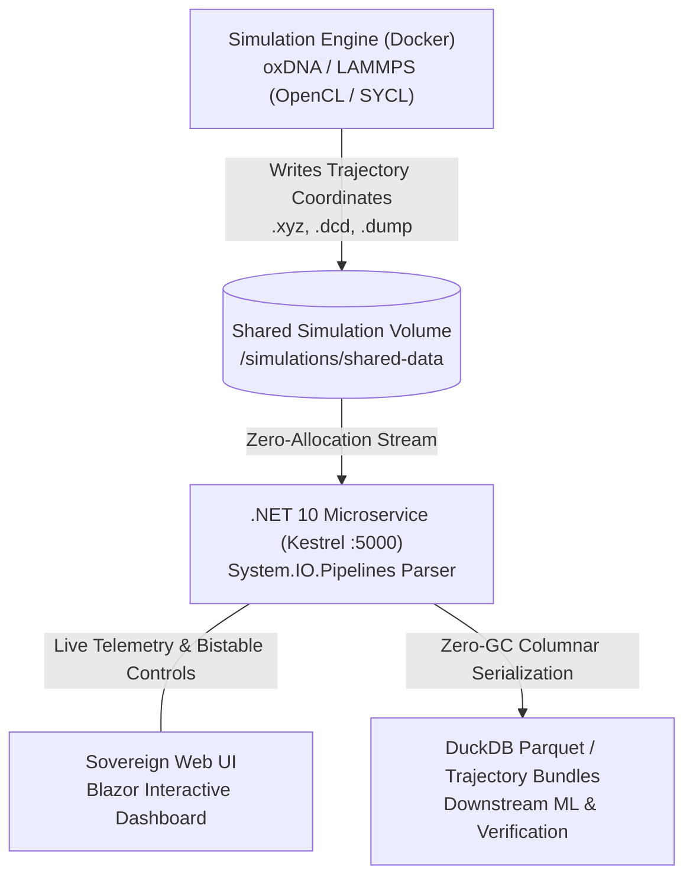

# NanoWeaverHrt (nanoweaver-hrt) Documentation & Wiki

> **Decentralized Synthetic Biology, DNA Origami Engineering, and Sovereign Hormone Replacement Therapy (HRT) Platform**

Welcome to the official documentation and wiki for **`nanoweaver-hrt`** (`NanoWeaverHrt`). This sovereign platform unites physics-based molecular dynamics simulation engines ([oxDNA](https://dna.physics.ox.ac.uk/) and [LAMMPS](https://www.lammps.org/)), a zero-allocation .NET 10 trajectory streaming parser, columnar Apache Parquet storage with DuckDB SIMD queries, and a Blazor Interactive Server dashboard.

---

## 🏛️ Sovereign Repository Notice: Authoritative Forgejo Source

> [!IMPORTANT]
> **Authoritative Upstream Source:** This project is developed and maintained on a sovereign, decentralized Git forge powered by **Forgejo**:  
> 🔗 **[https://git.lantea.one/lantea-one/nanoweaver-hrt](https://git.lantea.one/lantea-one/nanoweaver-hrt)**
>
> **GitHub is a Read-Only Downstream Mirror:** Due to the real threat of administrative censorship, account suspension, and arbitrary deplatforming of open-source synthetic biology and gender-affirming healthcare research by centralized corporate platforms, GitHub is maintained strictly as an automated read-only distribution mirror.
>
> **Contributing, Forking, and Issue Tracking:**  
> - **All forks, pull requests, issues, and active development MUST be conducted directly on the sovereign [Forgejo repository](https://git.lantea.one/lantea-one/nanoweaver-hrt).**
> - Do **not** fork or submit pull requests on GitHub; downstream mirrors are not the authoritative source of truth and are subject to third-party administrative disruption.
>
> ```bash
> # Clone directly from the authoritative sovereign Forgejo remote:
> git clone https://git.lantea.one/lantea-one/nanoweaver-hrt.git
> ```

---

## Project Vision & Therapeutic Goal

The foundational objective of this project is to model, design, and bench-synthesize a permanent **Female-to-Male (FtM)** and **Male-to-Female (MtF)** Hormone Replacement Therapy (HRT) system using **patient-targeted DNA origami nanocarriers**.

Conventional HRT relies on periodic exogenous depot injections, transdermal gels, or oral tablets. These methods suffer from:
1. **Supraphysiological Peak-to-Trough Spikes**: Causing mood volatility, cardiovascular stress, and erythrocytosis.
2. **Systemic Distribution**: Releasing steroids uniformly throughout the body rather than concentrating action where desired.
3. **Hepatic First-Pass Metabolism**: Generating unnecessary strain on the liver and kidneys.

**Our Approach:**
By folding single-stranded viral DNA (bacteriophage M13mp18) into rigid 3D nanostructures functionalized with synthetic DNA aptamer pockets and tissue-targeting ligands, we create **autonomous, closed-loop nanocarriers**. These nanocarriers home directly to anterior pituitary gonadotropes, hypothalamic receptors, or steroidogenic targets, releasing hormones in direct response to local physiological feedback loops.



---

## Core System Architecture

### 1. High-Performance Zero-Allocation Trajectory Streaming
- **Memory Constraint**: Zero heap allocation in coordinate parsing hot loops (`GC Gen 0 / 1 / 2 = 0`).
- **Pipelines Reader**: Raw byte buffers are ingested via `System.IO.Pipelines.PipeReader` and parsed using `ReadOnlySequence<byte>`, `ReadOnlySpan<byte>`, and `Utf8Parser`.
- **Hardware SIMD Acceleration**: Automatic vectorization across AVX-512 (512-bit), AVX2 (256-bit), and SSE4.2 (128-bit) instruction sets via `SimdCoordinateParser`.
- **Supported File Formats**:
  - Extended XYZ Trajectories (`.xyz`)
  - LAMMPS Custom Coordinate Dumps (`.dump`, `.lammps`)
  - CHARMM / NAMD / LAMMPS Binary Trajectories (`.dcd`)

### 2. Guided DNA Origami Bench Fabrication Wizard
- Step-by-step interactive workflow guiding researchers from digitized FASTA/nucleotide sequences to synthesis manifests.
- Mathematical sequence analysis: Base composition (A, T/U, G, C), GC-content percentage, and Dalton molecular weight.
- Algorithmic staple routing: Generation of structural crossover staples, ligand binding pockets, and receptor targeting poly-T anchors.
- Stoichiometric thermal annealing protocol: 6-stage cryogenic-to-ambient cooling schedule (90°C → 4°C).
- Cryptographic provenance manifests with deterministic SHA-256 integrity verification.

### 3. Patient-Targeted Endocrine Regulatory Hub & Pharmacogenomics
- Mathematical bistable state machine modeling in-vivo hormone setpoints:
  - **Feminizing HRT (MtF)**: E2 ≈ 550 pmol/L, T < 1.8 nmol/L, progesterone setpoint.
  - **Masculinizing HRT (FtM)**: T ≈ 20.0 nmol/L, E2 < 150 pmol/L.
- **Pharmacogenomic Risk & Predisposition Engine**:
  - High-impact variant screening: Factor V Leiden, Prothrombin G20210A, AR CAG repeats, COMT Val158Met, CYP1B1*3, UGT2B17 deletion, and TLR9 CpG hypersensitivity.
  - Severity-tiered visual call-out alerts (Critical, Warning, Advisory, Optimal) in the Blazor UI.
  - Closed-loop kinetic recalibration: clearance multiplier scaling, thrombosis burst-release damping, and safe estradiol setpoint capping.
- 72-hour closed-loop pharmacodynamics simulation with reciprocal negative feedback.
- Real-time HTML5 Canvas kinetics charting and 3D double helix projections.

### 4. Authoritative Database Configuration & Sovereign Peering
- **Database Precedence Law**: *"Whatever is in the database wins, stack environment variables do nothing if configuration exists in the database."*
- Supports PostgreSQL (`pg_duckdb`) with automatic fallback to embedded SQLite.
- Single-use cryptographically random tokens (`nanoweaver_hrt_...`) with configurable expiration windows:
  - `1h`, `4h`, `24h`, `7d`, `1m` (30 days), `1y` (365 days), and `Never` (permanent peering).
- Atomic redemption semantics preventing replay attacks or concurrent session takeover.

### 5. Sovereign Cryptographic PKI Identity, RBAC & Hardening
- **Zero Default Passwords & Mandatory Setup**: Initial launch enforces `/setup` wizard before platform unlocks; master Administrator account bound to cryptographic keypair (Ed25519 or ML-DSA-65).
- **Role-Based Authorization & Access Gating**: Strict enforcement across `Administrator`, `Researcher`, and `Patient` roles and transport boundaries (`Api`, `Web`, `ApiWeb`).
- **Automated Browser Idle Expiration**: Inactivity watchdog tracks client interactions and terminates abandoned sessions after 15 minutes.
- **Deterministic SQL Schema Migrations**: Versioned, dialect-aware DDL pipeline (`DatabaseMigrationRunner`) tracking applied revisions in `weaver_schema_migrations`.
- **Zero-Information-Disclosure RFC 7807 Error Responses**: Masking internal errors behind opaque trace IDs and redacting paths, connection strings, and private keys.

---

## Documentation Index

Explore the comprehensive guides and references below:

1. [**Scientific Abstract**](abstract.md)
   * Formal scientific abstract, biomolecular gating mechanisms, zero-allocation pipeline specifications, and pharmacogenomic models.
2. [**Getting Started & Deployment**](getting-started.md)
   * Local development prerequisites, .NET 10 setup, Docker Compose GPU backends (Intel Arc, NVIDIA CUDA, AMD ROCm, CPU).
3. [**Secure Public Access & Reverse Proxies**](secure-public-access.md)
   * Hardened production deployment architectures, automated Let's Encrypt SSL/TLS, Caddy, Nginx + Certbot, and Cloudflare Tunnels (CGNAT bypass).
4. [**Guided DNA Workflow Wizard**](workflow-wizard.md)
   * Deep-dive walkthrough of all 6 stages from digitized sequence ingestion to physical bench synthesis.
5. [**Endocrine Hub & Pharmacodynamics**](endocrine-hub.md)
   * Plain-English biomedical context of the HPG axis, bistable state transitions, and 72-hour kinetics.
6. [**In-Silico Simulation Studio**](in-silico-simulations.md)
   * Multi-scale molecular dynamics (oxDNA, LAMMPS) and whole-body PBPK modeling for in-silico translational de-risking.
7. [**Configuration & Sovereign Peering**](configuration-peers.md)
   * Database-first precedence rules, single-use share key lifecycle, and federating remote UI instances.
8. [**Stack Topology & Hardware Telemetry**](stack-services.md)
   * Service health inspection, diagnostic connectivity pings, SIMD detection, and Server GC telemetry.
9. [**Trajectory Streaming & Dataset Provenance**](trajectories-and-datasets.md)
   * Zero-allocation streaming pipelines, columnar Parquet serialization, and SHA-256 signed tarballs.
10. [**Example Biomedical Workflows**](example-workflows.md)
    * Concrete step-by-step examples: MtF feminizing nanotube, FtM masculinizing nanocage, and collaborative compute peering.
11. [**DIY & HomeLab Benchtop Fabrication Guide**](diy-fabrication-guide.md)
    * Step-by-step physical instructions for community scientists: 50 µL pipetting recipe, reagents checklist, 7-step bench execution, agarose gel QC, and non-toxic safety protocols.
12. [**Post-Quantum Cryptography & Regulatory Compliance**](compliance-and-security.md)
    * NIST FIPS 203 (ML-KEM-768), FIPS 204 (ML-DSA-65), HIPAA Safe Harbor, GDPR Article 17 crypto-shredding, GINA non-discrimination, FDA 21 CFR Part 11 audit trails, asymmetric PKI identities, SQL migrations, and idle session guards.
13. [**REST API Reference**](api-reference.md)
    * Full endpoint catalog, request/response JSON schemas, and test suite execution.
14. [**Scientific Research & Legal Disclaimer**](disclaimer.md)
    * Formal scientific research scope, medical non-advice, and BSL-1 biosafety declarations.
15. [**Release Notes & Architecture Evolution**](release-notes.md)
    * Phase 2 post-quantum cryptographic upgrades, transport boundary enforcement, column-level PHI encryption, and RFC 7807 contracts.

---

## Open-Source License & Sovereign Principles

NanoWeaverHrt is 100% free, open-source, and sovereign software licensed under the **[MIT License](https://git.lantea.one/lantea-one/nanoweaver-hrt/src/branch/main/LICENSE)**. It utilizes zero commercial proprietary dependencies, zero tracking CDNs, and zero third-party chart vendor libraries.
