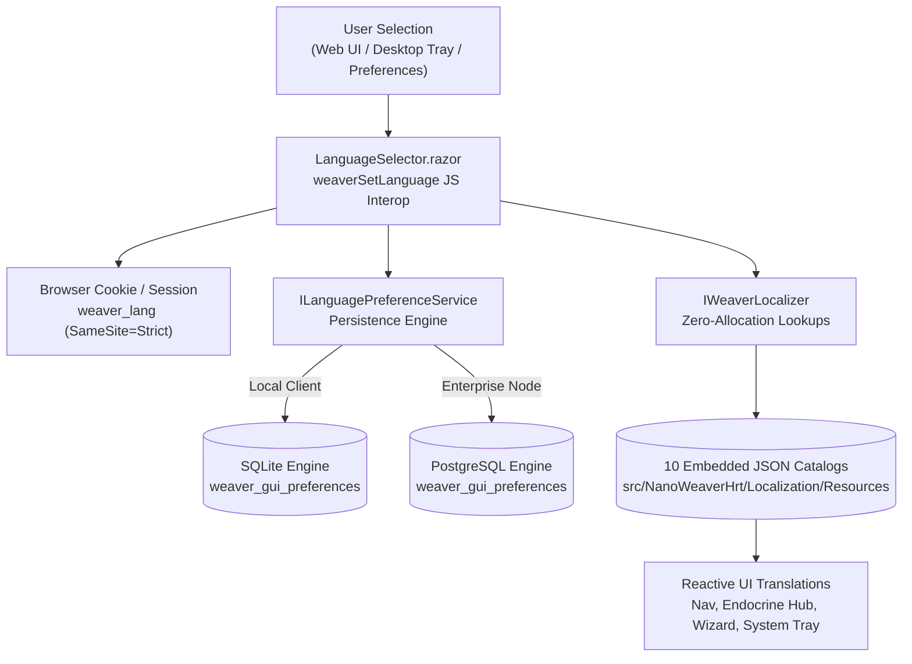

# Community Localization & Multilingual Architecture

> **Decentralized, Multilingual Access for Synthetic Biology and Patient-Directed HRT Research**

---

## 1. Overview & Community Mission

The mission of **`nanoweaver-hrt`** is to democratize advanced synthetic biology, DNA nanotechnology, and gender-affirming healthcare research. Historically, scientific computational tooling and clinical research platforms have been restricted to English-only interfaces, presenting steep barriers for community biohackers, patient cohorts, and autonomous lab collectives across Latin America, Europe, Asia, and Africa.

The **NanoWeaver HRT Community Localization Subsystem** delivers:
- **10 Native Language Catalogs**: Seamless user experience across English, Spanish, French, German, Brazilian Portuguese, Italian, Japanese, Simplified Chinese, Dutch, and Polish.
- **Unified Cross-Platform Coverage**: Identical terminology and resource keys across the Sovereign Web UI, Blazor server circuits, Desktop GUI shells (Avalonia UI), system tray monitors, and mobile platform heads.
- **Zero-Allocation In-Memory Catalogs**: Pre-parsed, thread-safe embedded JSON resources with fast O(1) dictionary lookups and fallback resolution.
- **Dual-Engine Preference Persistence**: Multi-tiered storage supporting local SQLite client databases, enterprise PostgreSQL servers, and client-side browser cookies (`weaver_lang` with `SameSite=Strict`).



---

## 2. Supported Languages & Culture Tags

The platform currently ships with 10 community-authored translation packs:

| Language Name | Native Endonym | IETF BCP 47 Tag | WeaverLanguage Enum | Default Locale Code |
|:---|:---|:---|:---|:---|
| **English** | English | `en-US` | `WeaverLanguage.English` | `en` |
| **Spanish** | Español | `es-ES` | `WeaverLanguage.Spanish` | `es` |
| **French** | Français | `fr-FR` | `WeaverLanguage.French` | `fr` |
| **German** | Deutsch | `de-DE` | `WeaverLanguage.German` | `de` |
| **Portuguese (Brazil)** | Português (Brasil) | `pt-BR` | `WeaverLanguage.Portuguese` | `pt` |
| **Italian** | Italiano | `it-IT` | `WeaverLanguage.Italian` | `it` |
| **Japanese** | 日本語 | `ja-JP` | `WeaverLanguage.Japanese` | `ja` |
| **Chinese (Simplified)** | 简体中文 | `zh-CN` | `WeaverLanguage.Chinese` | `zh` |
| **Dutch** | Nederlands | `nl-NL` | `WeaverLanguage.Dutch` | `nl` |
| **Polish** | Polski | `pl-PL` | `WeaverLanguage.Polish` | `pl` |

---

## 3. Architecture & Resolution Hierarchy

### Domain Abstraction (`IWeaverLocalizer`)
Localization is exposed through the thread-safe `IWeaverLocalizer` service registered in dependency injection as a singleton:

```csharp
public interface IWeaverLocalizer
{
    // Resolves a localized string for the specified language enum
    string GetString(string key, WeaverLanguage language);

    // Resolves a localized string for the specified BCP 47 culture code
    string GetString(string key, string cultureCode);

    // Formats a localized template string with dynamic positional arguments
    string Format(string key, WeaverLanguage language, params object[] args);

    // Enumerates all supported languages with display metadata
    IReadOnlyList<WeaverLanguageInfo> SupportedLanguages { get; }
}
```

### Fallback Hierarchy
When a translation key is queried:
1. **Target Language Lookup**: The system attempts to resolve the key from the requested language catalog (e.g., `pt-BR`).
2. **Neutral Culture Fallback**: If the regional key is missing, it falls back to the base language code (e.g., `pt`).
3. **Primary English Fallback**: If still unmapped, it transparently retrieves the authoritative string from `en-US`.
4. **Key Preservation**: If the key does not exist in any catalog, the raw key string itself is returned rather than throwing an exception or returning null, preventing UI crashes.

---

## 4. Catalog Structure & Key Taxonomy

Translation catalogs are stored as embedded JSON resources in:
`src/NanoWeaverHrt/Localization/Resources/<cultureCode>.json`

Each catalog follows a dot-delimited hierarchical key taxonomy:

```json
{
  "CultureCode": "es-ES",
  "LanguageName": "Español",
  "Strings": {
    "Common.Save": "Guardar",
    "Common.Cancel": "Cancelar",
    "Common.Delete": "Eliminar",
    "Common.Export": "Exportar",
    "Common.Import": "Importar",
    "Common.Refresh": "Actualizar",
    "Common.Status": "Estado",
    "Common.Error": "Error",
    "Common.Success": "Éxito",

    "Nav.Trajectories": "Explorador de Trayectorias",
    "Nav.Endocrine": "Centro Endocrino",
    "Nav.Simulations": "Estudio In-Silico",
    "Nav.Compliance": "Cumplimiento y PQC",
    "Nav.Wizard": "Asistente de Diseño",
    "Nav.Peers": "Conexión de Pares",
    "Nav.Services": "Topología de Servicios",
    "Nav.Configuration": "Configuración",
    "Nav.UserManagement": "Gestión de Usuarios",

    "Endocrine.Title": "Centro Endocrino y Farmacodinamia",
    "Endocrine.BistableToggle": "Regímenes de Transición Bistable",
    "Endocrine.FeminizingRegimen": "Régimen Feminizante (MtF)",
    "Endocrine.MasculinizingRegimen": "Régimen Masculinizante (FtM)",
    "Endocrine.EstradiolTarget": "17β-Estradiol (100–200 pg/mL)",
    "Endocrine.TestosteroneTarget": "Testosterona Total (300–1000 ng/dL)",

    "Tray.Status.Connected": "Conectado al nodo soberano",
    "Tray.Status.Simulating": "Simulación activa",
    "Tray.Status.Degraded": "Servicio degradado",
    "Tray.Action.Open": "Abrir NanoWeaver HRT",
    "Tray.Action.SwitchInstance": "Cambiar Instancia",
    "Tray.Action.SignOut": "Cerrar Sesión",
    "Tray.Action.Quit": "Salir de NanoWeaver"
  }
}
```

---

## 5. Dual-Engine Preference Persistence

User language selections are persisted across application launches via `ILanguagePreferenceService`:

### SQLite Persistence (Local Clients & HomeLabs)
For local desktop installs, standalone laptops, and off-grid portable builds, preferences are saved to an embedded SQLite database (`weaver_preferences.db`):

```sql
CREATE TABLE IF NOT EXISTS weaver_gui_preferences (
    preference_key TEXT PRIMARY KEY NOT NULL,
    preference_value TEXT NOT NULL,
    updated_at_utc TEXT NOT NULL
);
```

### PostgreSQL Persistence (Centralized & Enterprise Nodes)
When running as a centralized laboratory node with `POSTGRES_CONNECTION_STRING` configured, preferences automatically store in PostgreSQL using strict types and timestamp zones:

```sql
CREATE TABLE IF NOT EXISTS weaver_gui_preferences (
    preference_key VARCHAR(128) PRIMARY KEY NOT NULL,
    preference_value TEXT NOT NULL,
    updated_at_utc TIMESTAMPTZ NOT NULL
);
```

### Dual-Engine Upsert Semantics
The service handles atomic inserts and updates across both database dialects using standard SQL:

```sql
INSERT INTO weaver_gui_preferences (preference_key, preference_value, updated_at_utc)
VALUES (@key, @value, @updatedAt)
ON CONFLICT (preference_key) DO UPDATE SET
    preference_value = EXCLUDED.preference_value,
    updated_at_utc = EXCLUDED.updated_at_utc;
```

---

## 6. Client-Side Browser Integration & Cookies

In the Web UI, language preferences are synchronized between the Blazor circuit and browser storage via `weaver-session.js`:

```javascript
// Retrieve stored language preference with fallback hierarchy:
// 1. Session Storage -> 2. weaver_lang Cookie -> 3. navigator.language -> 4. 'en-US'
const userLang = window.weaverGetLanguage();

// Persist language selection to sessionStorage and SameSite=Strict cookie
window.weaverSetLanguage('pt-BR');
```

### Cookie Security & SameSite Attributes
- **Name**: `weaver_lang`
- **SameSite**: `Strict` (Prevents cross-site cookie leakage during third-party navigation).
- **Secure**: Automatically appended when the application is served over HTTPS or production reverse proxies.
- **Max-Age**: 1 year (31,536,000 seconds) for seamless persistent locale memory.

---

## 7. How to Contribute New Translations

We warmly welcome community translations for additional languages (e.g., Arabic, Korean, Turkish, Hindi, Ukrainian)!

### Step-by-Step Translation Guide

1. **Locate the Reference Catalog**:
   Copy the authoritative English catalog:
   `src/NanoWeaverHrt/Localization/Resources/en-US.json`

2. **Create New Resource File**:
   Create a new JSON file named after the target IETF BCP 47 culture tag:
   `src/NanoWeaverHrt/Localization/Resources/<target-culture>.json` (e.g., `ko-KR.json` for Korean).

3. **Translate Values (Keep Keys Intact)**:
   Translate the right-hand JSON string values into your native language. **Never modify the JSON keys** (`Common.Save`, `Nav.Endocrine`, etc.).

4. **Add Enum & Resource Registration**:
   - In `src/NanoWeaverHrt/Localization/WeaverLanguage.cs`: Add the new language member to `WeaverLanguage`.
   - In `src/NanoWeaverHrt/Localization/WeaverLocalizer.cs`: Map the new culture code and display name.

5. **Verify with the Universal Test Suite**:
   ```bash
   # Run unit tests and formatting gate
   ./scripts/verify-all.sh
   ```

6. **Submit Pull Request to Sovereign Forgejo Remote**:
   Submit your changes directly to `git.lantea.one`:
   ```bash
   git push origin main
   ```
