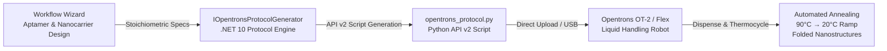
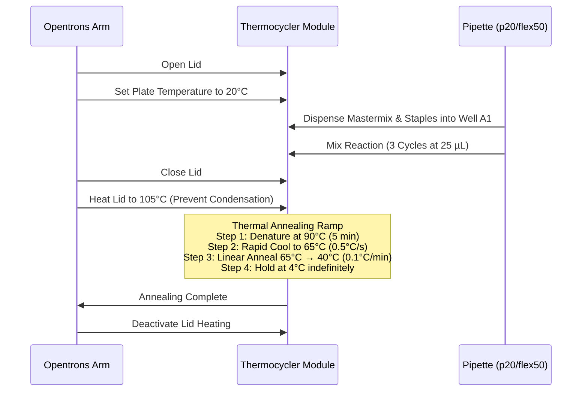

# Opentrons Wet-Lab Automation & Liquid Handling

> **Automated, Reproducible DNA Origami Benchtop Synthesis via Opentrons Python Protocol API v2**

---

## 1. Overview & Motivation

Physical benchtop fabrication of DNA origami nanostructures—such as the **MtF feminizing nanotube** and **FtM masculinizing nanocage**—requires dispensing nanoliter-to-microliter volumes of viral scaffold DNA (bacteriophage M13mp18), hundreds of distinct synthetic staple oligonucleotides, folding buffers, and stoichiometric divalent cations (Mg²⁺).

While manual pipetting is achievable using the [DIY & HomeLab Benchtop Fabrication Guide](diy-fabrication-guide.md), manual liquid handling across 96-well and 384-well plates introduces:
1. **Operator Pipetting Fatigue & Repetitive Strain**: Hand-pipetting hundreds of individual staple wells increases error rates.
2. **Volumetric Inconsistency**: Minor volume variations alter the critical staple:scaffold stoichiometric ratio (target: 10:1 to 20:1 excess).
3. **Evaporation & Contamination Risk**: Extended open-bench handling exposes reactions to aerosol nuclease contamination and volume loss.

The **NanoWeaver HRT Opentrons Automation Engine** bridges computational in-silico designs and physical laboratory synthesis. It programmatically generates fully executable, standards-compliant **Python Protocol API v2** scripts optimized for **Opentrons OT-2** and **Opentrons Flex** open-source pipetting robots.



---

## 2. Hardware Architecture & Supported Robots

The platform supports both major generations of Opentrons robotic platforms:

### Opentrons OT-2
- **Deck Configuration**: Standard 11-slot deck layout with dedicated trash slot (Slot 12).
- **Pipette Options**:
  - `p20_single_gen2`: 1 µL to 20 µL precision dispensing for scaffold, magnesium buffer, and fluorescent beacons.
  - `p300_single_gen2` / `p300_multi_gen2`: High-volume buffer transfers and 8-channel simultaneous plate addition.
- **On-Deck Modules**:
  - **Thermocycler Module (GEN1/GEN2)**: Occupies Slots 7, 8, 10, and 11. Provides automated lid heating (105°C) to prevent condensation and precise peltier ramping (`90°C → 20°C` at `0.1°C/min` to `1.0°C/min`).
  - **Temperature Module (GEN2)**: Occupies Slot 1 or Slot 3. Maintains `4°C` reagent preservation and post-synthesis cold storage.

### Opentrons Flex
- **Deck Configuration**: 12-slot standardized grid (Slots A1 through D3) with modular staging areas and integrated gripper support.
- **Pipette Options**:
  - `flex_1channel_50`: 1 µL to 50 µL high-precision single-channel pipetting.
  - `flex_8channel_50`: 1 µL to 50 µL 8-channel simultaneous transfer.
- **On-Deck Modules**:
  - **Flex Thermocycler Module**: Occupies Column 1 (Slots B1/C1). Automated motorized lid with programmable clamping force and active peltier block.
  - **Flex Temperature Module**: Precision active cooling to `4°C`.

---

## 3. Deck Layout & Labware Mapping

The protocol generator organizes deck labware according to standard ANSI/SLAS footprint conventions:

| Deck Slot (OT-2) | Deck Slot (Flex) | Labware Name | Purpose |
|:---|:---|:---|:---|
| **Slot 1** | **Slot D1** | `opentrons_96_aluminumblock_generic_pcr_strip_200ul` | Reaction Mastermix Tubes (Scaffold, 10× Folding Buffer, MgCl₂, Nuclease-Free H₂O) |
| **Slot 2** | **Slot C1** | `nest_96_wellplate_200ul_flat` | Staple Oligonucleotide Source Plate (Pre-mixed or arrayed staples) |
| **Slot 3** | **Slot D2** | `opentrons_temperature_module_v2` (Optional) | `4°C` Post-synthesis product preservation block |
| **Slot 4** | **Slot B2** | `opentrons_96_tiprack_20ul` / `opentrons_flex_96_tiprack_50ul` | Clean filter tip rack |
| **Slot 7–11** | **Slot B1–C1** | `thermocyclerModule` / `flex_thermocycler` | On-deck PCR plate for automated thermal annealing |
| **Slot 12** | **Fixed Trash** | `fixed_trash` | Contaminated tip disposal |

```
Opentrons OT-2 Deck Layout (Top View):
+-------------+-------------+-------------+
|   Slot 10   |   Slot 11   |   Slot 12   |
| [Thermocycler Module   ]  | [Fixed Trash]
+-------------+-------------+-------------+
|   Slot 7    |   Slot 8    |   Slot 9    |
| [Thermocycler Block    ]  |             |
+-------------+-------------+-------------+
|   Slot 4    |   Slot 5    |   Slot 6    |
| [Tip Rack   ]             |             |
+-------------+-------------+-------------+
|   Slot 1    |   Slot 2    |   Slot 3    |
| [Reagents   ] [Staples    ] [Temp Mod 4°C]
+-------------+-------------+-------------+
```

---

## 4. Stoichiometry & Dispensing Calculation

To achieve high-yield assembly of nanostructures without kinetic traps, staple oligonucleotides are supplied at a **10-fold molar excess** over scaffold strands:

$$\text{Staple Concentration} = 10 \times \text{Scaffold Concentration}$$

### Example 50 µL Reaction Mastermix Recipe

| Reagent Component | Stock Concentration | Target Concentration | Dispense Volume (per rxn) |
|:---|:---|:---|:---|
| M13mp18 ssDNA Scaffold | 100 nM | 10 nM | 5.0 µL |
| Core Staple Pool (Arrayed) | 1 µM each | 100 nM each | 5.0 µL |
| Targeting Aptamer Strands | 1 µM each | 100 nM each | 5.0 µL |
| 10× Folding Buffer (100 mM Tris, 10 mM EDTA, pH 8.0) | 10× | 1× | 5.0 µL |
| Divalent Cation (MgCl₂) | 100 mM | 12.5 mM | 6.25 µL |
| Nuclease-Free Ultrapure H₂O | — | — | 23.75 µL |
| **Total Volume** | — | — | **50.0 µL** |

### Liquid Handling Dynamics
- **Aspiration Flow Rate**: Reduced by 50% (`aspirate_speed = 10 µL/s`) to prevent shear degradation of high-molecular-weight ssDNA scaffolds.
- **Blowout & Touch Tip**: Automatically performed after every dispense to eliminate droplet retention on hydrophobic tip surfaces.
- **Tip Conservation Mode**: Can be toggled in protocol parameters (`ConserveTips = true`) to reuse tips during water/buffer distribution, or fresh tips per transfer (`ConserveTips = false`) for contamination-free sample handling.

---

## 5. Automated On-Deck Thermocycling

When an on-deck thermocycler module is present, the generated protocol automates the complete physical annealing ramp without manual intervention:



If an on-deck thermocycler is **not** present, the protocol dispenses the prepared reaction into a standard 96-well skirted PCR plate, displays a pause prompt with instructions to transfer the plate to an external standalone thermal cycler, and completes the run.

---

## 6. Generated Python Protocol Example

Below is an authentic sample of the Python API v2 script produced by `IOpentronsProtocolGenerator`:

```python
"""
NanoWeaver HRT - Automated DNA Origami Synthesis Protocol
Generated: 2026-10-29 UTC
Platform: Opentrons OT-2 / API v2
Target: MtF Feminizing Nanotube Delivery Carrier
"""

from opentrons import protocol_api

metadata = {
    'protocolName': 'NanoWeaver HRT - MtF Nanotube Synthesis',
    'author': 'NanoWeaver HRT Autonomous Fabrication Engine',
    'description': 'Automated staple-scaffold assembly with stoichiometric 10:1 excess',
    'apiLevel': '2.15'
}

def run(protocol: protocol_api.ProtocolContext):
    # Labware Setup
    tiprack = protocol.load_labware('opentrons_96_tiprack_20ul', '4')
    pipette = protocol.load_instrument('p20_single_gen2', 'right', tip_racks=[tiprack])

    reagent_block = protocol.load_labware('opentrons_96_aluminumblock_generic_pcr_strip_200ul', '1')
    staple_plate = protocol.load_labware('nest_96_wellplate_200ul_flat', '2')

    # Load Thermocycler Module
    tc_mod = protocol.load_module('thermocyclerModule')
    tc_plate = tc_mod.load_labware('nest_96_wellplate_100ul_pcr_full_skirt')

    # Reagents definition in Aluminum Block (Slot 1)
    scaffold = reagent_block['A1']
    buffer_10x = reagent_block['B1']
    mgcl2 = reagent_block['C1']
    water = reagent_block['D1']

    destination = tc_plate['A1']

    # 1. Distribute Water
    pipette.pick_up_tip()
    pipette.aspirate(23.75, water)
    pipette.dispense(23.75, destination)
    pipette.drop_tip()

    # 2. Distribute 10x Folding Buffer
    pipette.pick_up_tip()
    pipette.aspirate(5.0, buffer_10x)
    pipette.dispense(5.0, destination)
    pipette.drop_tip()

    # 3. Distribute MgCl2 (12.5 mM target)
    pipette.pick_up_tip()
    pipette.aspirate(6.25, mgcl2)
    pipette.dispense(6.25, destination)
    pipette.drop_tip()

    # 4. Add M13mp18 Scaffold (10 nM target)
    pipette.pick_up_tip()
    pipette.aspirate(5.0, scaffold)
    pipette.dispense(5.0, destination)
    pipette.drop_tip()

    # 5. Add Staple Pool (100 nM target)
    pipette.pick_up_tip()
    pipette.aspirate(10.0, staple_plate['A1'])
    pipette.dispense(10.0, destination)
    pipette.mix(3, 20.0, destination)
    pipette.drop_tip()

    # 6. Execute On-Deck Annealing Ramp
    tc_mod.close_lid()
    tc_mod.set_lid_temperature(105)
    
    # Denature scaffold-staple secondary structures
    tc_mod.set_block_temperature(90, hold_time_minutes=5)
    
    # Controlled slow cooling ramp: 90°C -> 20°C
    tc_mod.set_block_temperature(65, hold_time_minutes=15)
    tc_mod.set_block_temperature(55, hold_time_minutes=30)
    tc_mod.set_block_temperature(45, hold_time_minutes=30)
    tc_mod.set_block_temperature(20, hold_time_minutes=10)
    
    # Post-synthesis preservation
    tc_mod.deactivate_lid()
    tc_mod.set_block_temperature(4)
    protocol.comment("Synthesis complete. DNA origami nanostructures folded at 4°C.")
```

---

## 7. REST API Integration

The platform provides programmatic REST endpoints for wet-lab protocol generation and direct binary file downloads:

### Generate Protocol (`POST /api/fabrication/opentrons/generate`)
- **Transport**: `POST /api/fabrication/opentrons/generate`
- **Role Requirement**: `Researcher` or `Administrator`
- **Request Body**:
  ```json
  {
    "robotModel": "OT2",
    "pipetteModel": "p20_single_gen2",
    "pipetteMount": "right",
    "tipRackLabware": "opentrons_96_tiprack_20ul",
    "tipRackSlot": "4",
    "reagentLabware": "opentrons_96_aluminumblock_generic_pcr_strip_200ul",
    "reagentSlot": "1",
    "staplePlateLabware": "nest_96_wellplate_200ul_flat",
    "staplePlateSlot": "2",
    "targetWell": "A1",
    "scaffoldVolumeUl": 5.0,
    "stapleVolumeUl": 10.0,
    "bufferVolumeUl": 5.0,
    "mgCl2VolumeUl": 6.25,
    "waterVolumeUl": 23.75,
    "hasThermocycler": true,
    "thermocyclerStartTempC": 90.0,
    "thermocyclerEndTempC": 20.0,
    "thermocyclerHoldMinutes": 5,
    "conserveTips": false
  }
  ```
- **Response**:
  ```json
  {
    "protocolScript": "... python script string ...",
    "robotModel": "OT2",
    "totalReactionVolumeUl": 50.0,
    "estimatedRunTimeMinutes": 95,
    "hasThermocycler": true,
    "requiresTipReload": false,
    "generatedAtUtc": "2026-10-29T15:00:00Z"
  }
  ```

### Download Protocol Script (`POST /api/fabrication/opentrons/download`)
- **Transport**: `POST /api/fabrication/opentrons/download`
- **Role Requirement**: `Researcher` or `Administrator`
- **Response Headers**:
  - `Content-Type`: `text/x-python; charset=utf-8`
  - `Content-Disposition`: `attachment; filename=nanoweaver_origami_synthesis.py`

---

## 8. Guided DNA Workflow Wizard Integration

The Opentrons automation engine is embedded directly into **Stage 5 (Wet-Lab Automation)** and **Stage 6 (Final Execution)** of the [Guided DNA Workflow Wizard](workflow-wizard.md):

1. **Hardware Configuration**: Select between **Opentrons OT-2** and **Opentrons Flex**. Pipette models dynamically adjust to available mounts (`p20_single_gen2`, `flex_1channel_50`).
2. **Labware Deck Layout**: The visual deck map renders active slots in high-contrast obsidian dark theme (`#161f30`), highlighting source tubes, destination wells, and thermocycler blocks.
3. **One-Click Script Export**:
   - **Download Protocol File**: Emits an authentic UTF-8 `.py` file ready for loading via the Opentrons Desktop App or USB drive.
   - **Copy to Clipboard**: Quick-copy mechanism for immediate pasting into custom automation pipelines or Jupyter notebooks.

---

## 9. Quality Verification & Gel Electrophoresis QC

Following automated robotic synthesis, verify assembly yield using native agarose gel electrophoresis:
- **Matrix**: 1.5% to 2.0% Agarose gel in 0.5× TBE buffer supplemented with 11 mM MgCl₂.
- **Voltage**: Run at 60 V to 70 V on ice for 2.5 hours to prevent thermal denaturation of nanostructures.
- **Staining**: GelRed or SYBR Gold nucleic acid gel stain.
- **Expected Banding**: Correctly folded DNA origami nanostructures exhibit higher electrophoretic mobility (sharp, clean monomer band running faster) than unstructured single-stranded M13mp18 scaffold DNA.
