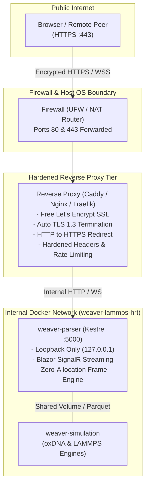
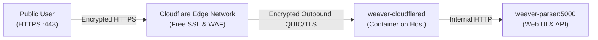

# Secure Public Access & Reverse Proxies

> **Summary:** A comprehensive, beginner-friendly guide to publishing your sovereign **weaver-lammps-hrt** instance to the public internet securely. Learn how to configure automated, free **Let's Encrypt SSL/TLS certificates**, eliminate plaintext HTTP, enable high-performance **WebSockets**, and harden your deployment using production-ready Docker Compose overlays and reverse proxy architectures.

---

## 1. Architecture & Threat Model

By default, the .NET 10 Trajectory Parser and sovereign Web UI listen on internal port `5000` (`http://localhost:5000`). While ideal for local development, **raw port 5000 must never be exposed directly to the public internet**.

### Why Raw Port 5000 Must Never Be Exposed Directly
1. **Plaintext Eavesdropping:** Plain HTTP transmits patient hormone target configurations, sovereign peering tokens, and experimental DNA origami manifests in cleartext over the public internet.
2. **Denial of Service (DoS):** Directly exposing Kestrel to public scanning invites brute-force connection exhaustion without reverse-proxy buffering or rate-limiting guards.
3. **Missing Security Headers:** Modern browser protections (such as `Strict-Transport-Security`, `X-Frame-Options`, and `X-Content-Type-Options`) must be enforced at the network boundary.



---

## 2. Reverse Proxy Comparison Matrix

Choose the reverse proxy option that best matches your infrastructure and comfort level:

| Feature / Consideration | Caddy (Recommended) | Nginx + Certbot | Traefik v3 | Cloudflare Tunnel |
| :--- | :--- | :--- | :--- | :--- |
| **Ease of Setup** | **Easiest (1 config file)** | Moderate | Moderate | Easy |
| **SSL/TLS Certificates** | **100% Automatic** | Automated via companion | Automatic ACME | Automatic at Cloudflare Edge |
| **Requires Open Router Ports?** | Yes (80 & 443) | Yes (80 & 443) | Yes (80 & 443) | **No (Bypasses CGNAT)** |
| **Blazor WebSockets** | Automatic passthrough | Requires `map` directive | Automatic | Automatic |
| **HTTP/3 (QUIC) Support** | Out-of-the-box | Requires Nginx 1.25+ | Out-of-the-box | Out-of-the-box |
| **Hardened Compose File** | `compose/docker-compose.public-caddy.yml` | `compose/docker-compose.public-nginx.yml` | In-line snippet below | `compose/docker-compose.public-cloudflare.yml` |

---

## 3. Prerequisites: Domain Name & Firewall

Before launching a public reverse proxy, ensure your host satisfies two basic networking prerequisites:

### 3.1. Domain Name & DNS Records
Obtain a domain or subdomain (e.g., `hrt.yourdomain.org` or a free dynamic DNS hostname like `my-lab.duckdns.org`):
- Create an **A Record** pointing your domain to your server's public IPv4 address.
- Create an **AAAA Record** pointing your domain to your server's public IPv6 address (if IPv6 is supported).

Verify DNS propagation from your terminal:
```bash
# Verify your domain resolves to your server's public IP
dig +short hrt.yourdomain.org
```

### 3.2. Router Port Forwarding & Host Firewall
If hosting from a home lab or office behind a NAT router:
1. Log into your router's administration interface.
2. Forward **TCP Port 80** and **TCP Port 443** (plus **UDP Port 443** for HTTP/3) to your server's local LAN IP (e.g., `192.168.1.150`).
3. Open the firewall ports on your Linux host:
```bash
# Allow inbound HTTP and HTTPS traffic via UFW
sudo ufw allow 80/tcp comment 'Let Encrypt ACME HTTP-01'
sudo ufw allow 443/tcp comment 'HTTPS Reverse Proxy'
sudo ufw allow 443/udp comment 'HTTP3 QUIC'
sudo ufw reload
```

---

## 4. Option 1: Automated Caddy Proxy (Recommended)

**Caddy** is the recommended reverse proxy for both beginners and seasoned researchers. It automatically obtains, renews, and manages free Let's Encrypt certificates without any external certbot cron jobs or renewal scripts.

### 4.1. Architecture
- Uses the included [`compose/docker-compose.public-caddy.yml`](https://github.com/lantea-one/dotnet-weaver-lammps-hrt/blob/main/compose/docker-compose.public-caddy.yml) overlay.
- Rebinds the Trajectory Parser from `0.0.0.0:5000` to `127.0.0.1:5000` (loopback only), completely shielding it from direct external connections.
- Exposes ports `80` and `443` on Caddy with non-root security boundaries and dropped Linux capabilities.

### 4.2. Hardened Caddy Configuration
The configuration is stored in [`compose/caddy/Caddyfile`](https://github.com/lantea-one/dotnet-weaver-lammps-hrt/blob/main/compose/caddy/Caddyfile):

```caddy
{
    # Global ACME TLS email for renewal notices
    email {$ACME_EMAIL}
}

{$DOMAIN} {
    # Hardened Security Response Headers
    header {
        Strict-Transport-Security "max-age=63072000; includeSubDomains; preload"
        X-Content-Type-Options "nosniff"
        X-Frame-Options "SAMEORIGIN"
        Referrer-Policy "strict-origin-when-cross-origin"
        Permissions-Policy "camera=(), microphone=(), geolocation=()"
        -Server
    }

    # Gzip and Zstandard compression for large JSON payloads
    encode zstd gzip

    # Support up to 500MB encrypted dataset and trajectory uploads
    request_body {
        max_size 500MB
    }

    # Reverse proxy to Trajectory Parser with low-latency streaming
    reverse_proxy trajectory-parser:5000 {
        flush_interval -1
        header_up X-Forwarded-Proto {scheme}
        header_up X-Forwarded-Host {host}
        header_up X-Real-IP {remote_host}
    }
}
```

### 4.3. Launching with Caddy
Run the following commands on your server:

```bash
# 1. Export your public domain and admin email
export DOMAIN="hrt.yourdomain.org"
export ACME_EMAIL="admin@yourdomain.org"

# 2. Launch the stack with the Caddy overlay
docker compose -f docker-compose.yml -f compose/docker-compose.public-caddy.yml up -d

# 3. View live logs to confirm certificate issuance
docker compose logs -f caddy-proxy
```

Caddy will automatically contact Let's Encrypt, solve the HTTP-01 challenge on port 80, install your SSL certificate, and begin serving the sovereign Web UI on `https://hrt.yourdomain.org`.

---

## 5. Option 2: Nginx with Automated Certbot Companion

For enterprise environments or researchers with existing Nginx workflows, the repository provides an automated Nginx + Certbot setup.

### 5.1. Architecture
- Uses [`compose/docker-compose.public-nginx.yml`](https://github.com/lantea-one/dotnet-weaver-lammps-hrt/blob/main/compose/docker-compose.public-nginx.yml).
- Pairs a hardened Alpine Nginx container with the official `certbot/certbot` image.
- Shares an ACME challenge webroot volume (`certbot_www`) and SSL certificate storage volume (`certbot_conf`).
- The Certbot companion runs an automated 12-hour renewal check in the background.

### 5.2. Bootstrap: First-Time Certificate Generation
Because Nginx requires a certificate file on disk before it can start its HTTPS listener, run this one-time initial bootstrapping step:

```bash
# 1. Define your domain and email
export DOMAIN="hrt.yourdomain.org"
export ACME_EMAIL="admin@yourdomain.org"

# 2. Temporarily request the initial certificate using Certbot standalone mode
docker run -it --rm --name certbot-bootstrap \
    -p 80:80 \
    -v "weaver-lammps-hrt_certbot_conf:/etc/letsencrypt" \
    certbot/certbot certonly \
    --standalone \
    -d "$DOMAIN" \
    --email "$ACME_EMAIL" \
    --agree-tos \
    --non-interactive

# 3. Launch the full Nginx + Certbot stack
docker compose -f docker-compose.yml -f compose/docker-compose.public-nginx.yml up -d
```

### 5.3. Nginx Virtual Host Highlights
The configuration template in [`compose/nginx/nginx.conf`](https://github.com/lantea-one/dotnet-weaver-lammps-hrt/blob/main/compose/nginx/nginx.conf) includes:
- **WebSocket Upgrade Mapping:** Correctly upgrades HTTP/1.1 connections to WebSockets for Blazor Server and SignalR hubs.
- **Zero Buffering (`proxy_buffering off;`):** Ensures real-time 60 FPS trajectory coordinate streaming reaches the client browser without intermediate chunking delays.
- **Extended Timeouts (`proxy_read_timeout 86400s;`):** Prevents long-running simulation monitoring sessions from timing out.
- **Modern Cipher Suites:** TLS 1.2 and TLS 1.3 with ECDHE ciphers and OCSP stapling enabled.

---

## 6. Option 3: Traefik v3 (Cloud-Native & Docker Labels)

If you use Traefik as your primary reverse proxy, you can route traffic to the Trajectory Parser using dynamic Docker labels without writing custom configuration files.

### 6.1. Traefik Compose Integration
Create a `docker-compose.traefik.yml` overlay:

```yaml
services:
  trajectory-parser:
    labels:
      - "traefik.enable=true"
      # HTTPS Router
      - "traefik.http.routers.weaver.rule=Host(`hrt.yourdomain.org`)"
      - "traefik.http.routers.weaver.entrypoints=websecure"
      - "traefik.http.routers.weaver.tls=true"
      - "traefik.http.routers.weaver.tls.certresolver=letsencrypt"
      # Internal Port Forwarding
      - "traefik.http.services.weaver.loadbalancer.server.port=5000"
      # Hardened Security Headers Middleware
      - "traefik.http.routers.weaver.middlewares=weaver-headers"
      - "traefik.http.middlewares.weaver-headers.headers.sslredirect=true"
      - "traefik.http.middlewares.weaver-headers.headers.stsSeconds=63072000"
      - "traefik.http.middlewares.weaver-headers.headers.browserXssFilter=true"
      - "traefik.http.middlewares.weaver-headers.headers.contentTypeNosniff=true"
```

---

## 7. Option 4: Cloudflare Tunnels (Zero Trust / CGNAT Bypass)

Many home lab researchers operate behind **Carrier-Grade NAT (CGNAT)** or residential ISPs that block incoming connections to port 80 and port 443. In these scenarios, traditional port forwarding is impossible.

**Cloudflare Tunnels** solves this completely by establishing an outbound encrypted tunnel between your host machine and Cloudflare's edge network:
- **No Open Inbound Ports:** Keep your router firewall 100% closed.
- **Free Automated SSL:** Cloudflare provisions and manages SSL certificates at their edge.
- **DDoS Protection:** Public traffic terminates at Cloudflare, keeping your home IP address completely private.



### 7.1. Cloudflare Tunnel Setup (Step-by-Step)
1. In the [Cloudflare Zero Trust Dashboard](https://one.dash.cloudflare.com/), navigate to **Networks** → **Tunnels**.
2. Click **Add a Tunnel**, choose **Cloudflared**, and name it `weaver-hrt-tunnel`.
3. Copy the provided `TUNNEL_TOKEN`.
4. In the **Public Hostname** tab:
   - **Subdomain:** `hrt`
   - **Domain:** `yourdomain.org`
   - **Service Type:** `HTTP`
   - **URL:** `trajectory-parser:5000`
   - Under **Additional application settings** → **HTTP Settings**, enable **HTTP2 support** and **No TLS Verify** (since traffic between cloudflared and the parser is container-internal).

### 7.2. Launching with Cloudflare Tunnel
Run the following commands using the repository's included overlay:

```bash
# 1. Export your Cloudflare Tunnel Token
export TUNNEL_TOKEN="eyJhIjoiNj..."

# 2. Launch the stack with the Cloudflare overlay
docker compose -f docker-compose.yml -f compose/docker-compose.public-cloudflare.yml up -d

# 3. Verify tunnel health
docker compose logs -f cloudflared
```

Within seconds, your sovereign Web UI will be securely reachable at `https://hrt.yourdomain.org` with zero open ports on your router.

---

## 8. Hardening Checklist & Security Verification

After deploying your public reverse proxy, perform the following verification steps to ensure your instance is completely hardened:

### 8.1. Verify Security Response Headers
Run `curl` against your public domain and confirm all security headers are present:

```bash
curl -I https://hrt.yourdomain.org
```

Expected output headers:
```http
HTTP/2 200
strict-transport-security: max-age=63072000; includeSubDomains; preload
x-content-type-options: nosniff
x-frame-options: SAMEORIGIN
referrer-policy: strict-origin-when-cross-origin
```

### 8.2. Verify SSL/TLS Rating (A+ Target)
Test your domain using the free [Qualys SSL Labs SSL Server Test](https://www.ssllabs.com/ssltest/):
- **Target Grade:** `A+`
- **Protocols Allowed:** TLS 1.2 and TLS 1.3 only (TLS 1.0, 1.1, and SSLv3 must be disabled).
- **Forward Secrecy:** Supported across all modern browser suites.

### 8.3. Verify Blazor SignalR & WebSocket Connectivity
1. Open your browser's Developer Tools (`F12`) and select the **Network** tab.
2. Filter by **WS** (WebSockets).
3. Navigate to `https://hrt.yourdomain.org`.
4. Confirm that the connection to `wss://hrt.yourdomain.org/_blazor` returns **HTTP 101 Switching Protocols**.
5. Switch to the **Trajectory Browser** tab; coordinate updates should stream smoothly at 60 FPS without disconnecting.

---

## 9. Troubleshooting & FAQ

### Q: Why do I get `502 Bad Gateway`?
- **Cause:** The reverse proxy cannot reach `trajectory-parser:5000`.
- **Solution:** Verify both containers share the same Docker network:
  ```bash
  docker compose ps
  docker network inspect weaver-lammps-hrt_default
  ```
  Ensure `weaver-parser` is healthy and listening on port 5000.

### Q: Why does the Blazor UI frequently disconnect or display "Attempting to reconnect"?
- **Cause:** The reverse proxy's read/write timeout is terminating idle WebSocket connections.
- **Solution:** Ensure your reverse proxy configuration sets `proxy_read_timeout 86400s;` (Nginx) or `flush_interval -1` (Caddy).

### Q: Let's Encrypt fails with `Connection Refused` on port 80?
- **Cause:** Port 80 is blocked by your ISP or not forwarded on your router.
- **Solution:** Let's Encrypt requires port 80 to complete HTTP-01 domain ownership challenges. If port 80 is permanently blocked by your internet provider, switch to **Option 4 (Cloudflare Tunnels)** or use DNS-01 challenges via Caddy's Cloudflare DNS plugin.
