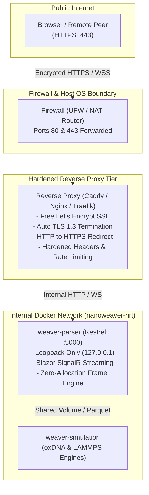
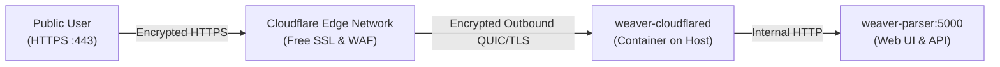
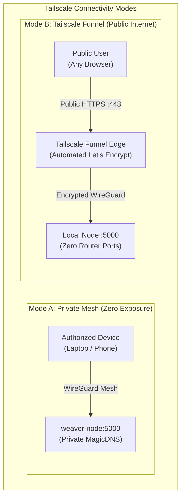

# Secure Public Access & Reverse Proxies

> **Summary:** A comprehensive, beginner-friendly guide to publishing your sovereign **nanoweaver-hrt** instance to the public internet securely. Learn how to configure automated, free **Let's Encrypt SSL/TLS certificates**, eliminate plaintext HTTP, enable high-performance **WebSockets**, and harden your deployment using production-ready Docker Compose overlays and reverse proxy architectures.

---

## 1. Architecture & Threat Model

By default, the .NET 10 Trajectory Parser and sovereign Web UI listen on internal port `5000` (`http://localhost:5000`). While ideal for local development, **raw port 5000 must never be exposed directly to the public internet**.

### Why Raw Port 5000 Must Never Be Exposed Directly
1. **Plaintext Eavesdropping:** Plain HTTP transmits patient hormone target configurations, sovereign peering tokens, and experimental DNA origami manifests in cleartext over the public internet.
2. **Denial of Service (DoS):** Directly exposing Kestrel to public scanning invites brute-force connection exhaustion without reverse-proxy buffering or rate-limiting guards.
3. **Missing Security Headers:** Modern browser protections (such as `Strict-Transport-Security`, `X-Frame-Options`, and `X-Content-Type-Options`) must be enforced at the network boundary.



---

## 2. Reverse Proxy Comparison Matrix

Choose the reverse proxy option that best matches your infrastructure and comfort level:

| Feature / Consideration | Caddy (Docker) | Nginx (Docker) | Cloudflare Tunnel | Tailscale (Funnel & Mesh) | Native Host Caddy | Native Host Nginx | Native Host Apache | Standalone Microsoft IIS |
| :--- | :--- | :--- | :--- | :--- | :--- | :--- | :--- | :--- |
| **Ease of Setup** | **Easiest** | Moderate | Easy | **Easiest** | Easy | Moderate | Moderate | Moderate |
| **SSL/TLS Certificates** | **100% Automatic** | Automated via Certbot container | Managed at Cloudflare Edge | Automatic Let's Encrypt | **100% Automatic** | Managed via Host Certbot | Managed via Host Certbot | Automated via win-acme |
| **Requires Open Router Ports?** | Yes (80 & 443) | Yes (80 & 443) | **No (Zero open ports)** | **No (Zero open ports)** | Yes (80 & 443) | Yes (80 & 443) | Yes (80 & 443) | Yes (80 & 443) |
| **CGNAT / Firewall Bypass** | No | No | **Yes** | **Yes** | No | No | No | No |
| **Blazor WebSockets** | Automatic | Configured | Automatic | Automatic | Automatic | Configured | Configured (`mod_proxy_wstunnel`) | Configured (ARR + WebSockets) |
| **HTTP/3 (QUIC) Support** | Out-of-the-box | Requires Nginx 1.25+ | Out-of-the-box | Out-of-the-box | Out-of-the-box | Requires Nginx 1.25+ | Experimental (`mod_http2`) | Out-of-the-box (Server 2022+) |
| **Deployment Method** | Compose Overlay | Compose Overlay | Compose Overlay | Host CLI (`tailscale funnel`) | Host systemd + package | Host systemd + package | Host systemd + package | Windows Features + ARR & Rewrite |

---

## 3. Prerequisites: Domain Name & Firewall

Before launching a public reverse proxy, ensure your host satisfies two basic networking prerequisites:

### 3.1. Domain Name & DNS Records
Obtain a domain or subdomain (e.g., `hrt.yourdomain.org` or a free dynamic DNS hostname like `my-lab.duckdns.org`):
- Create an **A Record** pointing your domain to your server's public IPv4 address.
- Create an **AAAA Record** pointing your domain to your server's public IPv6 address (if IPv6 is supported).

Verify DNS propagation from your terminal:
```bash
# Verify your domain resolves to your server's public IP
dig +short hrt.yourdomain.org
```

### 3.2. Router Port Forwarding & Host Firewall
If hosting from a home lab or office behind a NAT router:
1. Log into your router's administration interface.
2. Forward **TCP Port 80** and **TCP Port 443** (plus **UDP Port 443** for HTTP/3) to your server's local LAN IP (e.g., `192.168.1.150`).
3. Open the firewall ports on your Linux host:
```bash
# Allow inbound HTTP and HTTPS traffic via UFW
sudo ufw allow 80/tcp comment 'Let Encrypt ACME HTTP-01'
sudo ufw allow 443/tcp comment 'HTTPS Reverse Proxy'
sudo ufw allow 443/udp comment 'HTTP3 QUIC'
sudo ufw reload
```

---

## 4. Option 1: Automated Caddy Proxy (Recommended)

**Caddy** is the recommended reverse proxy for both beginners and seasoned researchers. It automatically obtains, renews, and manages free Let's Encrypt certificates without any external certbot cron jobs or renewal scripts.

### 4.1. Architecture
- Uses the included [`compose/docker-compose.public-caddy.yml`](https://git.lantea.one/lantea-one/nanoweaver-hrt/src/branch/main/compose/docker-compose.public-caddy.yml) overlay.
- Rebinds the Trajectory Parser from `0.0.0.0:5000` to `127.0.0.1:5000` (loopback only), completely shielding it from direct external connections.
- Exposes ports `80` and `443` on Caddy with non-root security boundaries and dropped Linux capabilities.

### 4.2. Hardened Caddy Configuration
The configuration is stored in [`compose/caddy/Caddyfile`](https://git.lantea.one/lantea-one/nanoweaver-hrt/src/branch/main/compose/caddy/Caddyfile):

```caddy
{
    # Global ACME TLS email for renewal notices
    email {$ACME_EMAIL}
}

{$DOMAIN} {
    # Hardened Security Response Headers
    header {
        Strict-Transport-Security "max-age=63072000; includeSubDomains; preload"
        X-Content-Type-Options "nosniff"
        X-Frame-Options "SAMEORIGIN"
        Referrer-Policy "strict-origin-when-cross-origin"
        Permissions-Policy "camera=(), microphone=(), geolocation=()"
        -Server
    }

    # Gzip and Zstandard compression for large JSON payloads
    encode zstd gzip

    # Support up to 500MB encrypted dataset and trajectory uploads
    request_body {
        max_size 500MB
    }

    # Reverse proxy to Trajectory Parser with low-latency streaming
    reverse_proxy trajectory-parser:5000 {
        flush_interval -1
        header_up X-Forwarded-Proto {scheme}
        header_up X-Forwarded-Host {host}
        header_up X-Real-IP {remote_host}
    }
}
```

### 4.3. Launching with Caddy
Run the following commands on your server:

```bash
# 1. Export your public domain and admin email
export DOMAIN="hrt.yourdomain.org"
export ACME_EMAIL="admin@yourdomain.org"

# 2. Launch the stack with the Caddy overlay
docker compose -f docker-compose.yml -f compose/docker-compose.public-caddy.yml up -d

# 3. View live logs to confirm certificate issuance
docker compose logs -f caddy-proxy
```

Caddy will automatically contact Let's Encrypt, solve the HTTP-01 challenge on port 80, install your SSL certificate, and begin serving the sovereign Web UI on `https://hrt.yourdomain.org`.

---

## 5. Option 2: Nginx with Automated Certbot Companion

For enterprise environments or researchers with existing Nginx workflows, the repository provides an automated Nginx + Certbot setup.

### 5.1. Architecture
- Uses [`compose/docker-compose.public-nginx.yml`](https://git.lantea.one/lantea-one/nanoweaver-hrt/src/branch/main/compose/docker-compose.public-nginx.yml).
- Pairs a hardened Alpine Nginx container with the official `certbot/certbot` image.
- Shares an ACME challenge webroot volume (`certbot_www`) and SSL certificate storage volume (`certbot_conf`).
- The Certbot companion runs an automated 12-hour renewal check in the background.

### 5.2. Bootstrap: First-Time Certificate Generation
Because Nginx requires a certificate file on disk before it can start its HTTPS listener, run this one-time initial bootstrapping step:

```bash
# 1. Define your domain and email
export DOMAIN="hrt.yourdomain.org"
export ACME_EMAIL="admin@yourdomain.org"

# 2. Temporarily request the initial certificate using Certbot standalone mode
docker run -it --rm --name certbot-bootstrap \
    -p 80:80 \
    -v "nanoweaver-hrt_certbot_conf:/etc/letsencrypt" \
    certbot/certbot certonly \
    --standalone \
    -d "$DOMAIN" \
    --email "$ACME_EMAIL" \
    --agree-tos \
    --non-interactive

# 3. Launch the full Nginx + Certbot stack
docker compose -f docker-compose.yml -f compose/docker-compose.public-nginx.yml up -d
```

### 5.3. Nginx Virtual Host Highlights
The configuration template in [`compose/nginx/nginx.conf`](https://git.lantea.one/lantea-one/nanoweaver-hrt/src/branch/main/compose/nginx/nginx.conf) includes:
- **WebSocket Upgrade Mapping:** Correctly upgrades HTTP/1.1 connections to WebSockets for Blazor Server and SignalR hubs.
- **Zero Buffering (`proxy_buffering off;`):** Ensures real-time 60 FPS trajectory coordinate streaming reaches the client browser without intermediate chunking delays.
- **Extended Timeouts (`proxy_read_timeout 86400s;`):** Prevents long-running simulation monitoring sessions from timing out.
- **Modern Cipher Suites:** TLS 1.2 and TLS 1.3 with ECDHE ciphers and OCSP stapling enabled.

---

## 6. Option 3: Traefik v3 (Cloud-Native & Docker Labels)

If you use Traefik as your primary reverse proxy, you can route traffic to the Trajectory Parser using dynamic Docker labels without writing custom configuration files.

### 6.1. Traefik Compose Integration
Create a `docker-compose.traefik.yml` overlay:

```yaml
services:
  trajectory-parser:
    labels:
      - "traefik.enable=true"
      # HTTPS Router
      - "traefik.http.routers.weaver.rule=Host(`hrt.yourdomain.org`)"
      - "traefik.http.routers.weaver.entrypoints=websecure"
      - "traefik.http.routers.weaver.tls=true"
      - "traefik.http.routers.weaver.tls.certresolver=letsencrypt"
      # Internal Port Forwarding
      - "traefik.http.services.weaver.loadbalancer.server.port=5000"
      # Hardened Security Headers Middleware
      - "traefik.http.routers.weaver.middlewares=weaver-headers"
      - "traefik.http.middlewares.weaver-headers.headers.sslredirect=true"
      - "traefik.http.middlewares.weaver-headers.headers.stsSeconds=63072000"
      - "traefik.http.middlewares.weaver-headers.headers.browserXssFilter=true"
      - "traefik.http.middlewares.weaver-headers.headers.contentTypeNosniff=true"
```

---

## 7. Option 4: Cloudflare Tunnels (Zero Trust / CGNAT Bypass)

Many home lab researchers operate behind **Carrier-Grade NAT (CGNAT)** or residential ISPs that block incoming connections to port 80 and port 443. In these scenarios, traditional port forwarding is impossible.

**Cloudflare Tunnels** solves this completely by establishing an outbound encrypted tunnel between your host machine and Cloudflare's edge network:
- **No Open Inbound Ports:** Keep your router firewall 100% closed.
- **Free Automated SSL:** Cloudflare provisions and manages SSL certificates at their edge.
- **DDoS Protection:** Public traffic terminates at Cloudflare, keeping your home IP address completely private.



### 7.1. Cloudflare Tunnel Setup (Step-by-Step)
1. In the [Cloudflare Zero Trust Dashboard](https://one.dash.cloudflare.com/), navigate to **Networks** → **Tunnels**.
2. Click **Add a Tunnel**, choose **Cloudflared**, and name it `weaver-hrt-tunnel`.
3. Copy the provided `TUNNEL_TOKEN`.
4. In the **Public Hostname** tab:
   - **Subdomain:** `hrt`
   - **Domain:** `yourdomain.org`
   - **Service Type:** `HTTP`
   - **URL:** `trajectory-parser:5000`
   - Under **Additional application settings** → **HTTP Settings**, enable **HTTP2 support** and **No TLS Verify** (since traffic between cloudflared and the parser is container-internal).

### 7.2. Launching with Cloudflare Tunnel
Run the following commands using the repository's included overlay:

```bash
# 1. Export your Cloudflare Tunnel Token
export TUNNEL_TOKEN="eyJhIjoiNj..."

# 2. Launch the stack with the Cloudflare overlay
docker compose -f docker-compose.yml -f compose/docker-compose.public-cloudflare.yml up -d

# 3. Verify tunnel health
docker compose logs -f cloudflared
```

Within seconds, your sovereign Web UI will be securely reachable at `https://hrt.yourdomain.org` with zero open ports on your router.

---

## 8. Option 5: Tailscale (Encrypted Mesh, MagicDNS, Serve & Funnel)

**Tailscale** is an open-source-based mesh VPN built directly on WireGuard. It connects your servers, developer workstations, laptops, and mobile devices into a private, encrypted peer-to-peer network (called a **tailnet**).

Tailscale provides two distinct patterns for accessing your sovereign node:
1. **Private Mesh Access (MagicDNS & Tailscale Serve):** Grants secure, end-to-end encrypted access strictly to your authenticated devices with zero internet exposure.
2. **Public Internet Access (Tailscale Funnel):** Publishes your sovereign node to the global internet with automated Let's Encrypt certificates without opening router ports or configuring DDNS.



### 8.1. Installing Tailscale on Host
Install Tailscale on your Linux host machine:

```bash
# 1. Install Tailscale package
curl -fsSL https://tailscale.com/install.sh | sh

# 2. Authenticate and join your tailnet
sudo tailscale up
```

### 8.2. Mode A: Private Mesh Access via MagicDNS
If you only need private access for yourself and trusted lab collaborators:
- Once connected, Tailscale assigns your node a unique **MagicDNS** name (e.g. `weaver-node.your-tailnet.ts.net`).
- Any device connected to your tailnet can navigate directly to `http://weaver-node:5000` or use Tailscale Serve to enable automatic HTTPS:
  ```bash
  # Enable local TLS termination inside your tailnet
  sudo tailscale serve --bg 5000
  ```
- Your node is reachable via `https://weaver-node.your-tailnet.ts.net` with zero TLS warnings and zero public exposure.

### 8.3. Mode B: Public Access via Tailscale Funnel (No Open Ports)
If you want anyone on the public internet to reach your sovereign node (e.g. for external patients, open-science collaborators, or public API access), use **Tailscale Funnel**:

1. In your [Tailscale Admin Console](https://login.tailscale.com/admin/acls), ensure the `funnel` capability is enabled in Access Controls (`tailscale.com/cap/funnel`).
2. Run the funnel command on your host:
   ```bash
   # Enable Tailscale Funnel on port 443 forwarding to internal port 5000
   sudo tailscale funnel 443 on
   sudo tailscale serve --bg 5000
   ```
3. Check status:
   ```bash
   sudo tailscale funnel status
   ```

Tailscale automatically provisions a Let's Encrypt certificate for your node's public hostname. The public internet can reach your sovereign Web UI and API at `https://weaver-node.your-tailnet.ts.net` with zero firewall holes on your local router.

---

## 9. Option 6: Native Standalone Nginx (No Docker Compose)

For bare-metal dedicated servers, high-performance computing (HPC) nodes, or Linux virtual machines running the Trajectory Parser directly via `systemd`, configure a native host Nginx reverse proxy.

### 9.1. Create Systemd Service Unit
Create `/etc/systemd/system/weaver-hrt.service` to manage the .NET 10 microservice:

```ini
[Unit]
Description=NanoWeaverHrt (nanoweaver-hrt) Trajectory Parser & Sovereign Web UI
After=network.target

[Service]
Type=simple
User=weaver
WorkingDirectory=/opt/nanoweaver-hrt
ExecStart=/usr/bin/dotnet run --project /opt/nanoweaver-hrt/src/NanoWeaverHrt/NanoWeaverHrt.csproj --configuration Release --no-restore
Restart=always
RestartSec=5
Environment=ASPNETCORE_ENVIRONMENT=Production
Environment=ASPNETCORE_URLS=http://127.0.0.1:5000
Environment=DOTNET_PRINT_TELEMETRY_MESSAGE=false

[Install]
WantedBy=multi-user.target
```

Enable and start the service:
```bash
sudo systemctl daemon-reload
sudo systemctl enable --now weaver-hrt
sudo systemctl status weaver-hrt
```

### 9.2. Standalone Nginx Configuration
Create `/etc/nginx/sites-available/nanoweaver-hrt`:

```nginx
upstream weaver_backend {
    server 127.0.0.1:5000;
}

server {
    listen 80;
    listen [::]:80;
    server_name hrt.yourdomain.org;

    location /.well-known/acme-challenge/ {
        root /var/www/html;
    }

    location / {
        return 301 https://hrt.yourdomain.org$request_uri;
    }
}

server {
    listen 443 ssl;
    listen [::]:443 ssl;
    http2 on;
    server_name hrt.yourdomain.org;

    ssl_certificate /etc/letsencrypt/live/hrt.yourdomain.org/fullchain.pem;
    ssl_certificate_key /etc/letsencrypt/live/hrt.yourdomain.org/privkey.pem;

    ssl_protocols TLSv1.2 TLSv1.3;
    ssl_ciphers ECDHE-ECDSA-AES128-GCM-SHA256:ECDHE-RSA-AES128-GCM-SHA256:ECDHE-ECDSA-AES256-GCM-SHA384:ECDHE-RSA-AES256-GCM-SHA384;
    ssl_prefer_server_ciphers off;

    add_header Strict-Transport-Security "max-age=63072000; includeSubDomains; preload" always;
    add_header X-Content-Type-Options "nosniff" always;
    add_header X-Frame-Options "SAMEORIGIN" always;
    add_header Referrer-Policy "strict-origin-when-cross-origin" always;
    add_header Permissions-Policy "camera=(), microphone=(), geolocation=()" always;

    client_max_body_size 500M;

    location / {
        proxy_pass http://weaver_backend;

        # WebSocket upgrades for Blazor Server & SignalR
        proxy_http_version 1.1;
        proxy_set_header Upgrade $http_upgrade;
        proxy_set_header Connection "upgrade";

        # Forwarded identity headers
        proxy_set_header Host $host;
        proxy_set_header X-Real-IP $remote_addr;
        proxy_set_header X-Forwarded-For $remote_addr;
        proxy_set_header X-Forwarded-Proto $scheme;

        # Zero buffering for real-time 60 FPS trajectory streams
        proxy_buffering off;
        proxy_read_timeout 86400s;
        proxy_send_timeout 86400s;
    }
}
```

### 9.3. Issue Free Let's Encrypt Certificate
Install Certbot, link the site configuration, and request the certificate:

```bash
# 1. Install Nginx and Certbot
sudo apt update && sudo apt install -y nginx certbot python3-certbot-nginx

# 2. Enable site configuration
sudo ln -s /etc/nginx/sites-available/nanoweaver-hrt /etc/nginx/sites-enabled/
sudo nginx -t

# 3. Obtain certificate via Certbot Nginx plugin
sudo certbot --nginx -d hrt.yourdomain.org --agree-tos --email admin@yourdomain.org

# 4. Reload Nginx
sudo systemctl reload nginx
```

---

## 10. Option 7: Native Standalone Caddy (No Docker Compose)

For researchers preferring the simplest native reverse proxy on bare metal or VMs, Caddy runs as a native system package with automatic Let's Encrypt SSL.

### 10.1. Install Caddy on Host
```bash
sudo apt install -y debian-keyring debian-archive-keyring apt-transport-https curl
curl -1sLf 'https://dl.cloudsmith.io/public/caddy/stable/gpg.key' | sudo gpg --dearmor -o /usr/share/keyrings/caddy-stable-archive-keyring.gpg
curl -1sLf 'https://dl.cloudsmith.io/public/caddy/stable/debian.deb.txt' | sudo tee /etc/apt/sources.list.d/caddy-stable.list
sudo apt update && sudo apt install -y caddy
```

### 10.2. Standalone Caddyfile Configuration
Edit `/etc/caddy/Caddyfile`:

```caddy
{
    email admin@yourdomain.org
}

hrt.yourdomain.org {
    # Response compression
    encode zstd gzip

    # Support up to 500MB dataset and trajectory uploads
    request_body {
        max_size 500MB
    }

    # Hardened Security Headers
    header {
        Strict-Transport-Security "max-age=63072000; includeSubDomains; preload"
        X-Content-Type-Options "nosniff"
        X-Frame-Options "SAMEORIGIN"
        Referrer-Policy "strict-origin-when-cross-origin"
        Permissions-Policy "camera=(), microphone=(), geolocation=()"
        -Server
    }

    # Low-latency proxying to local Kestrel service
    reverse_proxy 127.0.0.1:5000 {
        flush_interval -1
        header_up X-Forwarded-Proto {scheme}
        header_up X-Forwarded-Host {host}
        header_up X-Real-IP {remote_host}
    }
}
```

### 10.3. Apply and Validate Caddy Configuration
```bash
# Validate syntax
sudo caddy validate --config /etc/caddy/Caddyfile

# Reload Caddy service
sudo systemctl reload caddy
```

Caddy immediately contacts Let's Encrypt, binds ports 80 and 443, provisions the certificate, and begins proxying traffic to your local Trajectory Parser service.

---

## 11. Option 8: Native Standalone Apache (No Docker Compose)

For research institutions, clinical trial networks, and university infrastructure where **Apache HTTP Server (httpd / apache2)** is the authoritative enterprise reverse proxy, the Trajectory Parser microservice integrates via `mod_proxy`, `mod_proxy_http`, and `mod_proxy_wstunnel`.

### 11.1. Architecture & Module Requirements
Apache serves as the internet-facing TLS termination gateway on ports 80 and 443, proxying regular REST requests to `http://127.0.0.1:5000/` and transparently tunneling Blazor SignalR WebSockets at `/_blazor` to `ws://127.0.0.1:5000/_blazor`.

The following Apache modules are required:
- `mod_proxy` and `mod_proxy_http`: Core reverse proxy transport to the local Kestrel microservice.
- `mod_proxy_wstunnel`: Dedicated low-latency WebSocket tunnel for high-frequency molecular coordinate streaming.
- `mod_ssl`: TLS termination and cipher suite negotiation.
- `mod_headers`: Injection of HTTP security headers (`HSTS`, `X-Frame-Options`, `X-Content-Type-Options`).
- `mod_rewrite`: URL rewriting and HTTP-to-HTTPS enforcement.

Install Apache and Certbot on Debian/Ubuntu:
```bash
sudo apt update
sudo apt install -y apache2 certbot python3-certbot-apache

# Enable required Apache reverse proxy and SSL modules
sudo a2enmod proxy proxy_http proxy_wstunnel ssl headers rewrite
sudo systemctl restart apache2
```

### 11.2. Apache VirtualHost Configuration
Create `/etc/apache2/sites-available/nanoweaver-hrt.conf`:

```apache
# HTTP VirtualHost - Port 80 Redirect
<VirtualHost *:80>
    ServerName hrt.yourdomain.org
    ServerAdmin admin@yourdomain.org

    # Permanent 301 redirect to HTTPS
    Redirect permanent / https://hrt.yourdomain.org/

    ErrorLog /var/log/apache2/weaver_error.log
    CustomLog /var/log/apache2/weaver_access.log combined
</VirtualHost>

# HTTPS VirtualHost - Port 443 Reverse Proxy & WebSocket Tunnel
<VirtualHost *:443>
    ServerName hrt.yourdomain.org
    ServerAdmin admin@yourdomain.org

    # Modern TLS Configuration (TLS 1.2 and 1.3 only)
    SSLEngine on
    SSLProtocol -all +TLSv1.2 +TLSv1.3
    SSLCipherSuite ECDHE-ECDSA-AES128-GCM-SHA256:ECDHE-RSA-AES128-GCM-SHA256:ECDHE-ECDSA-AES256-GCM-SHA384:ECDHE-RSA-AES256-GCM-SHA384:DHE-RSA-AES128-GCM-SHA256:DHE-RSA-AES256-GCM-SHA384
    SSLHonorCipherOrder off
    SSLSessionTickets off

    # Let's Encrypt Certificate Paths (provisioned by Certbot)
    SSLCertificateFile /etc/letsencrypt/live/hrt.yourdomain.org/fullchain.pem
    SSLCertificateKeyFile /etc/letsencrypt/live/hrt.yourdomain.org/privkey.pem

    # Hardened Security Response Headers
    Header always set Strict-Transport-Security "max-age=63072000; includeSubDomains; preload"
    Header always set X-Content-Type-Options "nosniff"
    Header always set X-Frame-Options "SAMEORIGIN"
    Header always set Referrer-Policy "strict-origin-when-cross-origin"

    # Reverse Proxy Settings
    ProxyPreserveHost On
    RequestHeader set X-Forwarded-Proto "https"
    RequestHeader set X-Forwarded-Port "443"

    # Blazor SignalR WebSocket Tunneling
    # Dedicated tunnel for real-time molecular coordinate rendering
    ProxyPass /_blazor ws://127.0.0.1:5000/_blazor
    ProxyPassReverse /_blazor ws://127.0.0.1:5000/_blazor

    # Standard REST API & Sovereign Web UI Proxying
    ProxyPass / http://127.0.0.1:5000/
    ProxyPassReverse / http://127.0.0.1:5000/

    # Allow large trajectory bundle uploads and exports (up to 1 GB)
    LimitRequestBody 1073741824

    ErrorLog /var/log/apache2/weaver_ssl_error.log
    CustomLog /var/log/apache2/weaver_ssl_access.log combined
</VirtualHost>
```

### 11.3. Automated SSL Certificate Provisioning
Obtain a free Let's Encrypt SSL/TLS certificate using Certbot:

```bash
# Enable the Apache site configuration
sudo a2ensite nanoweaver-hrt.conf

# Obtain and install the Let's Encrypt certificate
sudo certbot --apache -d hrt.yourdomain.org

# Test Apache configuration syntax and reload
sudo apache2ctl configtest
sudo systemctl reload apache2
```

Certbot automatically registers a renewal timer via `certbot.timer` to refresh the certificate every 60 days.

---

## 12. Option 9: Standalone Microsoft IIS (No Docker Compose)

In hospital laboratories, academic medical centers, and enterprise environments operating on **Windows Server** or Windows workstations, **Microsoft Internet Information Services (IIS)** can serve as a reverse proxy fronting the Kestrel microservice.

### 12.1. Prerequisites & Required IIS Modules
Before configuring IIS, ensure the following Windows features and IIS modules are installed:
1. **IIS Web Server Role**: Installed via Server Manager or PowerShell.
2. **WebSocket Protocol Feature**: Enables bidirectional streaming for Blazor SignalR.
   - Install via PowerShell (Administrator):
     ```powershell
     Install-WindowsFeature -Name Web-WebSockets
     ```
3. **Application Request Routing (ARR) 3.0**: Enables HTTP reverse proxying functionality.
   - Download from the Microsoft ARR Download Page.
4. **URL Rewrite Module 2.1**: Enables URL matching, HTTPS enforcement, and header propagation.
   - Download from the Microsoft URL Rewrite Page.
5. **win-acme**: Free ACME client for automated Let's Encrypt certificate provisioning on Windows.
   - Download from the win-acme website.

### 12.2. Enabling ARR Reverse Proxy
To enable proxying across IIS sites:
1. Open **Internet Information Services (IIS) Manager**.
2. In the left Connections tree, select the root server node.
3. Double-click **Application Request Routing Cache**.
4. In the right Actions pane, click **Server Proxy Settings...**.
5. Check **Enable proxy**.
6. Set **HTTP Version** to `Pass through`.
7. Ensure **Preserve client IP in the following header** is set to `X-Forwarded-For`.
8. Click **Apply** in the Actions pane.

### 12.3. Hardened `web.config` Reverse Proxy Template
Create an IIS Website pointing to an empty deployment directory (e.g., `C:\inetpub\weaver-proxy`), and place the following `web.config` file inside:

```xml
<?xml version="1.0" encoding="utf-8"?>
<configuration>
  <system.webServer>
    <!-- Enable WebSockets for Blazor SignalR coordinate streaming -->
    <webSocket enabled="true" />

    <!-- Hardened Security Response Headers -->
    <httpProtocol>
      <customHeaders>
        <add name="Strict-Transport-Security" value="max-age=63072000; includeSubDomains; preload" />
        <add name="X-Content-Type-Options" value="nosniff" />
        <add name="X-Frame-Options" value="SAMEORIGIN" />
        <add name="Referrer-Policy" value="strict-origin-when-cross-origin" />
      </customHeaders>
    </httpProtocol>

    <!-- Reverse Proxy and HTTPS Redirection Rules -->
    <rewrite>
      <rules>
        <!-- Rule 1: Redirect plaintext HTTP (Port 80) to HTTPS (Port 443) -->
        <rule name="Redirect to HTTPS" stopProcessing="true">
          <match url="(.*)" />
          <conditions>
            <add input="{HTTPS}" pattern="off" ignoreCase="true" />
          </conditions>
          <action type="Redirect" url="https://{HTTP_HOST}/{R:1}" redirectType="Permanent" />
        </rule>

        <!-- Rule 2: Reverse Proxy all requests to local Kestrel port 5000 -->
        <rule name="ReverseProxyToKestrel" stopProcessing="true">
          <match url="(.*)" />
          <action type="Rewrite" url="http://127.0.0.1:5000/{R:1}" />
          <serverVariables>
            <set name="HTTP_X_FORWARDED_PROTO" value="https" />
            <set name="HTTP_X_FORWARDED_PORT" value="443" />
          </serverVariables>
        </rule>
      </rules>
    </rewrite>

    <!-- Allow up to 1 GB dataset archive uploads -->
    <security>
      <requestFiltering>
        <requestLimits maxAllowedContentLength="1073741824" />
      </requestFiltering>
    </security>
  </system.webServer>
</configuration>
```

### 12.4. Automated Let's Encrypt SSL with `win-acme`
1. Open PowerShell as Administrator and navigate to your `win-acme` folder.
2. Launch `wacs.exe`:
   ```powershell
   .\wacs.exe
   ```
3. In the interactive menu:
   - Select `N: Create certificate (default settings)`.
   - Select your IIS Website from the numbered list.
   - Choose `All bindings` or enter `hrt.yourdomain.org`.
   - Confirm your contact email for Let's Encrypt expiry notifications.
   - Accept the Let's Encrypt Subscriber Agreement.
4. `win-acme` validates domain ownership via the HTTP-01 challenge, generates the private key, installs the certificate into the Windows Certificate Store (WebHosting), binds HTTPS port 443 in IIS, and registers an automated Windows Scheduled Task that renews the certificate every 60 days.

---

## 13. Interactive API Documentation (Swagger & ReDoc)

The sovereign node automatically hosts self-documenting OpenAPI 3.0 endpoints. These interfaces provide comprehensive API exploration for biomedical engineers, lab automation tools, and remote peers.

```mermaid
flowchart LR
    Proxy["Reverse Proxy<br>(Caddy / Nginx / Tailscale / Cloudflare / Apache / IIS)"]
    
    Proxy -->|GET /swagger| SwaggerUI["Swagger UI Playground<br>(/swagger/index.html)<br>- Interactive API Calls<br>- Schema Inspection<br>- Model Validation"]
    Proxy -->|GET /documentation| ReDoc["ReDoc 3-Column Reference<br>(/documentation/index.html)<br>- Domain Specifications<br>- Structured DTOs<br>- Pharma Integration"]
    Proxy -->|GET /swagger/v1/swagger.json| Schema["OpenAPI 3.0 Specification<br>(/swagger/v1/swagger.json)<br>- Machine-Readable AST<br>- Client SDK Generators"]
```



### 13.1. Available Documentation Endpoints

| Endpoint | Interface Type | Description |
| :--- | :--- | :--- |
| **`/swagger`** | **Swagger UI** | Interactive testing playground. Executes live HTTP calls, shows request schemas, parameter constraints, and real-time responses. Automatically redirects to `/swagger/index.html`. |
| **`/documentation`** | **ReDoc** | Elegant, responsive 3-column API reference. Ideal for reading comprehensive model definitions, XML summaries, and protocol specifications. Automatically redirects to `/documentation/index.html`. |
| **`/swagger/v1/swagger.json`** | **OpenAPI 3.0 JSON** | Raw OpenAPI 3.0 specification document containing full endpoint paths, request/response models, and cryptographic data contracts. |

### 13.2. Reverse Proxy Transparency
All 9 reverse proxy options described in this guide transparently forward `/swagger`, `/documentation`, and `/swagger/v1/swagger.json` directly to the Kestrel backend on port 5000 without requiring special URL rewriting or dedicated proxy blocks.

---

## 14. Hardening Checklist & Security Verification

After deploying your public reverse proxy, perform the following verification steps to ensure your instance is completely hardened:

### 14.1. Verify Security Response Headers
Run `curl` against your public domain and confirm all security headers are present:

```bash
curl -I https://hrt.yourdomain.org
```

Expected output headers:
```http
HTTP/2 200
strict-transport-security: max-age=63072000; includeSubDomains; preload
x-content-type-options: nosniff
x-frame-options: SAMEORIGIN
referrer-policy: strict-origin-when-cross-origin
```

### 14.2. Verify SSL/TLS Rating (A+ Target)
Test your domain using the free [Qualys SSL Labs SSL Server Test](https://www.ssllabs.com/ssltest/):
- **Target Grade:** `A+`
- **Protocols Allowed:** TLS 1.2 and TLS 1.3 only (TLS 1.0, 1.1, and SSLv3 must be disabled).
- **Forward Secrecy:** Supported across all modern browser suites.

### 14.3. Verify Blazor SignalR & WebSocket Connectivity
1. Open your browser's Developer Tools (`F12`) and select the **Network** tab.
2. Filter by **WS** (WebSockets).
3. Navigate to `https://hrt.yourdomain.org`.
4. Confirm that the connection to `wss://hrt.yourdomain.org/_blazor` returns **HTTP 101 Switching Protocols**.
5. Switch to the **Trajectory Browser** tab; coordinate updates should stream smoothly at 60 FPS without disconnecting.

### 14.4. Verify Swagger & ReDoc Access
1. Navigate to `https://hrt.yourdomain.org/swagger`; verify the interactive Swagger UI loads with 34 decorated REST endpoints.
2. Navigate to `https://hrt.yourdomain.org/documentation`; verify ReDoc loads the 3-column reference.
3. Test an endpoint (e.g. `GET /api/datasets` or `GET /api/system/telemetry`) directly in the Swagger UI and confirm a successful `200 OK` response.

---

## 15. Troubleshooting & FAQ

### Q: Why do I get `502 Bad Gateway`?
- **Cause:** The reverse proxy cannot reach `trajectory-parser:5000` or local port 5000.
- **Solution:** Verify the backend service is running and listening:
  ```bash
  # For Docker Compose:
  docker compose ps
  docker network inspect nanoweaver-hrt_default

  # For Native Host systemd:
  sudo systemctl status weaver-hrt
  curl -I http://127.0.0.1:5000/api/datasets
  ```

### Q: Why does the Blazor UI frequently disconnect or display "Attempting to reconnect"?
- **Cause:** The reverse proxy's read/write timeout is terminating idle WebSocket connections.
- **Solution:** Ensure your reverse proxy configuration sets `proxy_read_timeout 86400s;` (Nginx) or `flush_interval -1` (Caddy).

### Q: Let's Encrypt fails with `Connection Refused` on port 80?
- **Cause:** Port 80 is blocked by your ISP or not forwarded on your router.
- **Solution:** Let's Encrypt requires port 80 to complete HTTP-01 domain ownership challenges. If port 80 is permanently blocked by your internet provider, switch to **Option 4 (Cloudflare Tunnels)** or **Option 5 (Tailscale Funnel)**, which bypass port 80 completely.
