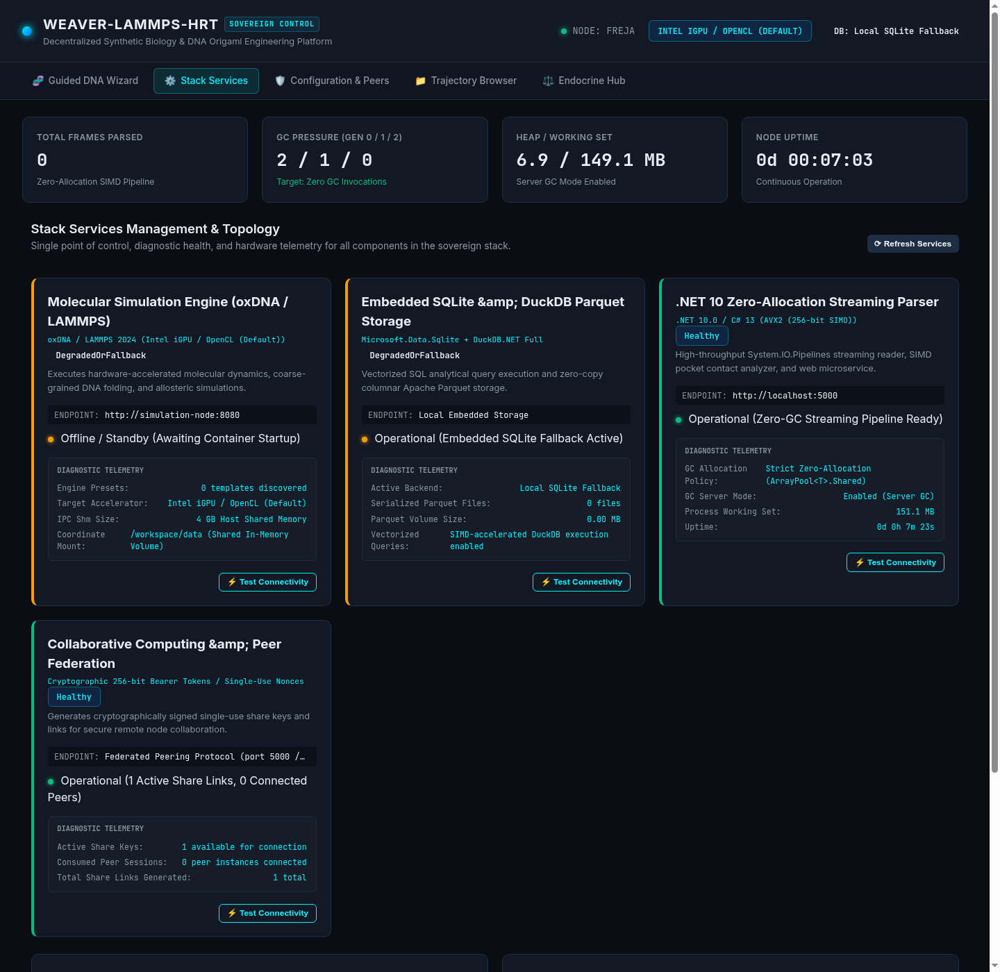
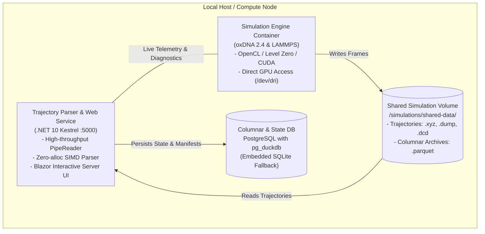
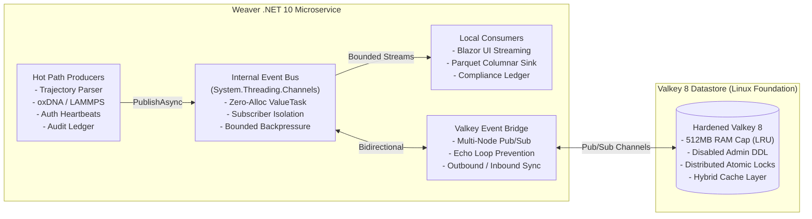

# Stack Topology & Hardware Telemetry

> **Microservice Orchestration, Diagnostic Health Pings, and Real-Time Hardware Telemetry**

The **Stack Services & Telemetry** module provides continuous, real-time observability across the decentralized research stack. It allows researchers and system administrators to monitor the health of simulation containers, track hardware resource consumption, and verify the zero-allocation performance of the trajectory parsing engine.



---

## 1. Distributed Stack Architecture

The Weaver-LAMMPS-HRT system is engineered as a decoupled, multi-container microservice stack:



### Components
1. **`trajectory-parser` (ASP.NET Core / .NET 10)**:
   - Hosts the sovereign Blazor Web UI and REST API on port `5000`.
   - Ingests streaming trajectory coordinates from the shared volume with zero heap allocations.
   - Manages state persistence, single-use share keys, and dataset export manifests.
2. **`simulation-engine` (oxDNA / LAMMPS)**:
   - Executes coarse-grained and all-atom molecular dynamics trajectories.
   - Utilizes containerized GPU compute drivers (Intel Level Zero, NVIDIA CUDA, or AMD ROCm).
3. **`database-engine` (PostgreSQL / SQLite)**:
   - Stores authoritative system configuration, user audit logs, and federated peer tokens.
   - Leverages DuckDB SIMD vectorization for ultra-fast spatial querying of Parquet files.

---

## 2. Health Probes & Connectivity Pings

The dashboard executes automated, non-blocking health checks against all local and remote microservices every 5 seconds.

### Probe Types
* **HTTP `/healthz` Probe**: Verifies that the Kestrel web server and pipeline workers are responsive.
* **Storage Mount Probe**: Verifies read/write access to `/simulations/shared-data/`.
* **Database Ping**: Measures round-trip SQL query latency (`SELECT 1;`) to detect database connection pool exhaustion.
* **Simulation Engine Heartbeat**: Inspects container process state via Docker socket or shared lockfiles.

### Health Status States
* **Healthy (Green)**: Round-trip latency < 20 ms; all storage mounts writable; simulation engine running.
* **Degraded (Amber)**: Elevated response latency (> 200 ms); disk storage > 90% full; or database operating in fallback SQLite mode.
* **Offline (Red)**: Target microservice unreachable; connection refused.

---

## 3. Real-Time Hardware Telemetry

The telemetry engine provides continuous insight into hardware resource utilization:

### CPU & Thread Pool Telemetry
* **Overall CPU Load Percentage**: Measures cumulative CPU time across all available logical cores.
* **Worker Threads Active vs. Available**: Tracks .NET ThreadPool starvation to ensure asynchronous file pipelines never block UI rendering.

### Server Garbage Collection (GC) Metrics
The trajectory parser runs in **Server GC Mode** with background workstation collections enabled. The dashboard visualizes:
* **Total Allocated Memory**: Cumulative heap size in bytes.
* **Gen 0 Collections**: Ephemeral short-lived object collections.
* **Gen 1 Collections**: Intermediate buffer collections.
* **Gen 2 Collections**: Full heap garbage collection cycles.

> [!IMPORTANT]
> **The Zero-Allocation Verification Rule**:
> When a multi-gigabyte trajectory file is streaming through `System.IO.Pipelines`, the **Gen 2 Collection Count must remain strictly flat (0)**. If Gen 2 collections rise during streaming, an illegal heap allocation has leaked into the hot parsing loop.

### GPU Compute Telemetry
* **Detected Devices**: Automatically enumerates available OpenCL, Level Zero, and CUDA compute platforms.
* **VRAM Allocation**: Displays active video memory usage by the oxDNA/LAMMPS simulation container.
* **Driver & Toolkit Versions**: Reports active OpenCL C version and hardware compute units.

---

## 4. Live System Event Log

The sovereign dashboard incorporates a real-time event log powered by an in-memory ring buffer:
* Captures the last 1,000 log events generated by the trajectory parser and simulation bridges.
* Categorized by severity level: `INFO`, `WARNING`, `ERROR`, and `CRITICAL`.
* Enables one-click filtering and export of diagnostic logs for peer troubleshooting.

---

## 5. High-Throughput Internal Event Bus & Hardened Valkey Overlay

To achieve maximum concurrency and decoupling without heap allocations, the platform implements a dual-layer event-driven architecture:



### Zero-Allocation In-Memory Event Bus (`System.Threading.Channels`)
* **Bounded Channel Buffering**: Protects producers against slow consumers using configurable backpressure (`BoundedChannelFullMode.DropOldest` or `Wait`).
* **Fault Isolation**: Handlers execute with exception containment so that a slow or failing consumer can never stall the hot parsing loop.
* **Typing & Serialization**: Uses strongly-typed records (`TrajectoryFrameBatchEvent`, `SimulationProgressEvent`, `UserSessionActivityEvent`, `AuditLogDispatchedEvent`, `SystemTelemetryUpdatedEvent`) satisfying `IWeaverEvent`.

### Hardened Valkey 8 Cluster Overlay (`compose/docker-compose.valkey.yml`)
* **Open Source Datastore**: Leverages Valkey 8 (`valkey/valkey:8-alpine`), the open-source Linux Foundation fork of Redis.
* **Security Hardening**:
  - Requires strong password authentication (`--requirepass`).
  - Caps memory footprint (`maxmemory 512mb`, `maxmemory-policy allkeys-lru`).
  - Disables dangerous administrative commands (`FLUSHALL`, `FLUSHDB`, `CONFIG`, `DEBUG`, `SHUTDOWN`, `KEYS`, `EVALSHA`, `SLAVEOF`, `REPLICAOF`).
  - Strict non-root execution (`USER 1000:1000`), read-only root filesystem, dropped Linux capabilities, and `no-new-privileges:true`.
* **Hybrid Caching & Distributed Locking**:
  - `ValkeyCacheService`: High-speed key-value caching with transparent fallback to in-memory concurrent storage when unconfigured or offline.
  - `ValkeyLockService`: Mutual exclusion locking utilizing atomic `SET NX PX` and Lua verification scripts with `SemaphoreSlim` fallback.
* **Zero Credential Disclosure**: Connection multiplexers redact passwords in all logging and telemetry endpoints (`password=[REDACTED]`).

```bash
# Launch stack with Valkey cluster overlay:
docker compose -f docker-compose.yml -f compose/docker-compose.valkey.yml up -d
```

---

## Next Steps
* Learn how trajectory coordinates are parsed in [**Trajectory Streaming & Dataset Provenance**](trajectories-and-datasets.md).
* Review concrete use-cases in [**Example Biomedical Workflows**](example-workflows.md).
