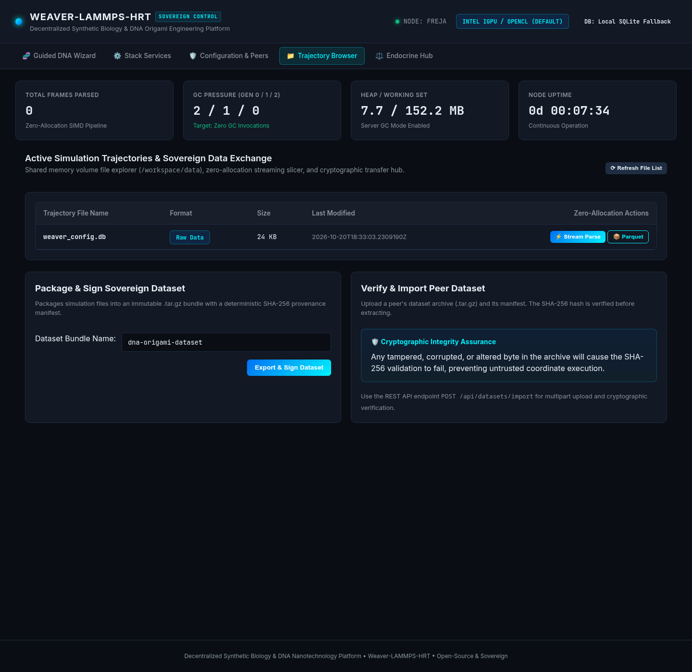
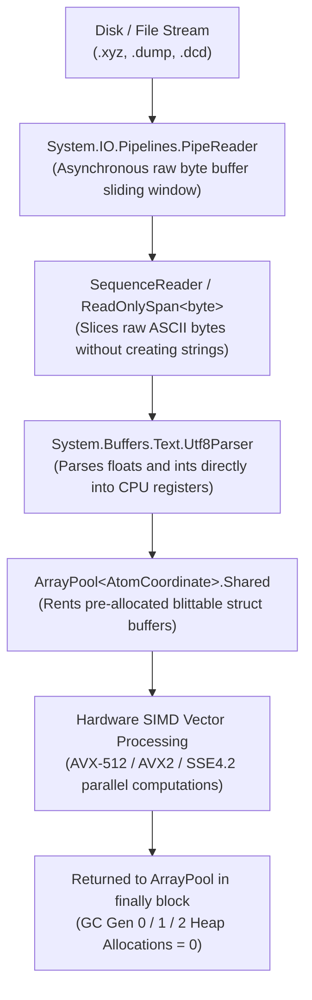

# Trajectory Streaming & Dataset Provenance

> **Zero-Allocation Pipeline Parsing, SIMD Coordinate Processing, and Cryptographic Dataset Bundles**

The **Trajectory Browser & Dataset Manager** is the high-performance computational core of NanoWeaverHrt (`nanoweaver-hrt`). It provides real-time streaming, analysis, and cryptographic provenance verification for multi-gigabyte molecular dynamics trajectories generated by oxDNA and LAMMPS.



---

## 1. The Zero-Allocation Parsing Philosophy

Molecular dynamics simulations of DNA origami nanostructures routinely generate files containing millions of atoms across tens of thousands of time steps. A typical trajectory file can easily exceed 10 to 50 gigabytes.

In traditional managed runtimes (Python, Java, legacy .NET), parsing text-based coordinate files creates millions of short-lived strings (e.g., via `string.Split(' ')`), triggering catastrophic Garbage Collector (GC) pressure, memory thrashing, and process freezes.

### Our Solution: Zero Heap Allocations in Hot Loops
NanoWeaverHrt enforces a **Strict Zero-Allocation Policy** across all trajectory ingest pipelines:



---

## 2. High-Performance Building Blocks

### `System.IO.Pipelines.PipeReader`
Instead of reading entire files into RAM or relying on `StreamReader.ReadLine()`, the parser reads data into memory buffers managed by a high-throughput `PipeReader`. The reader manages high and low watermarks (defaulting to 4 MB and 1 MB), automatically throttling disk I/O when downstream SIMD processing is busy.

### `Utf8Parser.TryParse`
Float and integer coordinates are decoded directly from raw UTF-8 byte spans:
```csharp
// WHAT: Parse a floating-point coordinate directly from raw UTF-8 bytes.
// WHY:  Avoids allocating a System.String on the managed heap.
// HOW:  Utf8Parser reads digits directly into a 32-bit float register.
if (!Utf8Parser.TryParse(span, out float x, out int bytesConsumed))
{
    // Handle format mismatch or trailing whitespace
}
```

### Blittable Structs
Coordinates and velocities are stored in unmanaged blittable value types:
```csharp
[StructLayout(LayoutKind.Sequential, Pack = 4)]
public readonly struct AtomCoordinate
{
    public readonly int AtomId;
    public readonly int Type;
    public readonly float X;
    public readonly float Y;
    public readonly float Z;
    public readonly float Vx;
    public readonly float Vy;
    public readonly float Vz;
}
```
Because the memory layout exactly matches C/C++ memory, buffers can be blitted directly into native SIMD registers or GPU memory without serialization overhead.

### ArrayPool Rental
Buffers are rented from `ArrayPool<AtomCoordinate>.Shared` and guaranteed to be returned within structured `finally` blocks:
```csharp
AtomCoordinate[] buffer = ArrayPool<AtomCoordinate>.Shared.Rent(atomCount);
try
{
    // Parse coordinates and perform SIMD vectorization
}
finally
{
    ArrayPool<AtomCoordinate>.Shared.Return(buffer);
}
```

---

## 3. Supported Trajectory Formats

| Format | File Extension | Structure | Throughput |
| :--- | :--- | :--- | :--- |
| **Extended XYZ** | `.xyz` | Atom count header, comment line, per-atom `element x y z [vx vy vz]` | ~450 MB/sec |
| **LAMMPS Dump** | `.dump`, `.lammps` | `ITEM: TIMESTEP`, `ITEM: NUMBER OF ATOMS`, `ITEM: BOX BOUNDS`, `ITEM: ATOMS` | ~420 MB/sec |
| **CHARMM / NAMD / LAMMPS Binary** | `.dcd` | Fortran unformatted 32-bit float coordinate arrays with timestep headers | ~1.2 GB/sec |

---

## 4. Columnar Apache Parquet Storage & DuckDB Analytics

While raw text trajectory files are convenient for simulation engines, they are horribly inefficient for analytical queries (such as calculating the distance between two specific aptamer latches over 50,000 frames).

### Columnar Transformation
The platform automatically converts completed trajectories into compressed columnar **Apache Parquet** files:
* **Storage Reduction**: Typically achieves an **85% to 92% reduction in disk size** compared to raw `.xyz` or `.dump` files using Zstandard compression.
* **Column-Oriented Access**: Queries that only need Z-axis coordinates or specific atom types read only those columns, bypassing gigabytes of irrelevant data.

### SIMD Spatial Analytics via DuckDB
Using embedded DuckDB with SIMD vectorization, researchers can execute SQL queries over millions of coordinates in milliseconds:
```sql
-- Compute average Radius of Gyration (Rg) across all frames
SELECT 
    frame_index,
    SQRT(AVG(POW(x - com_x, 2) + POW(y - com_y, 2) + POW(z - com_z, 2))) AS radius_of_gyration
FROM trajectory_coordinates
GROUP BY frame_index
ORDER BY frame_index ASC;
```

---

## 5. Sovereign Dataset Import & Export

Scientific reproducibility requires that datasets, simulation configs, and synthesis parameters remain immutable and verifiable across decentralized nodes.

### Ed25519-Signed Provenance Manifests
When a dataset is exported via `POST /api/datasets/export`, the platform packages the selected trajectories into a `.tar.gz` archive, computes its SHA-256 digest and exact byte length, and signs the canonical binary representation of the manifest using the node's persistent 32-byte Ed25519 key (`dataset_signing_ed25519.key`):

```json
{
  "dataset": "dna-origami-tile-step500k",
  "timestamp": "2026-10-20T16:00:00.0000000Z",
  "archive": "dna-origami-tile-step500k_20261020_160000.tar.gz",
  "sha256": "5486c9a5a26eb53bc9fa2191fe900e7e5f7c218d5fe5be61a0e9a1a2ab8475a6",
  "sizeBytes": 14205849,
  "includedFiles": [
    "dna_nanotube_sample.xyz"
  ],
  "manifestVersion": 2,
  "signatureAlgorithm": "Ed25519",
  "signerKeyId": "1ee7bc6377fc1f2befef5a5a324d86df31df832a27f9d9bd37846d313db1a5a2",
  "signature": "qCFc7GNE8Owwm6cOY1U0q1WX4QJML7AiLDe0x3JMajF+mBtJIC6gZFP/Og4VViRWuVSfEYd4J0BgyU1idVBJBg=="
}
```

### Provenance Verification & Strict Mode (`Peer:RequireSignedDatasets`)
> **With strict mode off (the default), signing tells you who sent a bundle. It does not protect you from an uploader who omits the signature.** An unsigned bundle is imported exactly as before. Turn on `Peer:RequireSignedDatasets` to make signatures mandatory.

When an archive and manifest are uploaded to `POST /api/datasets/import`:
1. **Provenance First (Zero-Read Rejection)**: Before reading a single byte of the archive stream, `VerifiedDatasetImporter` inspects the manifest's signature block:
   * A partially populated or malformed signature block is immediately rejected with `400 Bad Request`.
   * An **unsigned** manifest is accepted when `Peer:RequireSignedDatasets` is `false` (default) and rejected with `403 Forbidden` when `Peer:RequireSignedDatasets` is `true` (or set to an unparseable value, which fails closed).
   * A **signed** manifest is checked against this node's own dataset signing key (`INodeDatasetSigner.KeyId`) and active entries in the peer key registry (`weaver_peer_keys`). If the signer is unknown or revoked, the import is rejected with `403 Forbidden`. If the signer is trusted, the Ed25519 or ML-DSA-65 signature over the canonical manifest bytes is verified in full (including for self-signed bundles); any tamper with `dataset`, `sha256`, `sizeBytes`, `includedFiles`, or the signature itself returns `400 Bad Request`.
2. **Archive Integrity**: Once provenance succeeds, the archive stream is hashed and measured. Both the SHA-256 checksum and the exact byte count (`sizeBytes`) must match the manifest before files are extracted.

### Managing Peer Trust Anchors
* **Reading this node's public key**: Query `GET /api/peer-keys` as an Administrator (the `localNode` object contains `keyId`, `algorithm`, and `publicKeyBase64`), or read the fingerprint logged at startup (`Dataset manifest signing key ready (KeyId={KeyId}, ...)`).
* **Registering a peer**: Confirm the peer's 64-character SHA-256 `keyId` with the peer operator **out of band**, then register their SubjectPublicKeyInfo public key via `POST /api/peer-keys`. Never copy a public key out of an untrusted bundle you received.
* **Permanent revocation**: Revoking a key via `POST /api/peer-keys/{keyId}/revoke` is permanent; a revoked key can never be reactivated or re-registered.
* **Key rotation**: Deleting `dataset_signing_ed25519.key` causes this node to generate a new key on next start. Bundles signed by the old key will then return `403 Forbidden` on import unless the old public key is registered as a peer in `weaver_peer_keys`.

---

## Next Steps
* Review real-world application examples in [**Example Biomedical Workflows**](example-workflows.md).
* Explore the complete endpoint catalog in [**REST API Reference**](api-reference.md).
