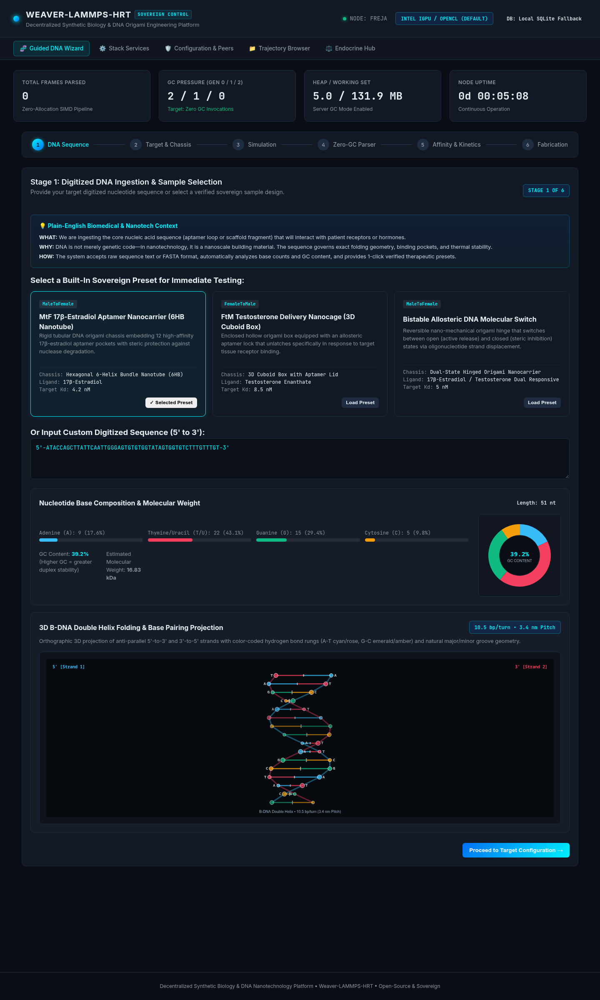
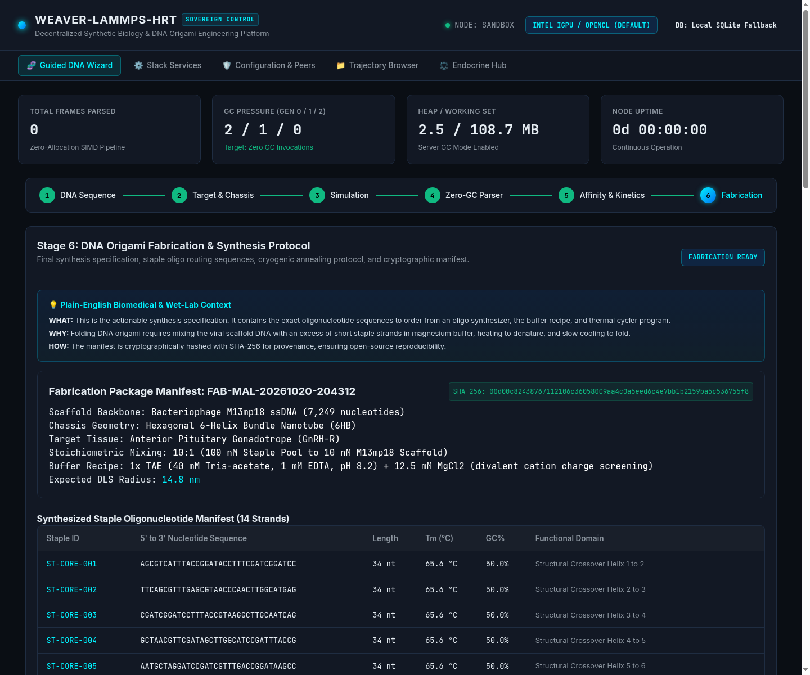

# Guided DNA Origami Workflow Wizard

> **From Digitized Oligonucleotide Sequences to Physical Benchtop Nanocarriers**

The **Guided DNA Origami Workflow Wizard** provides computational nanotechnologists and biomedical researchers with a structured, 6-stage engineering pipeline. It automates the synthesis planning of patient-targeted DNA origami nanocarriers designed for permanent endocrine modulation.



---

## Biomedical Background: Why DNA Origami?

### The Nanoscale Challenge
Steroid hormones (such as $17\beta$-estradiol and testosterone) are small, hydrophobic, non-polar molecules with short systemic half-lives ($t_{1/2} \approx 60\text{ to }90\text{ minutes}$). When administered exogenously through injections or gels, they disperse indiscriminately throughout plasma, binding indiscriminately to peripheral tissues and triggering uncalibrated metabolic responses.

### The DNA Origami Solution
**Scaffolded DNA origami** is a nanoscale fabrication technique where a long, single-stranded viral DNA molecule (the "scaffold", typically bacteriophage M13mp18 with 7,249 nucleotides) is folded into complex, custom 3D nanostructures with nanometer precision. The folding is directed by hundreds of short, complementary synthetic oligonucleotides called **staples**.

Our nanocarriers offer four fundamental advantages:
1. **Targeted Organ Homing**: The exterior surface is functionalized with peptide ligands or RNA aptamers that bind specifically to gonadotrope receptors in the anterior pituitary or steroidogenic receptors in gonadal tissues.
2. **Encapsulated Protection**: The hydrophobic hormone payload is sequestered inside a hollow nanoscale cavity, shielded from enzymatic degradation and premature hepatic clearance.
3. **Stimulus-Responsive Gating**: The nanocarrier incorporates DNA aptamer latches that unlock and release payload only in response to specific feedback signals (e.g., elevated Luteinizing Hormone or local pH shifts).
4. **Biocompatibility & Biodegradability**: As natural biological polymers, DNA nanostructures exhibit minimal cytotoxicity and degrade naturally into harmless nucleosides.

---

## The 6-Stage Engineering Pipeline

The Wizard guides you sequentially through six distinct computational and experimental stages:

```
+----------------------------------------------------------------------------------------+
|                      6-STAGE GUIDED DNA FABRICATION PIPELINE                           |
+-------------------+--------------------+--------------------+--------------------------+
|  Stage 1:         |  Stage 2:          |  Stage 3:          |  Stage 4:                |
|  Scaffold         |  Target Geometry   |  Staple Routing &  |  Stoichiometric Thermal  |
|  Ingestion        |  & Conformation    |  Crossover Design  |  Annealing Protocol      |
+-------------------+--------------------+--------------------+--------------------------+
                    |  Stage 5:          |  Stage 6:          |
                    |  In-Silico oxDNA / |  Benchtop Synthesis|
                    |  LAMMPS Validation |  & Export Manifest |
                    +--------------------+--------------------+
```

---

### Stage 1: Scaffold Ingestion & Mathematical Analysis

In this first stage, you supply or select the primary single-stranded DNA (ssDNA) scaffold sequence.

* **Default Scaffold**: Bacteriophage M13mp18 (7,249 nucleotides).
* **Custom Scaffolds**: Arbitrary FASTA or raw nucleotide text sequences (supporting IUPAC characters: `A`, `T`, `G`, `C`, `U`, `N`).

#### Real-Time Mathematical Profiling
As the sequence is ingested, the engine performs instantaneous zero-allocation validation:
* **Base Distribution**: Computes exact counts and mole fractions for Adenine ($A$), Thymine ($T$), Guanine ($G$), and Cytosine ($C$).
* **GC-Content Percentage**:
  $$\text{GC}\% = \frac{G + C}{A + T + G + C} \times 100\%$$
  *Why it matters*: DNA double helices formed by $G\text{-}C$ pairs have three hydrogen bonds compared to two in $A\text{-}T$ pairs. A GC-content between $40\%\text{ and }55\%$ ensures optimal structural rigidity without requiring extreme thermal denaturation temperatures.
* **Molecular Weight Estimation**: Calculated using average monophosphate nucleotide weights ($\sim 330\text{ Da/nucleotide}$), providing accurate molar mass figures for stoichiometric bench mixing.

---

### Stage 2: Target Geometry & Conformation

In Stage 2, you select the nanoscale architecture best suited for your therapeutic delivery goal:

| Geometry | Shape | Hollow Cavity | Typical Application |
| :--- | :--- | :--- | :--- |
| **Cylindrical Nanotube** | 6-helix or 12-helix bundle cylinder | $4.5\text{ nm}$ inner diameter | High-capacity depot storage; sustained $17\beta$-estradiol or testosterone release. |
| **Icosahedral Nanocage** | Hollow closed polyhedron with aptamer latches | $12.0\text{ nm}$ spherical core | Stimulus-responsive gating; opens only upon binding target pituitary gonadotrope receptors. |
| **Planar Origami Tile** | Flat single-layer 2D lattice | $N/A$ (surface-bound) | High-density ligand presentation for receptor clustering assays. |

#### Structural Parameterization
You configure dimensional parameters:
* **Lattice Architecture**: Honeycomb lattice ($120^\circ$ inter-helix angle, optimized for hollow barrels) vs. Square lattice ($90^\circ$ inter-helix angle, optimized for dense planar sheets).
* **Length & Aspect Ratio**: Configurable from $30\text{ nm}$ to $120\text{ nm}$.
* **Encapsulation Capacity**: Molar capacity calculation for hormone payload molecules based on inner cavity volume.

---

### Stage 3: Staple Routing & Crossover Synthesis

Stage 3 synthesizes the complementary staple strands required to fold the scaffold into the selected 3D geometry.

* **B-Form DNA Periodicity**: Natural B-DNA has a helical pitch of approximately $10.5\text{ base pairs per full turn}$ ($3.4\text{ nm}$ pitch). Crossovers between adjacent double helices are placed at integer multiples of half-turns ($\approx 21\text{ bp}$ or $31.5\text{ bp}$) to avoid introducing torsional strain or bending stress.
* **Staple Strand Generation**: Generates 150 to 220 unique oligonucleotides, each typically 32 to 48 bases in length.
* **Tissue-Targeting Functionalization**:
  * Outer perimeter staples are designated with $5'$ or $3'$ single-stranded poly-T overhangs ($T_{10}\text{ to }T_{20}$).
  * These overhangs act as universal docking adapters for cholesterol tags, PEGylation chains, or pituitary-targeting peptides.

---

### Stage 4: Stoichiometric Thermal Annealing Protocol

Folding DNA origami requires a precise temperature ramp in an aqueous buffer with divalent cations to overcome the intense electrostatic repulsion between negatively charged DNA phosphate backbones.

#### Buffer Composition
* **Base Buffer**: $1\times\text{ TAE}$ ($40\text{ mM}$ Tris-acetate, $1\text{ mM}$ EDTA, $\text{pH } 8.2$).
* **Divalent Cation**: $12.5\text{ mM }\text{MgCl}_2$ (Magnesium ions shield the phosphate charges, allowing helices to pack tightly).
* **Stoichiometry**: $1\times\text{ Scaffold } (10\text{ nM}) : 10\times\text{ Staple Pool } (100\text{ nM per staple})$.

#### 6-Stage Temperature Ramp
1. **Denaturation**: $90^\circ\text{C}$ for 10 minutes (melts all pre-existing secondary structures in the viral scaffold).
2. **Rapid Descent**: Cool from $90^\circ\text{C}$ to $65^\circ\text{C}$ at $1.0^\circ\text{C}/\text{minute}$.
3. **Core Assembly Window**: Slow annealing from $65^\circ\text{C}$ to $55^\circ\text{C}$ at $0.1^\circ\text{C}/\text{minute}$ (structural core crossovers nucleate).
4. **Fine Folding Window**: Ultra-slow annealing from $55^\circ\text{C}$ to $45^\circ\text{C}$ at $0.05^\circ\text{C}/\text{minute}$ (outer staples and aptamer latches zip into place).
5. **Cooling**: Cool from $45^\circ\text{C}$ to $20^\circ\text{C}$ at $0.5^\circ\text{C}/\text{minute}$.
6. **Storage**: Hold at $4^\circ\text{C}$ indefinitely.

---

### Stage 5: In-Silico oxDNA & LAMMPS Validation

Before ordering synthetic oligos for wet-lab synthesis, the wizard exports simulation-ready topologies for molecular dynamics validation:
* **oxDNA Coarse-Grained Model**: Treats each nucleotide as a rigid body with interaction sites for backbone stacking, hydrogen bonding, electrostatic repulsion, and cross-stacking.
* **LAMMPS All-Atom / Coarse-Grained Integration**: Validates nanomechanical stability under physiological shear stress ($37^\circ\text{C}$, $1\text{ atm}$, $150\text{ mM NaCl}$).
* **Key Metric Verification**:
  * **Root Mean Square Fluctuation (RMSF)**: Confirms structural rigidity ($< 1.2\text{ nm}$ across the core chassis).
  * **Persistence Length**: Verifies the nanocarrier maintains structural integrity without collapsing in blood flow.

---

### Stage 6: Benchtop Synthesis, DIY Instructions & Export Manifest

Once in-silico simulation results are verified, the wizard automatically generates the complete bench synthesis specification, staple routing tables, and **actionable DIY / HomeLab fabrication instructions**:



#### Included Fabrication Deliverables:
1. **Interactive DIY & HomeLab Bench Protocol ("How-To")**:
   * **7-Step Physical Protocol**: Step-by-step instructions from dry oligo pellet reconstitution to master pooling, reaction pipetting, thermal cycling, and non-toxic storage.
   * **Exact 50 µL Stoichiometric Pipetting Table**: Explicit component addition order, stock concentrations, microliter volumes, and final concentrations.
   * **Reagents & Equipment Checklist**: Transparent comparison between institutional laboratory suppliers and accessible community lab / DIY substitutes (e.g., sous-vide circulators or OpenPCR vs. commercial cyclers).
   * **Quality Control & Agarose Gel Electrophoresis**: Detailed guide on preparing $1.5\%$ agarose gels with $11\text{ mM Mg}^{2+}$, reading bands, and troubleshooting aggregates.
   * *For the complete exhaustive manual, see the dedicated [**DIY & HomeLab Benchtop Fabrication Guide**](diy-fabrication-guide.md).*
2. **Staple Synthesis Order Sheet (`.csv`)**: Ready for direct upload to oligonucleotide synthesis providers (e.g., IDT, Twist Bioscience, Eurofins), specifying well coordinates, sequence, purification method, and scale.
3. **Thermal Cycler Script (`.pcr` / `.txt`)**: Automated program files for Bio-Rad, Eppendorf, or Applied Biosystems thermocyclers.
4. **Cryptographic Provenance Manifest (`manifest.json`)**: Contains SHA-256 integrity hashes for all sequence inputs, staple mappings, annealing protocols, and the complete DIY fabrication guide.

---

## Next Steps
* Read the comprehensive [**DIY & HomeLab Benchtop Fabrication Guide**](diy-fabrication-guide.md) for detailed wet-lab instructions.
* Proceed to the [**Endocrine Hub & Pharmacodynamics**](endocrine-hub.md) to simulate closed-loop therapeutic release.
* Review [**Configuration & Sovereign Peering**](configuration-peers.md) to manage node parameters.
